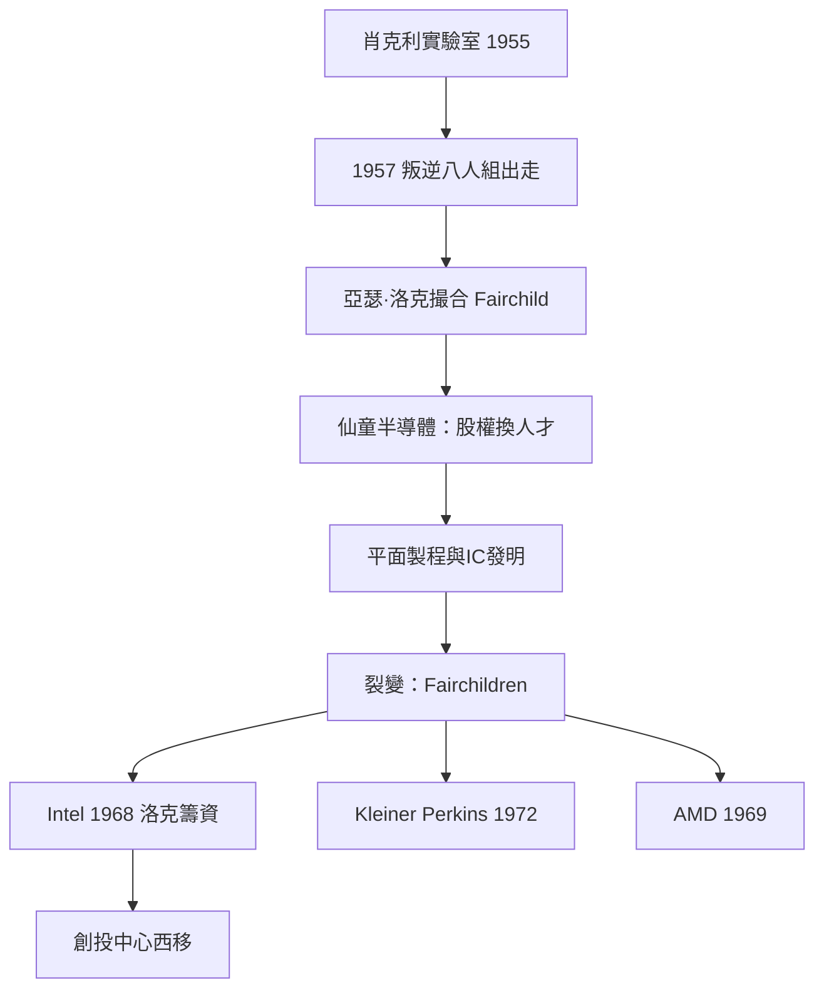

# 4.1 叛逆八人組與亞瑟·洛克

## 肖克利的實驗室

1955年，電晶體的共同發明人威廉·肖克利（William Shockley，貝爾實驗室出身，1956年諾貝爾物理獎）回到家鄉加州帕洛阿托，創立肖克利半導體實驗室（屬 Beckman Instruments），招募全美最聰明的年輕物理學家與工程師——其中包括 Robert Noyce、Gordon Moore、Jean Hoerni、Jay Last、Victor Grinich、Julius Blank、Eugene Kleiner、Sheldon Roberts。

肖克利是天才的科學家與災難的管理者：他的多疑、獨斷與對員工的測謊要求，使這批二十多歲的年輕人一年內集體絕望。1957年9月18日，八人集體辭職——他們被肖克利稱為叛逆八人組，語帶侮辱。

## 亞瑟·洛克：第一筆現代創投

八人需要資本。Eugene Kleiner 的父親認識一位紐約的攝影器材商，後者把他們介紹給 Hayden Stone 證券公司的舊金山辦事處，那裡有一位年輕的投資銀行家：亞瑟·洛克（Arthur Rock）。

洛克（1926年生，哈佛商學院出身，之後在紐約做證券分析）接到這份傑作——不是商業計畫，而是 Noyce 簽名的一頁信函，說明他們想成立一家做矽晶體管的公司。洛克被八人的才華與決心說服，飛回紐約向 Hayden Stone 的合夥人推銷。

問題是：誰來當這批年輕人的老闆？洛克與同事 Thomas Davis 找到了 Fairchild Camera and Instrument 的創辦人 Sherman Fairchild——IBM 的大股東、發明家、資本雄厚。談判的結果是一個史無前例的結構：仙童攝影器材公司出資約138萬美元（其中為八人提供每人約1.5萬美元的股權安排，八人另享分紅與未來認購權），設立仙童半導體（1957年10月成立），八人擁有顯著股權與經營自主權，並約定在獲利後可以以低價回購公司控股權——工程師第一次拿到這麼多股權，這是革命性的條款。

## 仙童的裂變與矽谷的誕生

仙童半導體迅速成功：1959年 Jean Hoerni 發明平面製程（planar process，使矽晶體管可以批量穩定製造），Noyce 依此發明積體電路（與德州儀器的 Kilby 並列為 IC 的共同發明人）。到1960年代中期，仙童成長為數千人的巨頭，但也走向裂變：公司控股權結構與東岸總部的控制使技術團隊紛紛出走。

這場裂變塑造了矽谷的基因。出走的仙童人被稱為 Fairchildren，創辦了數十家改變世界的新公司：

- Noyce 與 Moore 於1968年創立英特爾（Intel），由亞瑟·洛克籌資250萬美元（洛克為此離開紐約搬到舊金山，成為專職創投人）。
- Kleiner 與 Roberts 於1972年創立 Kleiner Perkins。
- Jerry Sanders 於1969年創立 AMD。
- 數十家中小公司，構成了半導體產業的家族樹。

矽谷的兩個文化基因在這段歷史中形成：第一，股權換人才（工程師成為合夥人而非僱員）——這是仙童結構的直接遺產；第二，跳槽與再創業是正常路徑而非背叛——裂變本身被制度化。

## 洛克的轉型

洛克在仙童與英特爾的成功使他意識到：可以以「為新公司籌資並持有股權」為職業。1970年前後他成立自己的合夥事業，成為西岸第一批專職創投人之一；他也是 Apple 的早期投資人（1978年參與融資並出任蘋果董事）。洛克用行動證明了多里奧特的理論，並把創投的中心地理從波士頓遷到了加州。

## 小結

叛逆八人組事件是矽谷的創世紀：它第一次證明工程師可以成為股東、資本可以為人才與技術而非抵押品下注。亞瑟·洛克為此發明了現代創投的操作雛形。下一節我們看沙丘路如何把這個雛形變成可以複製的產業。
