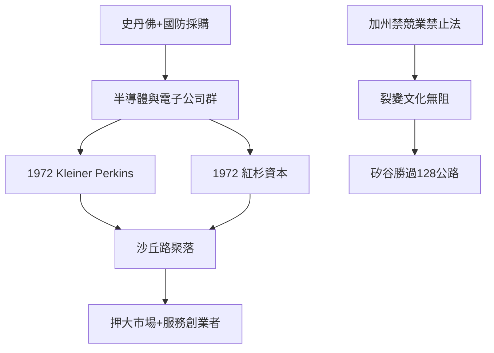

# 4.2 沙丘路聚落的形成

## 一條路的巧合與必然

沙丘路（Sand Hill Road）是門洛帕克與伍賽德之間的一條約兩英里長的道路，位於史丹佛大學校區邊緣的沙丘地帶。1950年代它只是通往海邊的郊區道路；1960年代史丹佛大學將沿路土地出租給商業開發（Bill Bowes 等開發商興建低層辦公樓），首批入住的是保險與會計事務所。1970年代起，創投公司開始落戶。

兩家公司的進駐是關鍵：

- Kleiner Perkins：Eugene Kleiner（仙童八人組之一）與 Thomas Perkins（惠普早期員工、Kleiner 的同事，曾在惠普與仙童任職）於1972年成立合夥基金，第一支基金募資約800萬美元，投資對象包括後來的 Tandem Computers（1974年，容錯電腦，1997年被康柏以30億美元收購）與 Genentech（1976年）。
- 紅杉資本（Sequoia Capital）：唐·瓦倫丁（Don Valentine，仙童銷售高管、後任英特爾首任市場負責人，1972年離職創業）同年成立紅杉，第一支基金募資約500萬美元（早期基金得到 Capital Group 等機構支持），早期投資包括 Atari（1972年，獲紅杉60萬美元種子投資）與 Apple（1977年，瓦倫丁投資約15萬美元並出任董事）。

兩家公司相繼搬入沙丘路沿線的辦公樓，模仿者跟進：Mayfield（1969年成立）、IFM（Inter-Florida Mgmt，後來的 Asset Management Company）、以及其他波士頓與紐約的基金西遷。到1980年代，沙丘路已成為全球創投最密集的地理座標，一條路上管理著數百億美元。

## 為什麼是沙丘路

沙丘路的成功不是偶然，而是多個條件的疊加：

1. 技術供給：史丹佛（特曼教授的工業園區與榮譽合作計畫）與國防部採購（惠普、Varian、洛克希德）孕育了半導體與電子產業的人才池。
2. 客戶密度：仙童與其裂變公司在半徑二十英里內形成了新創公司的密集供給，創投可以物理性地近距離看項目。
3. 天使與創投的接力：前一代創業者（仙童人、惠普人）成為新一代的天使與創投（PayPal 幫在三十年後重演了這個模式），形成知識與資本的代際循環。
4. 有限合夥的法律成熟：加州的有限合夥法（以及1978年美國退休金進入 VC 的法規放寬）使創投可以以 LP/GP 結構大規模募資（詳見第五章第二節）。
5. 氣候與文化：加州的個人主義、對失敗的低污名、以及「下一件大事」的敘事傳統。

## 沙丘路的文化

沙丘路也形成了自己的行業文化：合夥人會議的討論內容（deal flow、portfolio、fund raising）、專注於特定領域的分工（早期基金專注種子與 A 輪）、與創業者共進早餐的社交節奏、以及著名的「內部 pitch 會議」。矽谷創投的兩大信條在這裡成型：

- 押對賽道比押對公司更重要（瓦倫丁的名言：投資最大的市場而非最好的團隊——他偏好大市場）。
- 創投的本業是服務（Perkins 的座右銘：help the entrepreneur）——從提供資金升級為提供網絡、招聘、後續融資的資源整合者。

## 波士頓與加州的雙中心

1980年代，創投形成波士頓（128公路，DEC 與眾多迷你電腦公司）與加州（矽谷）雙中心的格局。加州的勝出有制度原因：加州法律禁止競業禁止協議（California Business and Professions Code 16600），使人才流動與裂變無法律障礙；而波士頓所在的麻州允許競業禁止——人才被鎖定在大公司內。這條法律的差異，成為矽谷裂變文化得以持續的制度關鍵（1980年代 128 公路與矽谷的比較研究，Saxenian 1994年《區域優勢》是經典）。

## 小結

沙丘路把創投從個案式的資金撮合，變成一個有地理聚集、有行業文化、有代際循環的產業。它的兩大旗艦（紅杉與 KPCB）將在個人電腦、生物科技與網際網路的三波浪潮中，把創投的規模與影響力推向全球——那是下一章的故事。
