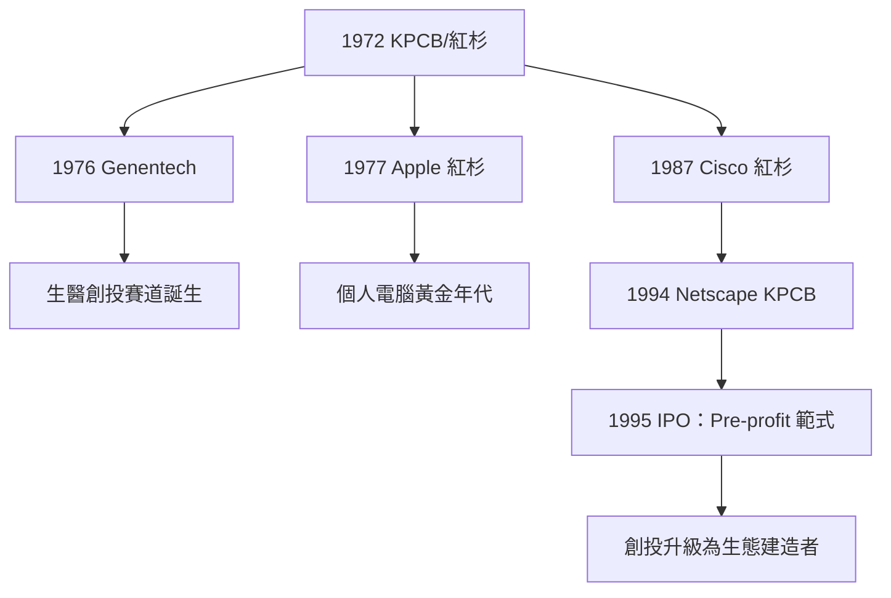

# 5.1 KPCB 與生物科技和網景

## 從硬體到生命的投資

Kleiner Perkins（1972年成立）在1970年代最重要的投資不是電腦，而是生物科技。1976年，風險投資家 Robert Swanson（KPCB 的合夥人）拜訪加州大學舊金山分校的分子生物學家 Herbert Boyer（1973年 Boyer 與 Stanley Cohen 開創了重組 DNA 技術），兩人一拍即合，創立基因泰克（Genentech）。KPCB 與 Swanson 投入約10萬美元種子資金。1977年，基因泰克成功讓細菌表達人類生長激素抑制素（somatostatin）；1978年表達人類胰島素；1980年10月上市，首日股價從35美元漲到89美元，創下當時最快的上市紀錄——生物科技產業由此誕生。

Genentech 的意義超出一筆投資：它證明創投可以投資科學（實驗室裡的分子生物學）而非僅僅工程，開啟了生醫創投這條賽道。此後 Amgen（1980）、Chiron（1981）以及無數生技公司以同樣的模式誕生。

## 個人電腦的黃金年代

同時，KPCB 與紅杉在個人電腦浪潮中各下重注：

- 紅杉：瓦倫丁1977年投資 Apple（並出任董事多年），蘋果1980年上市後獲得數百倍回報——這是紅杉成為頂級基金的奠基案例。
- KPCB：John Doerr（1980年加入 KPCB，曾在英特爾任職）在1980年代下注於 Compaq（1982年）與 Sun Microsystems（1982年，工作站與 Java）。
- 紅杉投資 Cisco（1987年，瓦倫丁主導）——網路設備是1990年代網際網路的硬體基礎，此案成為紅杉最重要的基金基石之一。

## 網景：創投史上最短週期的奇蹟

1994年，伊利諾伊大學 NCSA 的 Mosaic 瀏覽器開發者 Marc Andreessen 與 Silicon Graphics 的創辦人 Jim Clark 決定創業做網路瀏覽器。他們找到 John Doerr。KPCB 在1994年投資網景約500萬美元（占股約25%，與 Clark 各持顯著比例）。

網景的上市成為網路時代的開幕儀式：1995年8月9日 IPO，發行價28美元，開盤71美元，收盤58.25美元，市值約20億美元——公司成立僅16個月、尚未盈利。這個「Pre-profit IPO」成為1995–2000年網路狂熱的範式，也讓 KPCB 的投資回報以數十倍計。

Doerr 在1995–96年間公開說：網路是史上最大的合法財富創造機會。這個判斷正確，但它也預告了泡沫的到來（見第六章）。

## 創投角色的升級

1990年代的頂級創投與1970年代有本質區別。瓦倫丁與 Doerr 的公司提供的不只是錢：

1. 董事會治理：合夥人親任董事，直接參與戰略與高管招聘。
2. 生態連結：把創業者介紹給下一輪投資人、客戶、供應商（矽谷的引薦文化）。
3. 資本接力：從種子到上市，每一輪的節奏與估值管理都由創投設計。
4. 行業聲譽：頂級創投的品牌本身是創業公司的融資信號。

創投從資本提供者升級為生態建造者——這個轉變使矽谷的創投與其他地區（歐洲、日本）的創投拉開了質的差距。

## 小結

1970–1990年代的 KPCB 與紅杉，把創投從押注硬體公司升級為押注整個技術範式（生物、個人電腦、網路），並把自己定位為生態的核心節點。下一節我們拆解使這一切成為可能的金融結構——有限合夥——與紅杉的 Google 神話。
