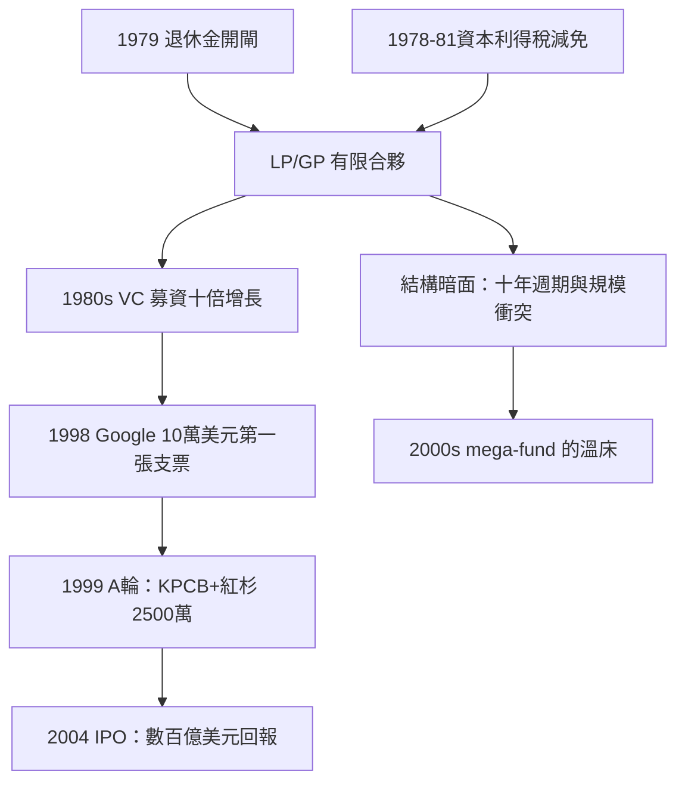

# 5.2 紅杉資本與 LP/GP 結構下的神話

## 有限合夥：創投的金融引擎

1970年代，創投完成了兩項關鍵的制度發明，使其從個案撮合變成可規模化的產業：

1. 有限合夥結構（LP/GP）：普通合夥人（GP）管理基金並承擔無限責任，有限合夥人（LP，機構如退休金、大學捐贈基金、家族辦公室）以出資為限承擔責任。基金存續期通常十年（可延展），GP 收取約2%管理費與20%的利潤分成（carried interest）。這個結構解決了 ARD 封閉式上市基金的缺陷：LP 不干預投資決策、GP 有長期鎖定的資本、激勵與風險對齊。1979年美國勞工部對《退休金保障法》謹慎人規則的解釋放寬，明確允許退休金投資高風險資產，是行業的關鍵轉折。
2. 資本利得稅的優惠：1978年美國將資本利得稅率從49.5%降至28%（1981年降至20%），使長期股權投資的稅後回報大幅改善——直接刺激了1980年代 VC 募資額的十倍級增長（美國 VC 年募資額從1970年代末的數億美元增至1987年的約40億美元）。

這兩項制度使紅杉與 KPCB 能夠從管理數千萬美元，成長到管理數十億美元的基金群。

## Google：創投史上最著名的投資之一

1998年，史丹佛博士生 Larry Page 與 Sergey Brin 決定把其搜尋引擎（PageRank，1996–98年在史丹佛開發）商業化。Sun 的共同創辦人 Andy Bechtolsheim 在1998年8月開出一張10萬美元的支票（抬頭寫給尚未正式註冊的 Google Inc.），成為第一筆資金。

1999年6月，Google 進行 A 輪融資：KPCB 與紅杉資本各投資1,250萬美元，合計2,500萬美元，公司估值約1億美元。杜爾與紅杉的 Mike Moritz 加入董事會。2004年8月19日 Google 上市（發行價85美元，首日收盤100.34美元，市值約230億美元），KPCB 與紅杉的股份在此後增值中達到數百億美元——以2,500萬美元換取如此規模的回報，成為創投史上的教科書案例。

紅杉同時期的另一系列投資（Yahoo 1995年 A 輪約400萬美元、YouTube 2005年種子輪350萬美元——2006年被 Google 以16.5億美元收購、LinkedIn、PayPal、Instagram 等）構成了1995–2015年間矽谷最著名的投資組合。Moritz 與 Doerr 成為一代創投文化的代言人。

## LP/GP 的暗面

有限合夥結構也埋下了後續問題的種子：

1. 十年週期與錯配：基金十年存續期迫使 GP 在特定窗口退出（上市或出售），催生了1990年代末趕上市的泡沫（見第六章）。
2. 資金規模與投資紀律的衝突：基金規模越大，單筆投資越大，投資階段越晚、越保守——2000年代的 mega-fund（第八章孫正義）正是這個邏輯的極端化。
3. 激勵的短期化：20% carry 的誘惑使部分 GP 關注估值而非企業本質——WeWork 案（第八章第二節）是極端案例。

## 小結

有限合夥結構與資本利得稅優惠，把創投從幾個人的賭注變成全球資本市場的正式資產類別。紅杉與 KPCB 的 Google 神話證明了這個結構的潛力；它也為2000年代的規模膨脹埋下伏筆。下一章我們看網路泡沫如何把這台引擎開到極限，然後炸開。
