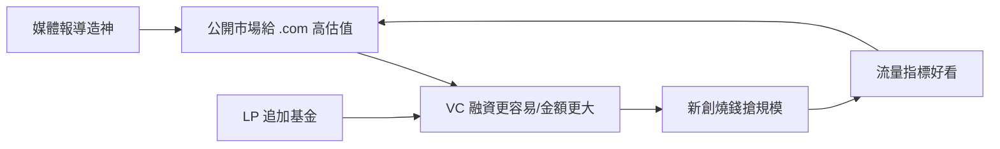

# 6.1 狂熱與燒錢率

## 網景開閘之後

1995年8月網景 IPO 之後，公開市場對「.com」的胃口被徹底打開。1995–2000年間：

- 納斯達克綜合指數從1995年初的約750點漲至2000年3月10日的5,048點。
- 1999年，457家公司上市（美國），多數為網路公司，首日平均漲幅逾70%——上市本身成為印鈔機。
- 1999年12月至2000年3月的短短三個月內，數百億美元的創投資金湧入網路公司。

## 燒錢率的範式

這個時代形成了一套新的創投評估語言，其核心不是獲利而是燒錢率（burn rate）與流量指標：

1. Get big fast：先搶規模與用戶，獲利以後再說——Amazon 的貝佐斯是此範式的先知（1997年股東信宣稱「It's all about the long term」，長期虧損換市場）。
2. 眼球與頁面瀏覽量：估值與媒體報導以 monthly unique users、page views 為指標，收入是次要的。
3. 超級碗廣告：2000年1月，十幾家網路公司在超級碗投放數百萬美元的廣告（ Pets.com 的傀儡狗、E*Trade 等），成為燒錢競賽的象徵。
4. 錢越多越好：融資的金額本身成為品牌——融資公告像產品發布一樣被媒體報導。

創投的行為模式同步扭曲：盡職調查壓縮到幾週甚至幾天（市場上好項目被搶，speed 是一切）；估值飆升（A 輪從1995年的數百萬美元漲到1999年的數千萬美元）；投資人從顧問變成啦啦隊——糾正創業者意味著丟掉下一輪的份額。

## 荒誕案例

1999–2000年的案例展示了範式的極端：

- Pets.com：1999年2月上線，寵物用品電商，重金廣告+低價補貼，運費高於產品價格。2000年11月倒閉，從上市到清算不到一年，燒掉約3億美元。
- Webvan：1996–2001年生鮮電商，計畫在全美建26座自動化倉庫（每座數千萬美元），融資逾10億美元（含高盛、軟銀、紅杉），2001年7月破產——被稱為史上最著名的 dot-com 破產案（值得注意的是，20年後 Amazon Fresh 與 Instacart 證明其模式並非完全錯誤，只是早了二十年）。
- eToys：1999年上市後市值一度逾80億美元，2001年3月破產。
- Boo.com：1999年成立的高檔時裝電商，燒錢1.35億美元，技術（重量級 Flash 網站）無法在當時的撥號上網下使用，2000年5月破產。
- Kozmo.com：一小時送貨，1999–2001年，燒掉約2.8億美元。

這些案例的共同點：真實的消費需求+不成立的單位經濟+資本市場的無限寬容。

## 創投的自我強化

狂熱的結構是自我強化的迴路：

媒體（The Industry Standard、Wired、CNBC）放大每一次融資與上市；LP 追加承諾；創業者的 IPO 夢成為全社會的敘事。1999年美國 VC 年投資額約540億美元（NVCA 數據），是1995年的十倍以上。整個系統沒有任何一環願意先停下來。

## 小結

燒錢率範式把創投的評估指標從「公司賺不賺錢」替換為「公司燒得夠不夠快、流量漲得夠不夠猛」。這個範式在2000年3月10日納斯達克見頂之後，遭遇了殘酷的清算。
