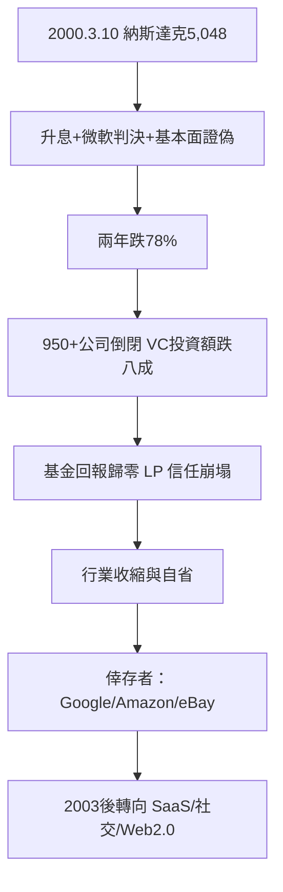

# 6.2 泡沫破滅與創投寒冬

## 2000年3月10日

納斯達克在2000年3月10日達到5,048點的頂峰。隨後幾個月，指數跌去三分之一以上；到2002年10月低點1,114點，累計跌幅約78%。清算的觸發因素是一組政策與基本面的合力：

1. 聯準會升息：2000年2–5月連續升息（從5.5%到6.5%），提高資金成本並壓縮長期資產估值。
2. 微軟反壟斷判決：2000年4月3日，聯邦法官裁定微軟非法壟斷——市場把它解讀為對整個科技龍頭估值的打擊。
3. 需求放緩的信號引爆恐慌。
4. 最重要的：基本面被證偽。多數網路公司的燒錢沒有帶來單位經濟的改善，廣告收入下降，B2C 電商的獲利遙遙無期。

## 倒閉潮

2000–2002年間：

- 逾950家網路公司倒閉，累計約數十萬科技工作失業。
- 美國 VC 投資額從2000年的約1,050億美元降至2002年的約210億美元，跌去八成。
- 2001年僅76家公司上市（2000年為380家）——IPO 窗口徹底關閉。
- 多數網路股從高點跌去九成以上。

## 創投的寒冬與自省

對創投行業本身，2000–2003年是一場殘酷的洗牌：

1. 基金回報歸零：1999–2000年募集的基金（vintage 1999–2000）多數回報為負——大量資金投在頂點附近。LP 對資產類別的信任崩塌，2002–2003年 VC 新募資額跌至1996年以來最低。
2. 行業收縮：活躍的 VC 公司從2000年的逾千家，縮減到2005年的約一半。
3. 評估方法的回歸：盡職調查重新變得嚴格，收入與毛利率重回議程——燒錢率不再是唯一指標。
4. 結構調整：封閉式上市基金模式徹底退出，行業完全轉向有限合夥。

## 幸存者與泡沫的長期遺產

泡沫並非全然負面。它留下的基礎設施（2000年代初鋪設的光纖網路使後來的寬頻成本暴跌、資料中心、電商物流）與人才（大量被裁的工程師進入新創或大公司）為下一波浪潮準備了條件。倖存與崛起的公司包括 Google（1998年成立，2004年上市，成為後泡沫時代最大贏家）、Amazon（2000年市值跌去九成後活下來，2003年首次實現全年盈利）、eBay（1998年上市，持續獲利，是少數從泡沫中走出來的獲利網路公司）。

2002年後，創投的投資重點從純 B2C 電商轉向：企業軟體（SaaS 開始興起，Salesforce 1999年成立、2004年上市）、搜尋與廣告（Google 的模式證明網路可以賺錢）、社交（LinkedIn 2003、Facebook 2004）、以及 Web 2.0 的輕資產模式（用戶生成內容取代自建倉庫）。

## 小結

網路泡沫證明了創投系統的雙重性：它可以在三年內把資本效率推到極端（2000年），也可以在四年內完成慘烈的清算（2002年）。但系統本身沒有死亡——它修復、縮小、學習，並在2004年後以社交、行動與雲端的新賽道重新起飛。泡沫的廢墟同時孕育了新一代的創投模式：加速器與超級天使。那是下一章的故事。
