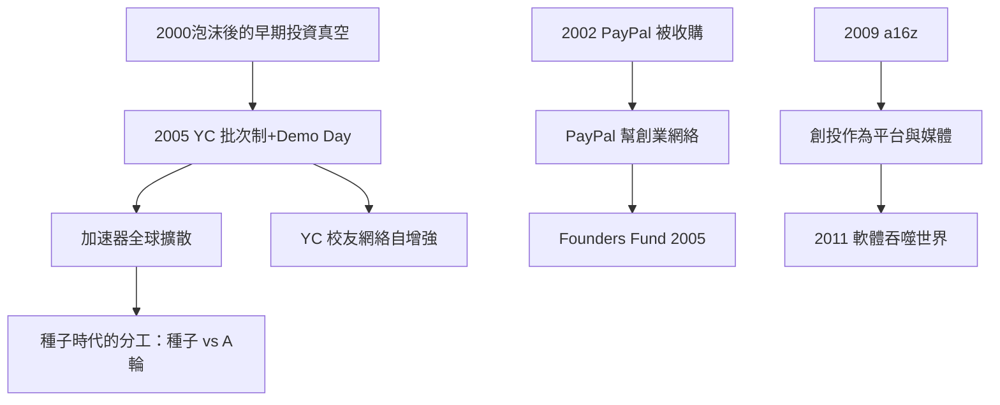

# 7.1 Y Combinator 與加速器革命

## YC 的誕生

2005年3月，Paul Graham（Lisp 程式語言專家、Viaweb 創辦人，1998年以約4,900萬美元賣給雅虎）、Jessica Livingston、Trevor Blackwell 與 Robert Morris 在劍橋創立 Y Combinator。他們的想法來自 Graham 的觀察：2000年泡沫破裂後，傳統創投不再碰早期項目，但最優秀的年輕創業者恰恰在這個階段最需要資金與指導。

YC 的模式極簡且可複製：

1. 批次制：每年兩批，每批數十至數百支團隊，三個月同一屋簷下。
2. 種子投資：早期約6,000美元×2名創辦人換約6%股權（隨年份調整，2018年起為15萬美元換7%的標準條款）。
3. Demo Day：批期結束時向數百名天使與基金展示——把募資從漫長的個別接觸壓縮到一天的競拍。
4. 校友網絡：Airbnb、Dropbox、Stripe、DoorDash 等 YC 校友互相投資、供應人才與經驗，形成自增強的生態。

YC 的發明使早期投資從手工藝變成流水線：一個小團隊每年可以看數千份申請、投資數百支團隊。到2020年代，YC 累計投資逾4,000家公司，其校友公司總市值以千億美元計（Airbnb、Stripe、DoorDash、Coinbase、Reddit 等均為 YC 校友）。

## 加速器的全球擴散

YC 的模式被迅速複製：Techstars（2006年）、500 Startups（2010年）、種子基金（Ron Conway 的 SV Angel——超級天使的代名詞，1990年代已投資 Google、PayPal 等早期公司）構成了2005–2015年間的種子時代生態。全球（倫敦的 Seedcamp 2007、以色列的加速器、中國的創新工場2009、東京的 Open Network Lab 2010）紛紛出現 YC 的本地版本。

加速器的意義是雙向的：創業者獲得資金的成本與時間大幅下降（從找資金需六個月變成三個月內完成種子輪），創投行業也出現了新分工——種子基金與加速器專注最早期的賭注，頂級基金專注 A 輪與後續。

## PayPal 幫與 a16z 的崛起

與 YC 平行的另一條線是創辦人轉型為創投。PayPal 在2002年被 eBay 以15億美元收購後，其創辦人與早期員工分散創業：Peter Thiel（創立 Founders Fund 2005）、Reid Hoffman（創立 LinkedIn，後加入 Greylock）、Max Levchin（Affirm）、Jeremy Stoppelman（Yelp）、Chad Hurley 與 Steve Chen（YouTube）、Elon Musk（SpaceX 2002、Tesla）——這個網絡被稱為 PayPal 幫，成為2000年代矽谷最強大的創辦人網絡。

2009年，Marc Andreessen 與 Ben Horowitz 創立 Andreessen Horowitz（a16z），首支基金3億美元。a16z 把創投重新定位為媒體+生態+平台：建立龐大的市場團隊（協助被投公司行銷、商務、招聘、公關），並以 Andreessen 的博客與媒體矩陣主導矽谷話語權。2011年8月，Andreessen 在《華爾街日報》發表〈為什麼軟體正在吞噬世界〉，成為該十年的行業綱領：所有產業都將被軟體公司重構（書店被 Amazon、音樂被 iTunes、視頻被 Netflix、汽車正在被 Tesla 重構）——這篇文章準確預測了2010年代的投資主題。

## 小結

2005–2015年的十年，創投行業發生了兩次分化：垂直上，種子基金與加速器把早期投資變成流水線；橫向上，創辦人轉型創投（PayPal 幫）與平台型創投（a16z）重寫了創投的服務內容。這兩次分化為下一波的極端形態——孫正義的千億基金——鋪好了資本與敘事的土壤。
