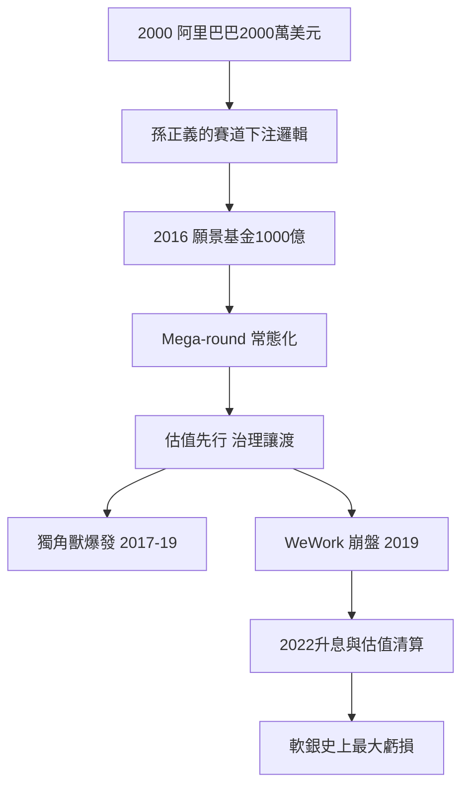

# 8.1 千億美元的願景基金

## 孫正義的路徑

孫正義（Masayoshi Son，1957年生）是韓裔日本人，1981年創立軟銀（SoftBank，起家於 PC 軟體批發），1990年代進入電信，2000年以2,000萬美元投資阿里巴巴（2000年1月，與馬雲會談後拍板，獲得約30%股權），2014年阿里巴巴上市使這筆投資價值一度超過600億美元——這是亞洲創投史上最著名的回報，也奠定了孫正義「賽道下注」的信心：他不投公司，投未來的產業格局。

2016年，孫正義宣布成立軟銀願景基金（SoftBank Vision Fund），規模1,000億美元——是此前全球最大 VC 基金（約40–50億美元）的二十倍以上。資金來源：沙烏地阿拉伯公共投資基金（PIF，450億美元）、軟銀自身（280億）、蘋果（10億）、高通、富士康、夏普等。孫正義的邏輯公開而簡單：AI 將重新定義所有產業，軟銀要成為 AI 時代的產業組織者——用壓倒性的資本，加速他認定會贏的公司，製造「贏家通吃」。

## Mega-round 時代的來臨

願景基金改寫了創投的規則：

1. 金額：2016年前，一輪融資過億美元已是新聞；2017年後，單輪5億、10億美元的 mega-round 成為常態。願景基金單筆投資常達數億至數十億美元（投資 Uber 約88億美元、WeWork 約100億美元級、滴滴出行數十億、Coupang、DoorDash、OYO 等）。
2. 估值：願景基金願意以遠高於市場的估值入場（WeWork 2019年1月估值470億美元、Uber 2018年估值720億美元），迫使其他基金跟進或退出。
3. 治理的讓渡：創辦人獲得超級投票權與「絕對控制」（WeWork 的 Adam Neumann 擁有20倍投票權），願景基金以「信任創辦人」為名放棄治理約束。
4. 退出路徑的改變：上市不再是終點而是起點——軟銀推動 Uber（2019年5月）、WeWork（2019年，失敗）等快速上市，以證明估值。

願景基金的效果在2017–2019年間是爆炸性的：全球獨角獸數量從2016年的約170家暴增至2019年的逾400家，融資總額在2018年創下紀錄。傳統創投被迫選邊：跟進（接受高估值）、或退出（讓出後期賽道）。

## 爭議與反面

孫正義模式從一開始就受到批評：

1. 資本規模與投資紀律的衝突：1000億美元的基金必須投出大額支票，導致投資選擇以「可容納大額資金的項目」為準，而非「最好的項目」——這扭曲了投資決策。
2. 規模不等於護城河：願景基金重倉的公司（WeWork、OYO、Katerra）多數沒有技術壁壘，只有補貼換來的規模——補貼可以被對手複製。
3. 估值先於商業本質：願景基金的估值邏輯是「未來壟斷者的折現」，而非當前現金流——這在低利率環境下成立，一旦利率上升（2022年起）就崩塌。
4. 治理的放棄：不設董事會否決權、不要求財務透明，使創辦人可以任意行事（WeWork 是極端案例）。

2019年 WeWork 上市失敗是轉折點（下一節詳述）；2020年疫情、2022年升息與科技股暴跌使願景基金一、二期的持倉（Uber、滴滴、Coupang、OYO、Klarna 等）普遍大幅低於投資價值，軟銀在2022–2023年連續兩年錄得集團史上最大年度虧損（願景基金部門兩年累計虧損逾數百億美元）。孫正義2022年11月公開道歉，宣布軟銀轉向防禦。

## 小結

願景基金證明了資本規模本身可以成為武器，也證明了這個武器的極限：當資本規模超過投資紀律所能駕馭的範圍，它製造的不是壟斷者，而是泡沫。WeWork 是這場實驗最完整的標本——它是下一節的主題。
