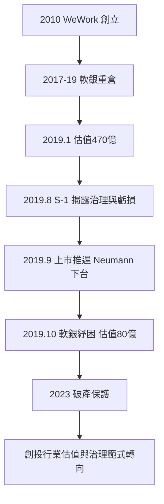

# 8.2 WeWork 估值大崩盤

## 從共享辦公到470億美元

Adam Neumann 於2010年與 Miguel McKelvey 在紐約創立 WeWork（起初名 GreenDesk，2010年改名 WeWork），模式是長租辦公樓、重新裝修、再短租給自由職業者與新創——本質上是辦公空間的轉租生意，帶有「共享經濟」與「社區」的敘事包裝。

WeWork 的融資曲線是創投史上的極端案例：

- 2014–2017年：從 Benchmark、紅杉、軟銀等募資多輪，2017年軟銀願景基金首次投資（44億美元級），估值達200億美元。
- 2019年1月：軟銀領投20億美元，估值470億美元——此時 WeWork 年營收約18億美元、淨虧損約19億美元。
- 2019年8月14日：WeWork 公布 S-1 上市文件，揭露巨額虧損（2018年虧損19億美元、2019年上半年虧損9億美元）、長期租賃負債逾180億美元、以及治理問題——Neumann 以20倍投票權控制公司、公司向其支付590萬美元購買 We 字號商標、他向公司出租自己持有的房產、內部大量親屬任職。

## 上市失敗與崩盤

S-1 公布後六週內，媒體與機構投資者的反應是災難性的：估值預期從470億一路下修至約100億以下；2019年9月22日，WeWork 推遲上市；9月24日，Neumann 被迫辭去 CEO；10月，軟銀出手紓困（注資與回購 Neumann 股份，換取控制權），估值落到約80億美元。軟銀在 WeWork 的累計投資逾100億美元，此後價值大幅縮水——2023年 WeWork 最終申請破產保護（2023年11月），市值歸零級。

WeWork 的崩盤同時暴露了軟銀治理的失敗：軟銀作為最大股東與債權人，對 Neumann 的行為（公司資金流向其個人與關聯方）長期缺乏約束。孫正義本人2019年11月公開承認：「我在 WeWork 的判斷上有錯。」

## WeWork 教訓的四個層次

1. 商業本質 vs 敘事：WeWork 的單位經濟（長租負債+短租收入）本質上是槓桿化的不動產生意，利率敏感、現金流脆弱——把它講成「科技與社區的平台」無法改變其財務結構。估值不能大於商業本質。
2. 創辦人崇拜的極限：獨角獸時代「創辦人最大、治理讓渡」的共識在 WeWork 案中被系統性反思——2020年後，機構投資者對雙重股權、創辦人絕對控制、以及「故事型估值」明顯收緊（軟銀自身的投資準則、後續 IPO 市場的治理審查都因此改變）。
3. 資本規模與紀律：願景基金以「規模換壟斷」的邏輯在 WeWork 上失效——規模本身不是護城河，沒有網路效應的規模只是負債。
4. 語言的反噬：WeWork 的 S-1 中自稱「We」的「platform」「community」「mission to elevate the world's consciousness」成為諷刺對象——過度的敘事包裝在盡職調查面前失效。

## 對創投行業的長期影響

WeWork 崩盤之後，創投行業出現了持續至今的變化：估值更保守（2019年後期起，IPO 市場對未盈利公司的容忍度下降）、治理要求更強（機構投資者要求創辦人控制權與治理改革掛鉤）、以及「規模不等於價值」的口號化共識。這場崩盤與2020年疫情、2022年升息一起，終結了2010年代「增長至上」的估值範式，為2020年代的「效率至上」（rule of 40、現金流優先）讓路。

## 小結

WeWork 是獨角獸時代的墓碑：它以最完整的方式展示了「資本規模+敘事+治理讓渡」的組合如何製造470億美元的幻覺，以及這個幻覺如何在六週內歸於80億。它的教訓滲入此後十年的創投行為（估值紀律、治理審查、單位經濟的重要性），也為2020年代的創投新賽道——硬科技與 AI——掃清了觀念上的障礙。
