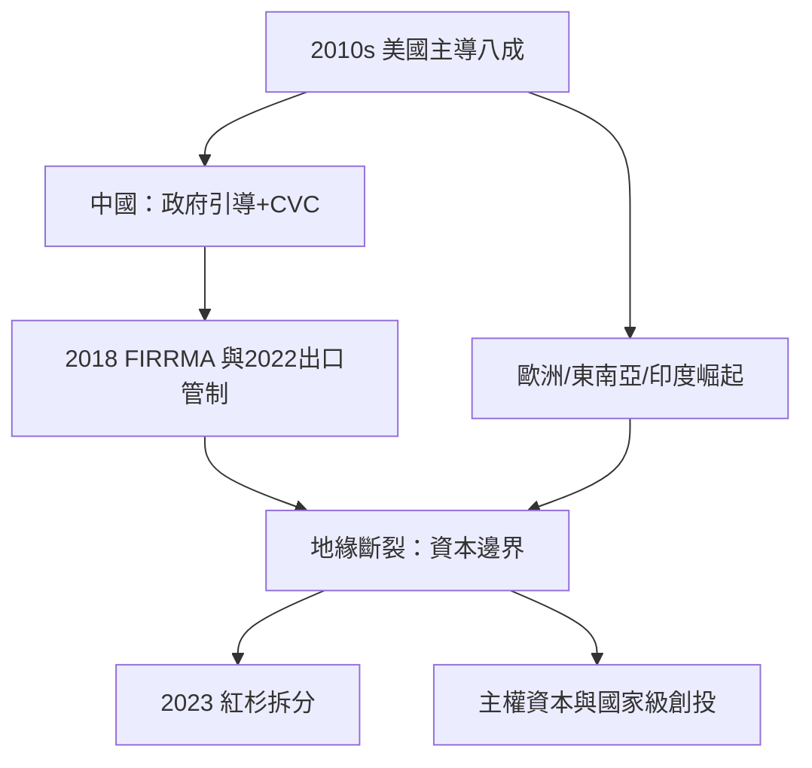

# 9.1 創投地理板塊移轉

## 從矽谷獨大到多極世界

2010年代初，全球創投資金約八成集中於美國，其中矽谷占美國的大半。到2020年代，這個格局發生結構性變化：中國、歐洲、印度、東南亞、中東各自形成規模可觀的創投生態。2021年，全球創投投資額首次突破6,000億美元，其中美國占比降至約五成，中國與歐洲分別達到兩成與一成以上（Crunchbase 與 Dealroom 的年度統計）。

## 中國：政府引導基金與 CVC 的雙引擎

中國的創投生態有兩個獨特的驅動力：

1. 政府引導基金：各級政府設立以財政與國有資本為來源的母基金，以撬動社會資本、發展本地產業為目的，投資於子基金與直接項目。2015年前後，規模以千億人民幣計的國家級與地方級引導基金相繼成立（如2015年的國家集成電路產業投資基金一期1,387億人民幣、2019年二期2,041億），直接推動了半導體、新能源、高端製造的本土投資潮。
2. 企業創投（CVC）：騰訊與阿里的戰略投資部門在2010年代成為全球最活躍的 CVC 之一（騰訊投資美團、京東、快手、拼多多、Epic Games、Spotify；阿里投資菜鳥、螞蟻、Lazada），CVC 的邏輯是戰略協同而非純財務回報——以生態與流量資源換取股權，改變了中國網路行業的競爭結構。

中國本土的創投（紅杉中國/沈南鵬、IDG 資本、經緯、高瓴）在2010年代成長為世界級機構。

## 歐洲與亞洲新興的崛起

歐洲在2010年代中期開始追趕：倫敦（DeepMind、Wise、Revolut）、巴黎（Doctolib）、柏林（N26、Delivery Hero）、斯德哥爾摩（Spotify、Klarna）形成多個中心。歐洲創投年投資額從2010年的約50億美元增至2021年的逾1,000億美元（Dealroom 數據）。

東南亞以 Grab（2012年）、Gojek（2010年）、Sea Group（2017年上市）為代表形成超級 App 的區域模式；印度以 Flipkart（2018年被沃爾瑪以160億美元收購）、Paytm、Zomato 為代表，2021年印度創投額突破400億美元。

## 地緣政治的斷裂

2017年起，地緣政治開始重塑創投的地理邏輯：

1. 美國的審查強化：2018年《外國投資風險審查現代化法》（FIRRMA）擴大 CFIUS 對關鍵技術（半導體、AI、生技）外資投資的審查範圍；2022年10月的出口管制新規進一步限制美國資本與人才參與中國先進晶片投資；2023年8月，拜登簽署行政命令，要求美國投資人對中國半導體、量子與 AI 領域的投資須申報並部分禁止。
2. 中國的反向：2020–2021年起，中國對網路平台（螞蟻上市暫停2020年11月、滴滴審查）與教育培訓的監管整頓，使美元基金對中國消費與網路賽道的投入急劇收縮；紅杉資本2023年宣布拆分為紅杉美國/歐洲與紅杉中國（後更名 HongShan）兩個獨立實體，是地緣斷裂的標誌性事件。
3. 中東資本的崛起：沙烏地 PIF 與阿布達比的 Mubadala 在2010年代末成為全球科技投資的主要來源（PIF 對 Uber、Lucid、軟銀願景基金的投入），主權資本與地緣政治深度綁定。

## 小結

創投的地理板塊從矽谷獨大變成多極+地緣斷裂：資本的流動開始沿著政治邊界而不是市場邊界運行。這個變化與另一個更深層的變化同時發生——投資的技術內容從軟體轉向硬科技。那是下一節的主題。
