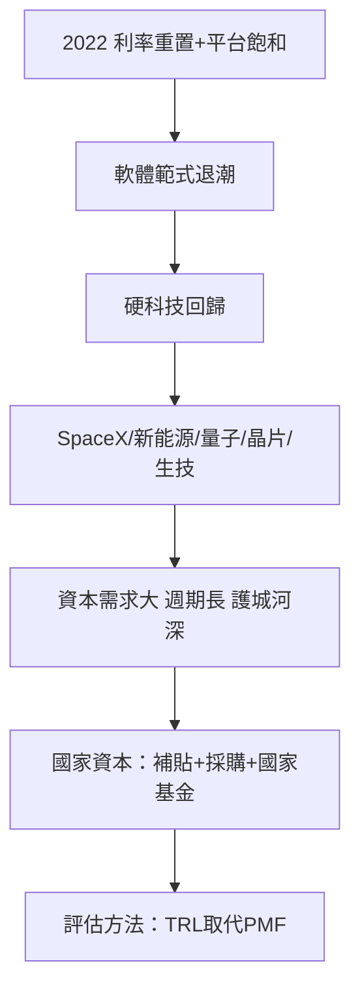

# 9.2 軟體退潮，硬科技抬頭

## 軟體範式的極限

2011年 Andreessen 的「軟體正在吞噬世界」定義了2010年代的創投主題：低資本需求、快速擴張的軟體公司（SaaS、社交、平台）佔據了絕大多數的創投資金。這個範式在2020年代初開始遭遇三個結構性問題：

1. 消費與平台的成熟：網路用戶滲透趨於飽和（全球上網人口占比逾六成），平台賽道的贏家格局已定，新平台公司難以再現 Facebook、Uber 的規模效應。
2. 估值的清算：2022年升息後，軟體公司的估值模型（遠期成長折現）被利率重置，多數未盈利軟體公司市值腰斬。
3. 國家的需求：晶片、新能源、航太、量子、生技——這些領域的競爭由國家安全驅動，無法靠軟體公司解決。

## 硬科技的回歸

硬科技（Deep Tech）投資的特徵與軟體截然不同：資本需求巨大（晶片廠一座數百億美元）、研發週期長（五年到十年）、技術風險高（可能失敗）、但一旦成功則形成極深的護城河（專利、製程、設備）。2020年代，這條賽道吸引了越來越多的創投資金：

1. 航太：SpaceX（2002年成立，馬斯克，2020年成為首傢俬營公司送人上太空，2024年估值逾2,000億美元）、Blue Origin（2000年，貝佐斯）、Rocket Lab（2017年上市）、Planet Labs（2017年上市）——商業航太從政府壟斷變成創投賽道。
2. 新能源與氣候科技：特斯拉的成功（2010年上市，2010年代後期成為全球市值最高的車企）驗證了清潔技術的商業路徑；2020年代，電池（Northvolt、QuantumScape 2020年 SPAC 上市）、氫能、碳捕捉、核聚變（Commonwealth Fusion、Helion——2021年微軟簽訂購電協議、2023年 Helion 獲 OpenAI CEO 奧特曼個人投資）成為新熱點。2023年，氣候科技成為全球創投最大的賽道之一。
3. 量子計算：IonQ（2021年 SPAC 上市）、Rigetti（2021年上市）、PsiQuantum（2021年4.5億美元融資，估值31億美元）——量子從實驗室走向風險投資。
4. 半導體：2022年美國《晶片與科學法》（CHIPS and Science Act，527億美元補貼）與歐盟《晶片法案》（2023年，430億歐元）使政府資本深度介入；創投則集中於 EDA 工具、先進封裝、光子晶片、以及 AI 晶片新勢力（Cerebras、Groq、SambaNova——2021年 SambaNova 獲軟銀領投6.76億美元）。
5. 生物科技：mRNA 的成功（Moderna 2010年成立，2020年新冠疫苗使其一戰成名，市值一度逾1,900億美元）與基因編輯（CRISPR Therapeutics、Editas）使生技持續成為大賽道；2020年代，AI 與生技的交叉（Isomorphic Labs、Insilico Medicine）成為新方向。

## 國家級創投的崛起

硬科技的資本需求與風險結構，使國家資本成為不可替代的角色：

1. 美國：In-Q-Tel（1999年成立，CIA 的創投部門，投資 Palantir、Keyhole——後者成為 Google Earth 的基礎）是政府創投的先驅；DARPA 的長期資助（互聯網、GPS、mRNA 基礎研究）是美國硬科技的真正引擎；2022年後，美國政府進一步以補貼與聯邦採購引導私人資本。
2. 中國：國家大基金（半導體兩期逾3,400億人民幣）與各省引導基金直接補貼晶圓廠與設備廠。
3. 歐盟：EIC Fund（2020年成立，歐盟創新理事會的股權基金）直接投資深度科技新創。
4. 日韓：日本的企業集團（軟銀、日產、三菱）與政府基金（JIC Ventures 2013年成立，2022年擴大為 JIC Capital 規模逾2兆日圓）系統性投資半導體與生技。

## 硬科技創投的方法論

投資硬科技與投資軟體需要不同的評估框架：技術驗證（TRL，技術就緒度等級）取代產品市場契合度（PMF）成為早期階段的核心指標；資本效率（每美元研發投入換取的技術進展）取代 CAC/LTV；創辦人必須是科學家或工程師本身（而非純商業背景）。2020年代的頂級創投（紅杉、a16z、Founders Fund、Lux Capital、Prelude Ventures）紛紛設立專職的硬科技與生技團隊，並開始招聘博士與前科學家作為投資合夥人。

## 小結

硬科技的回歸標誌著創投的一個範式轉移：從「輕資產、快回報」的軟體邏輯，轉向「重資本、長週期、深護城河」的工程邏輯——而這個轉移的主導者不再是純粹的市場資本，而是國家與主權基金。2022年底，一個新的技術範式——生成式 AI——把這兩條線（地緣資本競賽與硬科技投資）合流成一場創投史上最快的資金聚集。那是第十章的故事。
