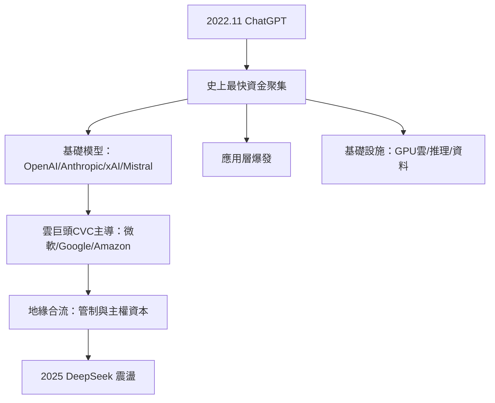

# 10.1 生成式 AI 的資金聚集

## OpenAI 的結構實驗

OpenAI 的資本結構本身就是創投史上的新範式。2015年12月，Sam Altman、Elon Musk 與一批矽谷領袖以非營利研究實驗室的形式創立 OpenAI，承諾捐資10億美元（實際到位遠少於此）。2019年，OpenAI 為籌措訓練大模型所需的巨額算力資本（訓練 GPT-4 估計耗資逾1億美元、GPT-5 級別以數億至十億美元計），設立了 OpenAI LP（有限獲利實體）並接受微軟10億美元投資；2023年1月，微軟追加投資至總額約100億美元（含雲端算力折價）；2024年10月，新一輪融資使 OpenAI 估值達1,570億美元；2025年，融資規模與估值再創新高（2025年3月估值3,000億美元級）。

這個結構（非營利母體控制、有限獲利實體融資、微軟的算力換股權）在法律與治理上前所未有的複雜，卻成為後續 AI 公司的模板。

## Anthropic 與雲巨頭的賽道

2021年，前 OpenAI 的 Dario Amodei 與 Daniela Amodei 等人出走創立 Anthropic，主打 AI 安全。其融資路徑複製了 OpenAI 的雲巨頭綁定模式：2022–2024年間，Google（AWS 之外的最大雲商）與 Amazon 分別投入數十億美元（Amazon 2023年9月承諾40億美元、2024年11月追加至總計80億美元；Google 累計投入逾20億美元），2025年 Anthropic 估值達1,830億美元級（2025年3月E輪融資350億美元估值1,830億美元）。

2022年11月30日 ChatGPT 上線後，兩個月內月活躍用戶破億，成為史上最快的消費級應用之一——這個事件把創投的注意力從 Web3/加密貨幣（2022年的 FTX 崩盤已使該賽道信用破產）急速轉向生成式 AI。

## 資金聚集的速度

生成式 AI 的資本聚集速度是創投史上空前的：

1. 2023年，美國 AI 相關新創的創投融資占全部創投的比例升至約三分之一以上（PitchBook 數據），2024年更高達四成以上。
2. 巨型輪次：OpenAI、Anthropic、xAI（2023年成立，馬斯克，2024年估值逾500億美元）、Mistral AI（法國，2023年成立，2024年估值60億美元級）、Cohere（加拿大，2024年估值55億美元級）等基礎模型公司的單輪融資以十億美元計。
3. 應用層爆發：Jasper、Character.AI（2023年被 Google 以約27億美元收購——主要是人才與授權收購）、Perplexity、Harvey（法律 AI，2024年估值30億美元級）、Sierra（客服 AI，Bret Taylor）等應用公司在2023–2025年獲得大量融資。
4. 基礎設施：GPU 雲（CoreWeave 2024–2025年估值達數百億美元級，2025年上市）、推理加速（Groq、Together AI）、資料標註（Scale AI 2024年估值138億美元）成為賽道。

## 地緣資本的合流

生成式 AI 的資本聚集同時是地緣競爭的延伸：

1. 美國：微軟、Google、Amazon、Nvidia（2023–2024年市值破3兆美元，成為 AI 算力的壟斷供給者）成為主要資本來源——CVC 主導了基礎模型賽道，傳統創投反而只能投應用與周邊。
2. 中國：2023年後，中國的基礎模型公司（智譜、月之暗面 Moonshot、MiniMax、百川、零一萬物、DeepSeek）主要依靠政府引導基金與大廠 CVC 融資；2025年初 DeepSeek 以低成本訓練出的模型震驚全球市場（2025年1月 DeepSeek R1 發布後，Nvidia 單日市值蒸發約6,000億美元，創美股史上最大單日市值損失紀錄）。
3. 中東與主權資本：阿聯酋的 G42 與 Mubadala、沙烏地 PIF 以算力與資本參與 AI 生態。
4. 國家管制：2023年10月，拜登政府發布 AI 出口管制新規，限制先進晶片出口；2025年起，多國開始規範 AI 模型的跨境資料與安全審查——AI 資本與主權安全深度綁定。

## 小結

生成式 AI 把創投帶入一個新階段：資本的主體不再是傳統 VC（紅杉、KPCB 仍參與但非主導），而是雲巨頭、主權基金與超大額 CVC；資本的規模以千億美元計；投資的邏輯從「押注公司」變成「押注範式」。這場聚集尚未結束——而它也把一個古老的問題推到前台：當資本與技術都高度集中，創投家本人的價值還剩下什麼？那是本書最後一節的問題。
