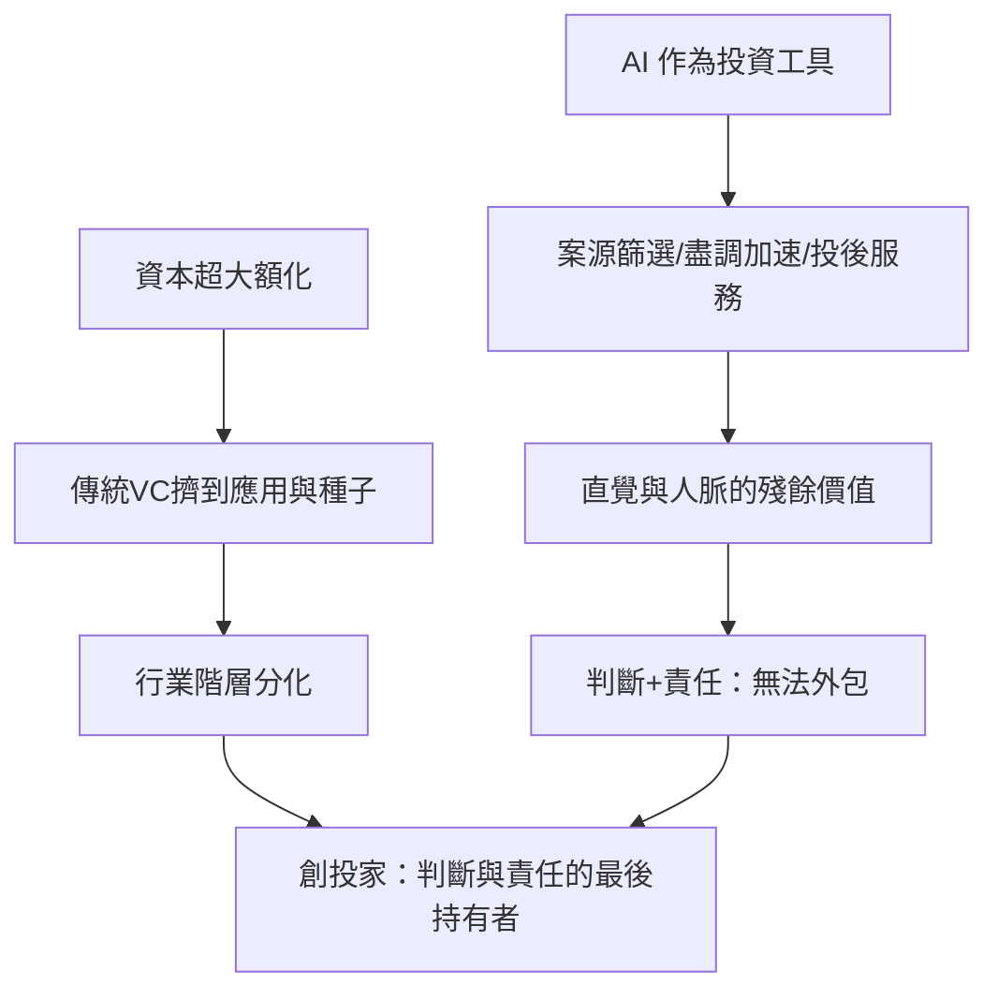

# 10.2 AI 與創投家的直覺重構

## AI 進入創投的兩端

2020年代中期，AI 開始從兩端滲透創投行業：作為投資對象（上一節）與作為投資工具。作為工具的應用路徑：

1. 案源篩選（Sourcing）：以自然語言模型掃描論文（arXiv、bioRxiv）、開源社區（GitHub）、專利、社群媒體，自動發現新興技術與團隊。新創公司如 SignalFire（其 Beacon 系統自2013年起以數據驅動早期投資）、且隨著 LLM 的普及，各基金自建或採用 AI 案源系統。
2. 盡職調查加速：以 AI 整理市場規模、競爭格局、財務模型的初稿，將分析師的準備時間從數週壓縮到數小時。
3. 投後服務：以 AI 助理協助被投公司的招聘初篩、市場分析、法務文書。
4. 估值與熱點預測：以機器學習模型分析融資數據與技術趨勢，預測賽道熱度與退出時機。

## 直覺與人脈的殘餘價值

但創投的核心活動——判斷創辦人、判斷範式、判斷時機——至今仍難以被 AI 取代，原因有三：

1. 樣本的極小性：成功的早期投資依賴少數極端案例（冪律），而極端案例在訓練數據中極為稀缺，模型對「下一個 OpenAI」的預測能力有限。
2. 關係與信任：頂級項目（如 Google 1999、OpenAI 2019）的融資不是開放競價，而是基於信任的定向邀約——這種網絡地位無法被演算法複製。
3. 責任的承擔：投資決策的錯誤（損失數百萬至數億美元）最終由 GP 對 LP 負責——法律與激勵結構把判斷的責任固定在人身上。

頂級創投家的應對是兩手策略：把 AI 用於放大直覺（以 AI 處理信息洪流，把人的注意力留給判斷），並投資「AI 原生」的公司（成為新範式的股東）。部分基金（如 a16z 的 SPEEDRUN、紅杉的 AI 團隊、Lux Capital 的深度科技組）以這種方式重構內部組織。

## 創投行業的結構性挑戰

AI 也對創投行業本身提出了結構性問題：

1. 案源的民主化與去中介化：當創業者可以透過 AI 快速完成 BP、財務模型與產品原型，創投的「專業判斷」門檻下降；創業者可以直接面向眾籌、社區與戰略投資者（Nvidia、微軟等 CVC 直接主導 AI 賽道），傳統 VC 的中介角色被邊緣化。
2. 資本的超大額化：基礎模型的融資規模（十億至百億美元）超出多數 VC 基金的單筆上限，把傳統 VC 擠到應用層與種子層——行業的階層分化加劇。
3. 回報週期的不確定：AI 基礎模型的資本消耗（訓練+推理算力）遠超以往任何賽道，投資回報的時點與規模高度不確定（2023–2025年間，多數 AI 應用公司的單位經濟仍不成立——推理成本、用戶留存、與雲巨頭的競爭使盈利遙遙無期）。
4. 政策與倫理的重量：AI 投資必須同時考慮監管（歐盟 AI 法案、美國行政命令、各國安全審查）、版權（訓練資料的訴訟）、與安全（模型能力的失控風險）——創投家必須是政策與倫理的讀者。

## 創投的下一個五十年

從多里奧特1946年的 ARD 到2025年的 AI 狂潮，創投的歷史呈現一個清晰的模式：每一項新技術（半導體、個人電腦、生物、網路、行動、AI）都會催生新一代的資本形態與評估方法，而每一輪資本狂熱都以泡沫與清算收場，但系統總能在廢墟上重組並投出下一個範式。

創投家本人的角色也在這個過程中不斷被重定義：從資金提供者（多里奧特）到生態建造者（瓦倫丁、Doerr）到平台與媒體（a16z）到超大額資本組織者（孫正義）。AI 時代的創投家，或許會成為「判斷與責任的最後持有者」——當 AI 能夠完成篩選、分析、建模，人類創投家剩下的核心，是對「什麼值得存在」的判斷，以及對失敗承擔責任的能力。這個角色無法被外包，因為它是資本與創新之間的信任基礎——而信任，正是從捕鯨船的分成契約到 OpenAI 的複雜股權結構，貫穿創投五百年歷史的那條主線。

## 小結

AI 沒有取消創投家，而是把他推向更高的抽象層次：從篩選項目到判斷範式，從管理組合到承擔責任。這本書從捕鯨船的分成契約開始，到 AI 時代的創投新範式結束——貫穿始終的是同一條線：人類總是需要一種制度，把富餘的資本引向高風險的未知，並以信任、激勵與責任把兩端連接。創投是這個制度的現代形態，而它的故事，仍在寫下去。
