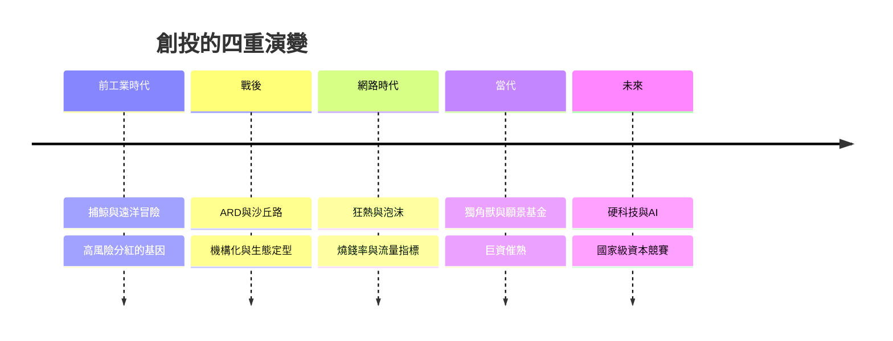

# 創投的故事：從捕鯨高風險冒險、矽谷車庫神話到獨角獸狂潮與 AI 時代的資本引擎

本書跨越數百年，講述「風險投資」這股資本力量如何從遠洋冒險與捕鯨業的高風險分紅傳統，經歷美東先驅的機構化實驗、矽谷沙丘路的生態定型、網路泡沫的洗禮，演變為推動獨角獸誕生、重塑全球科技地緣競爭、並進入 AI 時代的終極資本引擎。

全書沿四條主線交織：資本形態與來源、與創業者的關係、投資賽道轉變、評估核心指標。

* 第1章-捕鯨業與遠洋貿易：現代創投的原始基因
    * [1.1-捕鯨船的股權分紅機制](01.1-捕鯨船的股權分紅機制.md)
    * [1.2-天使投資人與愛迪生](01.2-天使投資人與愛迪生.md)
* 第2章-家族辦公室與早期冒險資本
    * [2.1-洛克斐勒與洛斯柴爾德的冒險資本](02.1-洛克斐勒與洛斯柴爾德的冒險資本.md)
    * [2.2-戰前融資困境](02.2-戰前融資困境.md)
* 第3章-現代創投之父與ARD的崛起
    * [3.1-多里奧特與ARD的誕生](03.1-多里奧特與ARD的誕生.md)
    * [3.2-DEC神話：七萬美元的證明](03.2-DEC神話七萬美元的證明.md)
* 第4章-叛逆八人組與沙丘路傳奇
    * [4.1-叛逆八人組與亞瑟·洛克](04.1-叛逆八人組與亞瑟洛克.md)
    * [4.2-沙丘路聚落的形成](04.2-沙丘路聚落的形成.md)
* 第5章-個人電腦與網際網路狂潮
    * [5.1-KPCB與生物科技和網景](05.1-KPCB與生物科技和網景.md)
    * [5.2-紅杉資本與LP/GP結構下的神話](05.2-紅杉資本與LPGP結構下的神話.md)
* 第6章-Dot-Com泡沫爆破與創投大洗牌
    * [6.1-狂熱與燒錢率](06.1-狂熱與燒錢率.md)
    * [6.2-泡沫破滅與創投寒冬](06.2-泡沫破滅與創投寒冬.md)
* 第7章-社群網路、行動通訊與孵化器模式
    * [7.1-Y Combinator與加速器革命](07.1-YCombinator與加速器革命.md)
    * [7.2-PayPal幫與a16z的崛起](07.2-PayPal幫與a16z的崛起.md)
* 第8章-孫正義與願景基金的資本巨浪
    * [8.1-千億美元的願景基金](08.1-千億美元的願景基金.md)
    * [8.2-WeWork估值大崩盤](08.2-WeWork估值大崩盤.md)
* 第9章-全球化破裂、硬科技與國家級創投
    * [9.1-創投地理板塊移轉](09.1-創投地理板塊移轉.md)
    * [9.2-軟體退潮硬科技抬頭](09.2-軟體退潮硬科技抬頭.md)
* 第10章-OpenAI狂潮、AI Agent與創投新範式
    * [10.1-生成式AI的資金聚集](10.1-生成式AI的資金聚集.md)
    * [10.2-AI與創投家的直覺重構](10.2-AI與創投家的直覺重構.md)

## 全書架構圖

