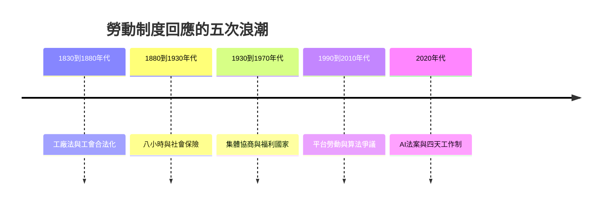

# 11.2 生成式AI與白領腦力的重構

2022年11月，OpenAI發布ChatGPT，兩個月內用戶破億。2023年起，GitHub Copilot、微軟Copilot與各類生成式AI工具快速進入辦公室。這場變革的特殊之處在於：自動化第一次大規模指向白領的核心任務，寫作、編程、分析、設計。藍領的技術性失業史，正在白領身上重演。

## 白領任務的拆解

要理解AI對白領的衝擊，可以借用泰勒制的邏輯反過來看：白領的知識工作同樣可以被拆解為任務的組合。一個財務分析師的一天包括：收集數據、清洗整理、跑模型、寫摘要、做簡報、開會討論、寫郵件。其中相當比例的任務（清洗、初稿、摘要、模板化的簡報與郵件）正是生成式AI已經能勝任的。

2023年以來的實證研究提供了初步證據。MIT的研究發現，用ChatGPT輔助的專業寫作任務，完成時間平均縮短約四成、品質提升；GitHub的研究顯示，使用Copilot的開發者在特定任務上完成速度提升約五成；波士頓諮詢與哈佛的實驗發現，使用AI的顧問在合適的任務上表現提升超過四成，但在AI容易出錯的任務上（jagged frontier，鋸齒狀邊界），過度依賴AI反而使表現下降。

這些研究指向的核心問題不是工作會不會消失，而是任務的重新分配：AI承擔初稿與重複性任務，人類轉向判斷、審核、創意與客戶關係。白領的技能結構因此重構：會用AI成為新的基本功（如同1980年代的會用電腦），審核AI的輸出成為新的責任（包括對幻覺與錯誤的責任），而純粹的執行型職位（初級法律文書、初級文案、基礎客服）面臨最直接的壓縮。

## 歷史的韻腳

這不是白領第一次經歷任務的自動化。打字員被文字處理機消滅（第八章），銀行櫃員與文書員被ATM與ERP壓縮，會計的抄錄被試算表吸收。歷史的經驗有兩面：一面是任務層面的替代（具體工作消失），一面是職業層面的重組（新職業誕生：資料分析師、產品經理、社群運營都是資訊化的產物）。經濟學家奧托爾與弗雷2013年的著名研究估算，美國約四成七的就業崗位在未來一二十年內有高度自動化風險；後續研究修正為：任務自動化普遍，但職業整體被替代的比例較低。AI時代的多數預測遵循同樣的框架：任務層面的重構深、職業層面的替代不均。

勞動制度的回應已經開始。歐盟2024年通過《AI法案》，對高風險AI系統（包括僱傭決策中的AI）設定透明與人類監督的要求；多國的勞動法開始處理算法管理（第九章）與AI解僱的程序正義；工會的訴求中，AI的引入程序與再訓練權成為新的談判項（好萊塢2023年的編劇與演員罷工，核心議題之一正是AI的使用規範，最終協議對AI起草劇本與數位分身的使用設定了限制與補償）。

## 未來的受薪者

從德爾麥地那的工匠到AI時代的白領，本書的旅程跨越了四千年。每一代勞動者都面對過技術與制度的重構：行會匠人面對工廠，織工面對動力機，職員面對打字機與電腦，司機與騎手面對演算法。歷史的反覆出現兩條規律：技術的衝擊從不平均（總是先壓縮最易標準化的任務），制度的回應總是滯後但最終到來（工廠法、八小時、工會、社會保險、平台工作指令）。

未來的受薪者是誰？可能是與AI協作、以判斷與創意定價的知識工作者；可能是仍有保障的平台僱員（如果平台工作指令落地）；可能是四天工作週的產出導向員工。可以確定的是：契約的形式會繼續演化，而每一次演化，都會像過去四千年一樣，伴隨著衝突、組織與立法。員工的故事，是一個永遠在書寫中的故事。
