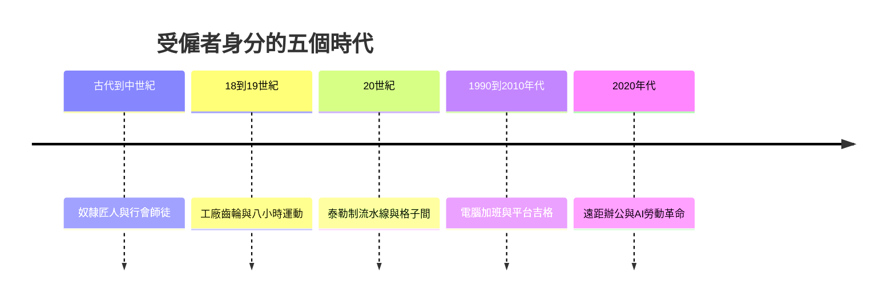

# 員工的故事：從奴隸苦役、工廠齒輪到勞工運動與演算法時代的白領與藍領史詩

本書跨越數千年，將藍領勞工與白領上班族統合在受僱者的大框架下，講述人類如何從古代的奴隸與匠人，經歷工業革命的蒸汽與血汗、工會運動的血淚抗爭、泰勒制與科層制辦公室的建立，一路演變成現代面對平台經濟吉格人、遠距辦公、週休三日討論與AI時代下的勞動重構。

全書依循四條交織的線索：

1. 身份與契約關係：奴隸與苦役、行會師徒、出售體力的藍領、出售腦力與時間的白領、被演算法派單的吉格人。
2. 勞動空間與工具：工地與農田、紡織廠與鋼鐵廠、摩天大樓與格子間、客廳與無邊界的數位雲端。
3. 時間與監控手段：鞭笞、工廠鐘聲與秒錶、打卡鐘與KPI、手機即時連線與演算法派單。
4. 心理與反抗形式：砸碎機器、流血罷工、工會協商、迷因自嘲與寂靜離職、追求彈性自主與週休三日。

## 目錄

* 第1章-金字塔下的石匠與奴隸苦役（約西元前2500年–西元5世紀）
    * [1.1-德爾麥地那勞工村與史上首次罷工](01.1-德爾麥地那勞工村與史上首次罷工.md)
    * [1.2-奴隸與恥感：古希臘羅馬的勞動觀](01.2-奴隸與恥感：古希臘羅馬的勞動觀.md)
* 第2章-中世紀行會、師徒制與日傭工（西元11世紀–17世紀）
    * [2.1-行會與學徒幫工大師的職涯階梯](02.1-行會與學徒幫工大師的職涯階梯.md)
    * [2.2-黑死病後的勞動法令與日傭工](02.2-黑死病後的勞動法令與日傭工.md)
* 第3章-珍妮紡織機、盧德份子與「工人階級」的誕生（西元1780年代–1840年代）
    * [3.1-機器進廠：農夫匠人變產業工人](03.1-機器進廠：農夫匠人變產業工人.md)
    * [3.2-盧德運動與馬克思的剖析](03.2-盧德運動與馬克思的剖析.md)
* 第4章-三八婦女節、五一勞工節與血淚八小時（西元1880年代–1910年代）
    * [4.1-乾草市場事件與八小時運動](04.1-乾草市場事件與八小時運動.md)
    * [4.2-三角內衣廠大火與職場安全立法](04.2-三角內衣廠大火與職場安全立法.md)
* 第5章-打字機、帳簿與最早的「白領上班族」（西元1870年代–1910年代）
    * [5.1-鐵路大公司與第一批職員](05.1-鐵路大公司與第一批職員.md)
    * [5.2-打字機與女性走入辦公室](05.2-打字機與女性走入辦公室.md)
* 第6章-秒錶、流水線與「鋼鐵工人」的規訓（西元1910年代–1930年代）
    * [6.1-泰勒的秒錶與科學管理](06.1-泰勒的秒錶與科學管理.md)
    * [6.2-福特流水線與摩登時代](06.2-福特流水線與摩登時代.md)
* 第7章-灰色西裝男、日本「公司人」與格子間（西元1950年代–1980年代）
    * [7.1-懷特與組織人](07.1-懷特與組織人.md)
    * [7.2-企業戰士與過勞死](07.2-企業戰士與過勞死.md)
    * [7.3-格子間的誕生與規訓](07.3-格子間的誕生與規訓.md)
* 第8章-PC、E-mail與無休止的無形加班（西元1990年代–2000年代）
    * [8.1-辦公桌上的個人電腦](08.1-辦公桌上的個人電腦.md)
    * [8.2-電子郵件與永不下班的待命狀態](08.2-電子郵件與永不下班的待命狀態.md)
* 第9章-平台經濟、996與「社畜/打工人」的迷因抗爭（西元2010年代）
    * [9.1-外賣騎手與演算法派單](09.1-外賣騎手與演算法派單.md)
    * [9.2-996、社畜與職業倦怠的迷因](09.2-996、社畜與職業倦怠的迷因.md)
* 第10章-疫情大流行、遠距辦公與大離職潮（西元2020年至今）
    * [10.1-史上最大遠距辦公實驗](10.1-史上最大遠距辦公實驗.md)
    * [10.2-大離職潮與寂靜離職](10.2-大離職潮與寂靜離職.md)
* 第11章-週休三日、生成式AI與未來的「受薪者」（21世紀至今）
    * [11.1-週休三日的全球實驗](11.1-週休三日的全球實驗.md)
    * [11.2-生成式AI與白領腦力的重構](11.2-生成式AI與白領腦力的重構.md)
