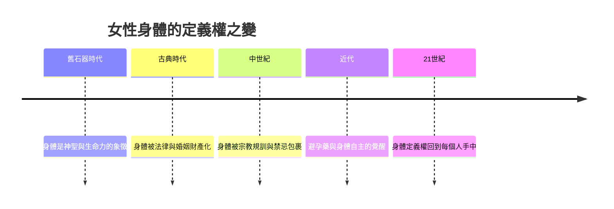

# 10.3 賽博格宣言與多元性別的未來

1985年，生物學家出身的女學者唐娜·哈拉維發表了一篇後來成為女性主義經典的文章：《賽博格宣言》。開篇寫道：這是一個企圖建立女性主義者忠誠的嘗試，透過一個諷刺的政治神話，賽博格。三十九年後，當生理性別、社會性別與科技之間的界限日益模糊，這份宣言讀起來像一份預言。

## 什麼是賽博格

賽博格是人與機器的混合體。哈拉維用它作為隱喻，指出二十世紀末的三個界限正在崩潰：人與動物、動物與機器、物理與非物理。她認為，傳統女性主義依賴的一些概念基礎，特別是女性本質論：認為存在著一個統一的、以生理為基礎的女性身分——已經不足以應付新時代。

她的核心主張是：與其追求一個純粹的、未被科技污染的女性本質，不如承認我們都是混合物、都是邊界上的存在。這不是放棄鬥爭，而是換一種方式理解自己：女性主義的團結不必建立在共同本質上，而可以建立在親緣關係上，建立在選擇的聯盟上。

## 性別的流動

哈拉維的思想與同一時代的性別理論匯流。1990年，朱迪斯·巴特勒出版《性別麻煩》，提出性別是一種表演：不是生理決定了性別角色，而是不斷重複的社會實踐製造了性別這個範疇本身。這個觀點把波娃的女人是被後天形成的命題推向更遠：連男人與女人這個二分法本身，都是社會製造的。

實踐層面的變化與之呼應。跨性別權利運動在二十一世紀獲得前所未有的能見度；多國允許法律性別變更，部分國家承認第三性別或取消性別登記；醫療、體育、法律與教育都在重新處理性別的定義。2010年代起，非二元性別與性別酷兒成為公共詞彙。

這場變革對女性主義提出了深刻的問題：如果女性不再是一個本質範疇，女性主義還為誰而戰？許多學者與運動者的回答是：女性主義的核心從來不是一個身分，而是一種對權力結構的批判。只要還存在著以生理性別為基礎的壓迫結構，這種批判就有必要；而批判的對象，也包括那些讓跨性別者受害的同一套性別秩序。

## 未來的書寫

回到本書的起點。三萬年前，一位無名祖先雕出威倫道夫維納斯時，女性的身體是神聖與生命力的象徵。數千年來，這個身體被神聖化、被貶低、被財產化、被規訓、被禁錮、被浪漫化、被商品化；女性為了奪回身體、聲音與主體性，從修道院、閨閣與沙龍，走向斷頭台、街頭、議會、網路與法庭。

未來的故事將如何書寫，取決於幾個正在展開的問題。技術會繼續重塑身體與生殖：人工子宮、基因編輯、生殖細胞技術，都將再次把生育從身體中分離，女性主義必須參與這些技術的方向之爭。數位空間已成為第二個公共領域：誰能在網路上安全發言，誰的聲音被演算法放大，都是新的性別政治。而賽博格的隱喻提醒我們：未來沒有純粹的人性可以守護，只有混合、流動、不斷被重新協商的邊界。

哈拉維在宣言結尾寫道：我寧願成為賽博格，也不願成為女神。這句話是本書結尾最恰當的註腳：三萬年前，人類把女性的身體雕成女神；今天，女性拒絕再被雕成任何形象，包括女神。她們要的是自己握著刻刀。

這就是女性的故事，一個尚未結束的故事。
