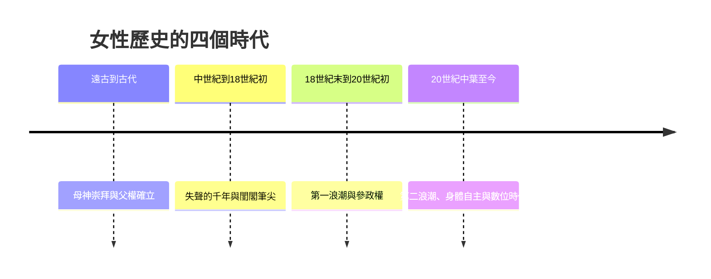

# 女性的故事：從母系黎明、失聲千年到身體自主與性別重構

本書跨越數萬年，從遠古石雕與母系崇拜開始，講述女性如何在歷史長河中經歷父權結構的確立與失聲，並透過三次女性主義浪潮、勞動與政治權利的爭取、身體自主權的覺醒，一路演變成現代多元性別與科技時代下的主體性重構。

全書依循四條交織的線索：

1. 身份與地位：神聖母神、被邊緣化的私領域附庸、爭取公民權的個體、具備完整主體性的多元人類。
2. 身體與控制：生育工具與貞潔符號、避孕藥與墮胎權、審美解放與身體包容。
3. 聲音與傳播：歷史失聲、閨閣文學與沙龍、街頭參政抗爭、網路社群與數位發聲。
4. 主題深化：參政權、社會與職場平等、交織性與多元文化、科技與演算法時代的性別重構。

## 目錄

* 第1章-維納斯雕像與大地母神（約西元前30,000年–前3000年）
    * [1.1-威倫道夫維納斯與母神崇拜](01.1-威倫道夫維納斯與母神崇拜.md)
    * [1.2-從母系部落到父系繼承的轉折](01.2-從母系部落到父系繼承的轉折.md)
* 第2章-埃及的女王與希臘羅馬的私領域（約西元前1500年–西元5世紀）
    * [2.1-哈特謝普蘇特與克麗奧佩脫拉](02.1-哈特謝普蘇特與克麗奧佩脫拉.md)
    * [2.2-雅典私領域與羅馬婦女的財產權](02.2-雅典私領域與羅馬婦女的財產權.md)
    * [2.3-希帕提婭的殉道](02.3-希帕提婭的殉道.md)
* 第3章-聖女、女巫與貞潔枷鎖（西元5世紀–17世紀）
    * [3.1-聖女貞德與希德嘉的雙面鏡](03.1-聖女貞德與希德嘉的雙面鏡.md)
    * [3.2-獵殺女巫狂潮](03.2-獵殺女巫狂潮.md)
    * [3.3-纏足與東方禮教](03.3-纏足與東方禮教.md)
* 第4章-婦女城與閨閣中的筆尖（西元1405年–17世紀末）
    * [4.1-皮桑與婦女城](04.1-皮桑與婦女城.md)
    * [4.2-閨閣文學與沙龍女主人的智識網絡](04.2-閨閣文學與沙龍女主人的智識網絡.md)
* 第5章-斷頭台上的宣言與女權覺醒（西元1791年–1848年）
    * [5.1-奧蘭普德古熱與斷頭台](05.1-奧蘭普德古熱與斷頭台.md)
    * [5.2-沃斯通克拉夫特與女權的辯護](05.2-沃斯通克拉夫特與女權的辯護.md)
    * [5.3-塞內卡瀑布會議](05.3-塞內卡瀑布會議.md)
* 第6章-工廠女工、參政派與投票權（西元1880年代–1920年）
    * [6.1-紡織廠女工與三八婦女節](06.1-紡織廠女工與三八婦女節.md)
    * [6.2-潘克斯特與參政權劇烈派](06.2-潘克斯特與參政權劇烈派.md)
    * [6.3-第十九修正案與投票權](06.3-第十九修正案與投票權.md)
* 第7章-人不是生來就是女性，而是變成女性（西元1949年–1960年代）
    * [7.1-波娃與第二性](07.1-波娃與第二性.md)
    * [7.2-傅瑞丹與無名之痛](07.2-傅瑞丹與無名之痛.md)
* 第8章-避孕藥、身體自主與個人即政治（西元1960年代–1980年代）
    * [8.1-避孕藥與身體革命](08.1-避孕藥與身體革命.md)
    * [8.2-個人即政治](08.2-個人即政治.md)
    * [8.3-黑人女性主義與交織性](08.3-黑人女性主義與交織性.md)
* 第9章-網路空間的MeToo風暴與日常抗爭（西元2010年代至今）
    * [9.1-MeToo運動與沉默的終結](09.1-MeToo運動與沉默的終結.md)
    * [9.2-身體包容、經期正義與審美解放](09.2-身體包容、經期正義與審美解放.md)
* 第10章-科技、演算法偏見與未來的性別重構（21世紀至今）
    * [10.1-STEM中的女性崛起與玻璃天花板](10.1-STEM中的女性崛起與玻璃天花板.md)
    * [10.2-演算法偏見與數據時代的父權陰影](10.2-演算法偏見與數據時代的父權陰影.md)
    * [10.3-賽博格宣言與多元性別的未來](10.3-賽博格宣言與多元性別的未來.md)
