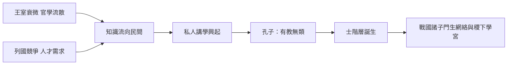

# 1.1 孔子與三千弟子

## 貴族壟斷知識的世界

在孔子（前551–前479）之前，接受教育是貴族的特權。西周的官學體系中，「學在官府」：典籍、禮樂、文字都由世襲的史官、樂官掌握，平民與知識幾乎絕緣。識字本身就是一種階級標記。

春秋時代（前770–前476）的兩個變化為教育革命創造了條件。其一是王室衰微、禮崩樂壞，原本壟斷知識的王官流散到民間，形成所謂「天子失官，學在四夷」的局面，私人得以接觸典籍。其二是社會流動加劇，各國競爭激烈，人才的需求超出了世襲貴族的供給——一個平民子弟若能讀書知禮，就有機會被任用。

孔子正是這個縫隙中的人物。他出身沒落的貴族家庭（父親叔梁紇為魯國武士），幼年貧賤，「吾少也賤，故多能鄙事」。這個背景使他成為中國歷史上第一個大規模面向平民辦學的人。

## 有教無類

《論語·衛靈公》記載孔子的宣示：「有教無類。」這四個字在當時是激進的：不分出身、貧富、地域，只要送上薄禮（「自行束脩以上，吾未嘗無誨焉」——一束乾肉作為學費），就可以入門。司馬遷《史記·孔子世家》記載孔子弟子三千，身通六藝者七十有二人。三千可能是誇張的概括，但弟子來源的多元是有記載為證的：子貢是商人，子路出身「鄙人」（鄉野粗人），顏回居陋巷、簞食瓢飲，冉雍出身低賤，子張是「魯之鄙家」。

這批學生構成了歷史上第一批以「學生」為明確身分的平民群體。他們不是來學手藝的學徒，也不是祭司的門徒——他們修習的是一種新的資本：禮、樂、射、御、書、數（六藝），以及詩、書、禮、義的闡釋能力。

## 學生作為職業官僚的預備

孔子辦學的深層動力是一個時代的問題：在世襲貴族體系崩壞之後，誰來治理國家？他的答案是「舉賢才」——治理者應該由德性與學問決定，而非血統。這使他的學校不只是一個道德共同體，更是一個官僚培養所。

事實上孔門弟子畢業後的去向證明了這一點：子路、冉有在季氏手下任事，子貢出使列國、貨殖致富，子夏在西河講學並成為魏文侯的老師，曾子一脈傳下《大學》《孝經》的傳統，子游在武城治理實踐禮樂。孔門是戰國「士」階層興起的搖籃——「士」從武士轉型為文士，正是從這批學生開始。

## 教學法：不憤不啟，不悱不發

《論語》記錄的孔子教學方式，有幾個直到今天仍屬先進的特徵：

- 啟發式：「不憤不啟，不悱不發。舉一隅不以三隅反，則不復也。」學生不先自己思考到極限，老師不開口。
- 因材施教：同一個問題（問仁、問孝、問政），對不同弟子給出不同答案——子路性急就讓他慢一點，冉有退縮就推他一把。
- 對話式記錄：《論語》是語錄體，不是講義體。真理在問答中浮現，而非單向灌輸。

這個傳統確立了此後兩千多年東亞師生關係的原型：老師不是知識的零售商，而是人格的塑造者；學生追隨老師，追隨的不只是內容，而是道路（道）。

## 諸子百家的門生網絡

孔子開創的模式在戰國被迅速複製與競爭：

- 墨子（約前470–前391在世）組織了更嚴密的門徒團體，有明確的紀律（《墨子》記載鉅子制度），墨家弟子能赴湯蹈火、死不還踵。
- 孟子「後車數十乘，從者數百人」遊說諸侯；許行的農家、惠施與公孫龍的名家、鄒衍的陰陽家，各自帶著門徒周遊。
- 齊國的稷下學宮（約前四世紀中葉建立）則是官方出資的智庫與學堂，「不治而議論」，荀子曾三為祭酒——這是國家養士的最早大規模實驗。

## 小結

孔門創造了三項影響深遠的發明：平民可以成為學生（教育階級壟斷的第一道裂縫）、學生可以成為官僚（學習與仕途的連結，這條線在隋唐科舉中完成制度化）、師生關係以人格傳承為核心。下一節，我們把鏡頭拉近到孔門內部，看兩位最著名的弟子如何定義「學生」的兩種極端人格。
