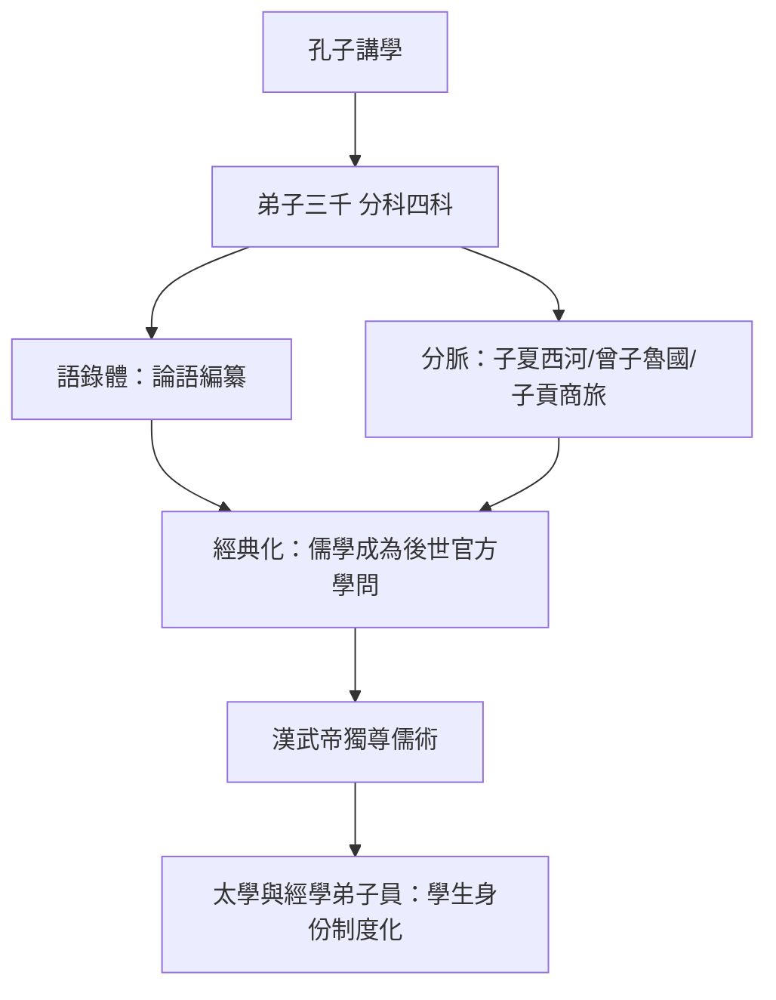

# 1.2 顏回與子路：弟子的忠誠與傳承

## 兩種學生的原型

孔門弟子中，最常被後世並提的是顏回與子路。他們恰好代表「學生」的兩種極端原型：顏回是內省型的賢者，安貧樂道、以理解為滿足；子路是行動型的勇者，剛直莽撞、以踐行為忠誠。孔子對他們的態度構成了一部微型的教育心理學。

## 顏回：簞食瓢飲的求道者

顏回（前521–前481），字子淵，魯國人，比孔子小三十歲。他出身貧寒，住在陋巷，「一簞食，一瓢飲，人不堪其憂，回也不改其樂」（論語·雍也）。孔子說他「其心三月不違仁」，又承認自己講學時「終日不違如愚」——顏回從不提問、看似遲鈍，但退而省其私，發現他能把所學充分發揮，「回也不愚」。

顏回早逝（約四十歲），孔子的悲慟在《論語》中被原樣記錄：「噫！天喪予！天喪予！」別人勸他不必過度哀傷，他答：「非夫人之為慟而誰為？」——不為這樣的學生痛哭，還為誰痛哭？這可能是文獻中最早的、被完整記錄的師生之情。

顏回在後世的意義遠超其生平：唐代起被尊為「復聖」，歷代科舉考場與文廟必祭四配，顏回位列其一。「顏子之樂」成為中國思想史的重要母題——宋儒周敦頤教二程「尋孔顏樂處，所樂何事」，把一個兩千年前的學生的生活方式，變成理學的核心問題。

## 子路：勇者的蛻變

子路（前542–前480），字仲由，卞人。初見孔子時「冠雄雞，佩豭豚」（戴公雞冠、佩豬皮飾品，顯示其粗野好鬥），曾陵暴孔子。孔子以禮漸次誘導，子路最終儒服委質，成為弟子。

他與孔子的關係在《論語》中是生動的。他常直接反駁老師：孔子想應邀去衛國叛臣佛肸處任職，子路當場攔阻；孔子見衛靈公夫人南子，子路面露不悅，逼得孔子發誓「予所否者，天厭之！天厭之！」。孔子也常敲打他：「由也好勇過我，無所取材。」「若由也，不得其死然」（子路這樣恐怕不得好死）——這句預言殘酷地應驗了：前480年衛國內亂，子路在都城激戰中結纓而死（他說君子死不免冠，繫帽的帶子被砍斷仍要繫好再死），被剁成肉醬。孔子聞訊，叫人倒掉廚房裡的肉醬。

但孔子同樣肯定子路是治國之才（政事科高弟），並說「片言可以折獄者，其由也與」。勇而忠、莽而直，子路把「對老師不服氣的忠誠」表現得淋漓盡致——這種允許學生頂撞的師生關係，在後世的尊師傳統中反而變得罕見。

## 傳承的機制：師門如何延續

孔子的死亡（前479年）提出了一個組織問題：沒有制度、沒有學位、沒有財產的學派，如何延續？答案有四個機制：

1. 弟子守墓：《史記》記載「弟子皆服三年。三年心喪畢，相訣而去……子貢廬於冢上，凡六年」。子貢為老師守了六年——這是文獻中最極端的師生忠誠案例。
2. 弟子樹立門風：弟子們商議以有若的相貌與言似孔子而師事之（不久因無法應問而作罷），顯示他們意識到「老師」本身需要被複製。
3. 語錄的編纂：《論語》由弟子及再傳弟子編成，把活的師生對話固化為經典——這是師承的第一個技術載體。
4. 分脈傳播：子夏居西河、曾子居魯、子貢貨殖於衛魯，各立門牆。戰國的大師（孟子自稱「予未得為孔子徒也，予私淑諸人也」）以「再傳、私淑」自居，形成跨越數代的學術譜系。

## 瑕疵與真實

需要誠實記錄的是，這個理想化的師門也有現實的痕跡。孔子曾感嘆「吾未見剛者」、說「三年不改於父之道可謂孝」時也坦承過對某些弟子的失望；宰予晝寢被罵「朽木不可雕也」；樊遲請學稼被斥為小人。孔門不是平等討論的沙龍，師長的權威是絕對的——顏回的「不違」與子路的頂撞，都在這個權威框架內。

## 小結

顏回與子路確立了學生的兩種經典人格：以理解與德性為志的求道者，與以踐行與忠誠為志的行動者。孔門分脈傳播的組織技術（語錄、守喪、譜系），使「師生關係」第一次成為可以跨代運作的社會結構。當這個結構在西方被另一種方式重新發明——以辯論而非默識為核心——我們得到的是柏拉圖學院。那是第二章的故事。
