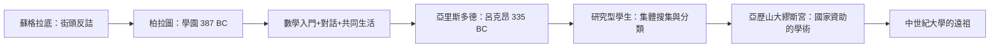

# 2.1 柏拉圖學院與蘇格拉底方法

## 蘇格拉底：不開班的學生殺手

西方的學生史，始於一個拒絕收學費的人。蘇格拉底（前470–前399）終生沒有辦學校，沒有課程表，沒有學費——他在雅典的市集、體育館與街角攔住年輕人提問。他的方法（後世稱為蘇格拉底方法，Socratic Method，或反詰法 elenchus）有三步：先請對方陳述一個常識性定義（例如「什麼是勇敢」），再以追問找出定義的反例與矛盾，最後使對方承認自己其實不知道——從而產生求知的動機。

《色諾芬回憶錄》與柏拉圖對話錄記錄了大量這種場景。例如《拉克斯篇》討論勇敢、《游敘弗倫篇》討論虔誠，對話都以無結論（aporia）結束。蘇格拉底的名言「我知道我一無所知」（出自《申辯篇》的轉述）正是這個方法的自我描述。

雅典當局無法容忍這個「使年輕人敗壞」的職業提問者。前399年，七十歲的蘇格拉底被五百人陪審團以褻瀆神明與敗壞青年之罪判處死刑，飲毒堇汁而死。他的死使「學生」獲得了一個強大的敘事：真理的追尋者可能被國家殺死——而這個死本身使柏拉圖寫下了《申辯篇》《克里同篇》《斐多篇》，成為西方教育文學的開山之作。

## 柏拉圖學院：有地址的哲學

蘇格拉底死後，柏拉圖（前427–前347）在雅典城外西北約一公里的地名為 Academos 的聖林（屬英雄阿卡德摩斯的園林，內有體育館）買下房產，約於前387年創辦學園（Academy）。這是西方最早有固定場所、固定社群與長期課程的教學機構——Academy 一詞從此成為「學術機構」的世界通用語，直到今天（如 Academy、Academia、學院）。

學園的運作特徵：

1. 數學為入門：傳說學園門口刻著「不懂幾何學者莫入」（ἀγεωμέτρητος μηδεὶς εἰσίτω）。柏拉圖認為數學是從感官世界轉向理念世界的訓練——這是「先修課程」概念最早的哲學化。
2. 對話與講授並行：亞里斯多德等記錄顯示，柏拉圖以講演（lecture）與對話（dialogue）混合教學；《蒂邁歐篇》等對話錄本身就是教學文本。
3. 共同生活：學園成員共同進餐、討論、研究，類似畢達哥拉斯學派的共同體傳統。
4. 長期化與制度化：學園延續了近九百年（直到529年東羅馬皇帝查士丁尼以異端為由關閉雅典哲學學校），其間誕生了歷任「學園掌門」（scholarch）的譜系——斯彪西波、克塞諾克拉底、波勒謨、克蘭托爾，直到懷疑派的阿凱西勞斯改弦易轍。

## 亞里斯多德：學生二十年

柏拉圖最著名的學生亞里斯多德（前384–前322）於前367年十七歲入學，在學園待了約二十年，直到柏拉圖去世。他從學生變成同事（可能講授修辭學），對老師的理念論提出系統批評（名言「吾愛吾師，吾更愛真理」源於後人對《尼各馬可倫理學》中相關段落的概括：柏拉圖是親愛的，但真理更親愛）。

這段師生關係建立了西方學術的一個核心規範：學生可以、甚至應該超越並推翻老師。與孔門的「述而不作」不同，亞里斯多德與柏拉圖在理念論、靈魂論、詩學上針鋒相對，而兩人都被後世同樣尊為大師。這條「批判性繼承」的路線，成為西方大學的隱性基因。

前335年，亞里斯多德在雅典城東的呂克昂（Lyceum，阿波羅呂克歐斯聖林中的體育館）自辦學園。因為喜歡在帶頂的柱廊（peripatos）邊走邊講，其學派被稱為逍遙學派（Peripatetic）。呂克昂的另一項創新是集體研究：亞里斯多德與弟子（如泰奧弗拉斯托斯）合作搜集動植物標本、城邦政制（據說收集了一百五十八部）——學生從「聽講者」變成「研究助理」，這是近代研究型大學的遠祖。

## 亞歷山大圖書館：學生的巨無霸實驗室

希臘化時期，學習的中心北移。托勒密王朝在亞歷山大城建立的繆斯宮（Mouseion，約前280年代）附有大圖書館，藏書據說達數十萬卷（古代記載在40萬至70萬卷之間）。歐幾里得、埃拉托色尼（測量地球周長）、阿基米德（曾通信）、希帕提婭（5世紀）先後在此工作或求學。這裡的「學生」更接近近代意義的研究生：在固定薪俸與免費膳宿下從事系統研究。

## 小結

希臘傳統為「學生」注入了兩個關鍵基因：以提問與反駁為求知的引擎（而非記誦師說），以及批判性繼承的規範（學生應超越老師）。當羅馬接管希臘，這套哲學教育被改造為另一種更實用的東西——為帝國培養演說家的修辭學校。那是下一節的主題。
