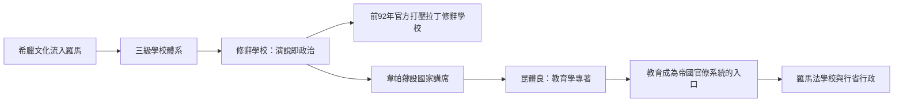

# 2.2 羅馬修辭學校與實用型學生

## 從希臘家教到拉丁學校

羅馬人征服希臘（前146年）之後，希臘文化反向征服了羅馬精英。詩人賀拉斯的名句「被征服的希臘征服了野蠻的征服者」（Graecia capta ferum victorem cepit）精準描述了這個過程。前三至二世紀，希臘俘虜成為羅馬家庭的家教：前168年，馬其頓國王珀爾修斯被俘，其圖書館與學者被帶到羅馬；著名的希臘學者如卡爾西迪烏斯的帕奈提烏斯（斯多噶哲學家）受西庇阿圈子禮遇。

羅馬的教育體系在此基礎上分為三級：

1. Ludi（小學）：讀寫算，約七至十二歲，教師（litterator）多為希臘或解放奴隸，地位低下。
2. Grammaticus（文法學校）：約十二至十五歲，教授希臘語與拉丁語的文學、詩歌、文法——這是「經典文本細讀」教育的起源。
3. Rhetor（修辭學校）：約十五歲起，培養公共演說與法律辯論能力。

## 修辭學校：為帝國製造演說家

修辭學校是羅馬學生的終點站，其存在理由只有一個：公共演說是羅馬政治的貨幣。沒有擴音器、沒有媒體，一個羅馬貴族的政治影響力直接等於他在元老院與法庭上的演說能力。西塞羅正是這個體系的完美產品與完美代言人。

前三世紀至前一世紀，羅馬的修辭學校經歷了一場政治鬥爭：西塞羅的老師之一、拉丁修辭學校的開創者 Lucius Plotius Gallus（約前93年開辦第一所拉丁語修辭學校）遭到傳統派的打壓——前92年，執政官瑪爾庫斯·喀西烏斯與克奈烏斯·多米提烏斯發布著名法令，譴責「新式學校」（指拉丁語修辭學校）教導年輕人「無所學而妄言」（qui nihiligerent discere, audaciae magisterium），下令關閉。這是文獻記載中最早的「教育官方審查」案例之一：政治當局害怕的是會說話的學生。

有趣的是，實用的拉丁修辭學校最終還是勝出，而希臘修辭學校則保持高端地位。到帝國時期，羅馬的學生流動形成穩定的路線：想在法律與政治上有所成就者赴雅典或羅德島學哲學與修辭；想學醫或醫學理論的赴亞歷山大。西塞羅年輕時赴雅典（前79年）聽哲學家斐洛與安提俄庫斯的課，又去羅德島跟隨阿波羅尼烏斯（Molon）修辭學——這條路線圖，正是後世「留學」的原型。

## 昆體良：第一位有工資的教授

羅馬對教育的最大制度性貢獻，是把教師變成國家公務員。韋帕薌皇帝（69–79在位）設立國家講席（cathedrae），為修辭學與文法學教師支付公帑薪水。昆體良（Quintilianus，約35–100）因此成為第一位領取國家薪俸的修辭學教授——他的《演說家教育》（Institutio Oratoria，約95年）是史上第一部完整的教育學專著。

昆體良的教育觀點至今仍屬先進：

- 反對體罰：「我反對對自由人使用鞭打，即使他已經懈怠與不聽話。」他主張以榮譽感與遊戲激勵學生。
- 重視幼兒教育：主張從嬰幼兒期就注意語言品質（奶媽的口音、同伴的用語）。
- 主張個別差異：教師應了解每個學生的天賦，「就像醫生觀察病人的體質」。
- 主張休息與遊戲：課間休息、讓兒童玩耍是必要的，如同土地需要休耕。

## 學生的社會結構

羅馬修辭學校的學生幾乎全是精英家庭的男性。塞涅卡在信中抱怨羅馬貴族為子女聘請的「裝飾性學者」與昂貴家教；小普林尼的信件記錄了他在比提尼亞省擔任總督時，地方議會為爭取教師待遇而來信的細節——教育資源的爭奪從地方到中央都是政治議題。

與此同時，另一類「學生」在社會底層流動：跟隨工匠學藝的學徒（apprentice）在作坊中透過觀察與實作習得手藝。這條手工藝學徒制在羅馬帝國崩潰後的歐洲延續下來，成為中世紀行會制度的基礎——正式學校教育與職業訓練的分流，從羅馬開始就已成形，並將持續到工業革命之後。

## 教育的帝國化

羅馬把教育變成了統治工具的一部分。拉丁文法學校培養了一批批能以標準拉丁文書寫公文、能在行省法庭辯護的官僚與律師；羅馬法學教育（如貝里圖斯的貝魯特法學校，三四世紀已是帝國東部的法學中心）直接為帝國供給法官與法學家。帝國不僅需要軍人與農夫，也需要能寫、能辯、能治理的學生。

## 小結

羅馬學生是「實用型」的：學習的目的不是求道，而是演說、訴訟與治理。國家開始給教師發薪水、開始管理課程——教育與權力的聯姻在羅馬完成。接下來的一千年，這條「教育即仕途」的路在中國被推向極致：科舉把讀書與做官的連結，變成了幾乎所有讀書人的人生軌道。那是第三章的主題。
