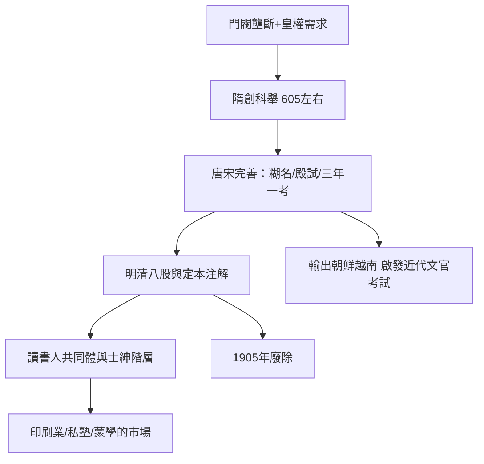

# 3.1 科舉：朝為田舍郎，暮登天子堂

## 為什麼需要科舉

隋唐之前，中國的選官制度是拼圖式的：漢代察舉（地方官推薦孝廉），魏晉九品中正制（中正官定品第）——後者迅速淪為門閥的工具，形成「上品無寒門，下品無勢族」的固化。隋文帝（581年起）開始以考試選官，隋煬帝大業年間設進士科（約605年前後），科舉的骨架成形。

制度的深層邏輯是政治的：皇帝需要一條繞過門閥的官僚供給線。考試選出的官員，其權力來源是皇帝與考試制度本身，而非家族——因此科舉既是教育制度，更是中央集權的工具。

## 學生的日常：寒窗的具體內容

科舉把「學生」變成了一種人生階段（事實上是半生）。一個讀書人要過的關卡在明代固定為：

1. 童試（縣試、府試、院試）→ 秀才
2. 鄉試（三年一次，省級）→ 舉人，取得做官資格
3. 會試（京師）→ 貢士
4. 殿試（皇帝親策）→ 進士，分三甲

考試內容以四書五經為範圍，宋代王安石改革後以經義取代詩賦，明代成化年間形成八股文格式（破題、承題、起講……八段定格）。學生的生活因此高度標準化：背誦經書原文與朱熹《四書章句集注》的官方注解、練習小楷、揣摩範文。

清代考棚的實物條件記錄在案：號舍寬約三尺、深四尺，考生自帶帳篷、食物與便桶，連考三場、每場三天。江南貢院有號舍兩萬餘間——這是世界歷史上最大規模的封閉考試場所。

## 真實的階級流動：多少寒門能上梯

「朝為田舍郎，暮登天子堂」是真實存在的現象，但比詩句暗示的要窄。何炳棣（Ping-ti Ho）一九六二年的經典研究《明清社會史論》（The Ladder of Success in Imperial China）統計明代進士的家世：約百分之五十來自前三代無功名的家庭（平民之家）；清代這一比例降至約百分之三十七。艾爾曼（Benjamin Elman）的研究則補充：能通過縣試的讀書人已是少數（因需多年脫產讀書），而錄取率極低——清末約有二百萬童生，三年一次的進士名額僅兩百餘人，錄取率約萬分之一。

因此科舉創造的不是「人人可及」的階梯，而是一個龐大的預備身分：童生、秀才、監生、舉人——數百萬人的期待、焦慮與自我認同懸在梯子的下半段。蒲松齡（本身是秀才，長期未中舉）在《聊齋》與自嘲文字中記錄了這種煎熬；《范進中舉》（《儒林外史》）是這個心理結構的文學定型。

## 制度的副產品：讀書人作為共同體

科舉的深遠影響超出了選官：

1. 文化整合：科舉指定的經典與注解（朱注四書自元代起為定本）使全帝國的讀書人共享同一套文本、術語與價值觀。這是中華帝國能長期維持文化統一的重要技術之一。
2. 士紳階層：考取功名者享有免役、見官不跪、地方公共事務話語權等特權，形成介於官與民之間的士紳階層，主導了地方書院、宗族、賑濟與水利。
3. 印刷與私塾產業：科舉需求直接餵養了宋代以降的印刷業（科舉用書、範文選本、類書）、私塾與蒙學教材（如《三字經》《千字文》——它們本身就是為了讓孩子早一天參加考試）。
4. 對鄰國的輸出：朝鮮（958年起）、越南（1075年起）、日本（一度仿行，主要影響律令制下的學問）先後引入科舉或類似制度。十八世紀，英國、法國的啟蒙學者（如伏爾泰）把科舉視為「以考試而非血統選官」的典範，影響了近代文官考試制度的論述（英國1855年起的公務員考試改革常引用此淵源）。

## 小結

科舉把「學生」制度化為通往權力的梯子，創造了世界歷史上最大規模的考試社會。但這個梯子有兩個結構性副作用：它使學習的目的高度單一化（考試成功而非探究），並將數百萬人的生命與一場考試綁定。當帝國內部的讀書人開始思考「國家興亡，匹夫有責」、不僅求個人功名也要求政治參與時，學生就走向了它的第二重身分——政治覺醒者。那是下一節的東林書院與太學生的故事。
