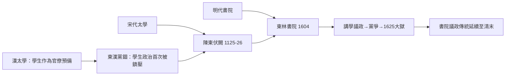

# 3.2 東林書院與太學生的政治覺醒

## 太學生：帝國的青年知識分子

漢武帝於前124年採納董仲舒、公孫弘的建議設立太學，置博士弟子員五十人——這是中國歷史上第一所中央官辦大學，學生入學後可以參加考試補官。到西漢末，太學生已增至三千人；東漢洛陽太學極盛時（質帝本初元年，146年前後）學生達三萬餘人，這是世界古代史上罕見的巨型學生群體。

龐大的太學生群體很快發現自己有政治用途。東漢桓帝、靈帝時期宦官專權，太學生與以李膺、陳蕃為首的士大夫官僚結盟，品評人物、抨擊時政（時稱「處士橫議」，太學中流行「天下模楷李元禮」等口號）。166年與169年，兩次黨錮之禍：李膺等被下獄處死，太學生被禁錮（不得做官），受牽連者逾百人。這是中國歷史上第一次官方對「學生政治」的大規模鎮壓——學生作為政治力量的存在，已被權力中心明確感知。

## 宋代太學與學生伏闕

宋代太學制度化程度更高（王安石三舍法：外舍、內舍、上舍，以考核升等）。靖康之難前後，太學生成為重要的政治聲音：1125–1126年，金兵南下，太學生領袖陳東兩度率太學生「伏闕上書」（直接到宮門請願），要求罷免宰相李邦彥、起用李綱，首次集結數萬軍民響應，宋欽宗被迫接受。陳東後來（1127年）被高宗處死，年僅四十二。太學生伏闕成為宋代的政治傳統，此後屢有發生。

## 東林書院：講學即議政

明代書院繼承了太學的議政傳統，而以東林書院最著名。1604年，被罷官的原吏部郎中顧憲成與高攀龍、錢一本等人，在無錫修復宋代楊時（龜山）講學的東林書院。顧憲成擬定的《東林會約》明言講學宗旨，其中最著名的一句話出於他為書院撰寫的對聯：

風聲雨聲讀書聲，聲聲入耳；
家事國事天下事，事事關心。

東林書院的運作是一套講會制度：每年一大會、每月一小會，江浙士人徒步赴會，講《四書》、論時政。它不是官學，也不直接出產科舉（雖然東林人科舉成績極佳），它的核心活動是把學術討論與政治批評接通——顧憲成明言：「官輦轂，志不在君父，官封疆，志不在民生，居水邊林下，志不在世道，君子無取焉。」

1606年後，東林人逐漸進入朝廷，與浙、齊、楚等黨爭論。1620年代，魏忠賢的閹黨掌權，東林與之對抗。1625–1626年，魏忠賢興大獄，左副都御史楊漣、左光斗、魏大中等「東林六君子」「東林七君子」相繼死於獄中（楊漣獄中以土囊壓身、鐵釘貫耳而死，遺有《絕筆》罵賊）；東林書院本身於1626年被詔毀。天啟七年（1627年）崇禎即位後翦除魏黨，為東林平反，重修書院。

## 為什麼學生走向政治

東林與太學生的現象提出一個結構性問題：為什麼這些本應專心應試的讀書人，一再走向政治冒險？答案有三層：

1. 制度的內在矛盾：科舉培養的價值觀是「以天下為己任」（《大學》的修身齊家治國平天下），但官僚體系又高度專制，使讀書人難有制度化的參與管道——於是伏闕、講學、結社成為僅存的出口。
2. 經濟與社交基礎：書院與講會提供了超越科舉的組織空間（同門、同年、同鄉網絡），印刷術（宋明刻書業）使政治評論得以流通（東林人物的文章與書院會語廣泛傳抄）。
3. 危機的催化：外患（宋之金兵、明之滿洲與農民軍）、宦禍、財政崩壞，使讀書人感到「不說」即是不忠。

## 清代的收編與遺產

清廷對書院議政高度警惕。雍正十一年（1733）雖准許部分書院存在，但明確納入官辦軌道（院長需官方聘任、經費官給）；乾隆時書院普遍變成科舉預備學校。議政的書院傳統在中國大陸沉寂了近兩百年，直到晚清：1890年代康有為講學的萬木草堂、梁啟超主持的時務學堂，再次把書院變成政治動員的基地——而這一次的學生運動，將在1919年五四運動中達到頂峰（第六章）。

## 小結

從東漢太學生到東林書院，中國讀書人反覆演示了一個模式：學生因為既有文化資本（識字、經典）又有組織空間（太學、書院、講會），天然容易成為政治批評的集結點；而權力對此的反應也一再相同——鎮壓、禁錮、收編。這個模式將在下一節的歐洲中世紀大學中，以完全不同的制度形式重演：在那裡，學生不僅議政，還一度僱傭了自己的老師。
