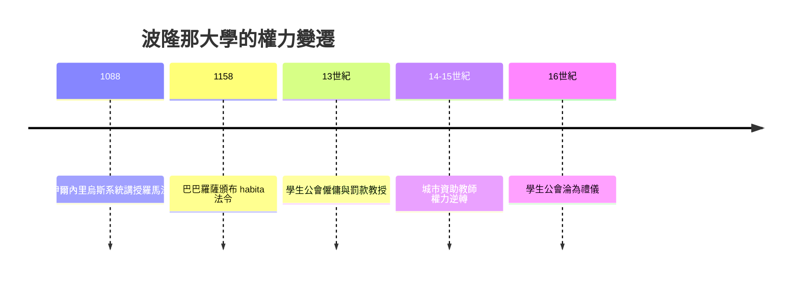

# 4.1 波隆那：學生僱傭教授的傳奇

## 十二世紀的法律復興

波隆那大學的誕生源於一場法律文獻的再發現。約1076年，波隆那的法学教师佩波（Pepo）開始講授重新被發現的《查士丁尼法典》與《學說彙纂》（Digest，533年查士丁尼命人整理的羅馬法大全，長期湮沒於西方）。到伊爾內里烏斯（Irnerius，約1050–1125）手中，對《學說彙纂》的系統註釋成為一門職業學問——他被稱為「法學的明燈」（lucerna iuris）。

為什麼是波隆那？三個條件：它是教皇與神聖羅馬帝國衝突的邊界城市，法律事務極其複雜；它是商業與十字軍交通樞紐，人流頻繁；意大利城市沒有巴黎式的主教控制傳統，法律教學相對自由。

而「學生」從哪裡來？答案是：成年男性。他們不是十八歲的少年，而是已經有職業身份的人——各地的公證人、法官助理、商人與貴族子弟，為了在快速商業化的意大利城市中取得法律資格而來。這些人已經是組織能力成熟的成年人，付得起錢，也懂得工會。

## 學生僱傭老師

波隆那的教學最初由教師（doctores）私人開課收費。學生們為了保障自身利益，組織起來，這就是 universitas 的起源——這個詞本義是「整體、公會」（拉丁文 universitas magistrorum et scholarium，教師與學生的公會），是一個中世紀的法人概念，如同商人公會或工匠行會。

波隆那的特殊之處在於：學生的公會（universitas scholarum）掌握了實際權力。13世紀的文獻顯示，學生公會的權力包括：

1. 聘任與解聘教授：教授與學生公會簽訂契約，議定薪水、開課時間、教學內容。
2. 罰款制度：教授上課遲到或提前下課會被罰款；跳過章節、佔用學生時間同樣罰款。教師若要離城（例如去外地講課）需先繳保證金。
3. 教授宣誓：教授就職前向學生公會代表宣誓遵守契約。
4. 學生對教師的評價：被稱為 denuntiationes（報告員）的學生負責記錄教師是否遵守契約條款。

外國學生另組「 Nations 」（民族團），按出身分為倫巴第、托斯卡納、羅馬（及阿爾卑斯山外）等團，各有代表，共同組成公會大會，選出校長（rector）——校長通常由學生擔任。

## 制度為何可能

學生掌權的制度不是抽象的權利，而是三個現實條件的產物：

1. 老師依賴學費：沒有國家或教會的固定薪俸，教師完全依賴學生繳費，談判籌碼天然在學生一邊。
2. 學生是成年人且有組織傳統：他們來自行會化的意大利城市社會，把行會的契約邏輯直接帶進學校。
3. 城市的默許：波隆那市政府認識到法律學校對城市聲望與經濟的價值（學生數以千計，帶來消費），也願意以「學生公會」的名義與教師、教會談判。

1158年，神聖羅馬皇帝腓特烈一世（巴巴羅薩）在隆卡利亞會議頒布《Authentica habita》法令，承認前往求學的學者受帝國保護，不得被地方政府隨意逮捕或課稅——這是「學術特權」（學生不受普通司法管轄的起源）的關鍵法律文本。它既保護了學生，也預示了後來的矛盾：特權的大學人與市民之間的衝突（如1229年巴黎大學罷課遷校）。

## 學生權力的衰落

學生的黃金時代沒有持續。14–15世紀，兩股力量改變了平衡：

1. 城市與教會開始直接資助教師（波隆那市政府14世紀起為部分教授支付薪水），教師不再完全依賴學費，談判地位逆轉。
2. 大學擴張後，未成年人比例上升（尤其是北方來的學生），公社式自治難以維持。

到16世紀，波隆那已被改造成教師與當局主導的大學，學生公會只剩禮儀性角色。但這段歷史留下了一個永久的可能性證明：大學可以由學生僱傭教師、校長可以由學生擔任——這個事實至今仍出現在每一本高等教育史的教科書中，作為「學生權力」的歷史先例。

## 小結

波隆那證明了：當學生是成年人、有錢、有組織，而教師依賴他們的學費時，學生可以成為大學的主人。這個模式的反面是巴黎——那裡的教師公會（而非學生公會）掌握了權力，並發展出另一套大學模型（碩士行會、教師控制）。兩個模型的競爭與混合，構成了歐洲大學史的底層張力。下一節我們看這些早期的歐洲大學生如何生活、遷徙與越軌。
