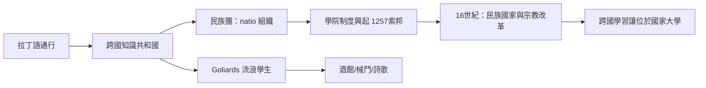

# 4.2 遊學學徒與拉丁語的知識共和國

## Goliards：大學之間的流浪者

12–13世紀的歐洲出現了一類奇特的學生：他們不屬於任何固定的學校，從巴黎到波隆那、從沙托魯到薩拉曼卡，輾轉於新興大學之間，有時讀書，有時乞討、賣唱、寫詩。他們被稱為 Goliards（戈利亞德，詞源可能與歌利亞巨人或 gula 暴食有關）。

戈利亞德留下了一部真實的文學遺產：13世紀初編成的《布蘭詩歌》（Carmina Burana，藏於巴伐利亞的本篤會布倫修道院，1803年被發現）。其中最著名的一首《我被命運的車輪碾過》（O Fortuna，20世紀被卡爾·奧爾夫譜曲而廣為人知）正是戈利亞德的作品。他們的詩歌主題包括：對命運的嘲弄、對教會腐敗的諷刺、酒館與愛情、對學習本身的厭倦——Archipoeta 的《我燃燒的心》中有著名的自白：「我拋下書本，投入爭論」（Meum est propositum in taberna mori——「我願意死在酒館裡」）。

戈利亞德不是傳說，而是有姓名與文獻的群體：如「漂流學者」Venantius Fortunatus 的後繼者、烏格斯·德·奧爾良（Hugues d'Orléans，綽號 Primas，12世紀）與上述 Archipoeta。他們的生活方式展示了早期大學的鬆散結構：沒有學籍制度、沒有國籍限制、沒有固定的修業年限——一個學生可以聽了幾個月課就離開，換一所大學再聽。

## 拉丁語：跨國學籍的技術基礎

讓這種流浪成為可能的技術，是拉丁語。中世紀大學的教學、教材（手抄本）、考試與辯論全部使用拉丁語；從波蘭到葡萄牙，一個學生可以在任何大學聽懂課程。這造成了一個獨特的現象：歐洲擁有了一個跨國的知識共同體（respublica literaria，文學共和國）——學生與學者的認同先於民族認同。

大學的國際性有硬數據可證：巴黎大學在13–14世紀的外國學生比例極高，英國人、德國人、義大利人、北歐人各有自己的「民族團」（natio），在1358年的紀錄中巴黎大學分為法蘭西、諾曼底、皮卡第、英格蘭四個民族團（英格蘭團包含所有「北方」學生，包括德意志與斯堪的納維亞）。1364年成立的海德堡大學、1386年成立的神聖羅馬帝國的第一所大學，章程直接抄自巴黎。

這個跨國體系因為兩個原因而終結：

1. 民族國家的興起：15–16世紀，各國王室開始控制大學（法國國王、英國國王、帝國選侯對大學的任命與資助），拉丁語的地位在16世紀宗教改革與人文主義中被本國語言侵蝕（路德的德語、拉伯雷的法語）。
2. 宗教分裂：宗教改革後，天主教與新教的大學互相排斥，學生的跨國流動被信仰邊界切斷。

## 學生的真實生活

中世紀大學生的日常有大量文獻留存：

- 住：多數學生住租屋（collegia，學院制度14世紀起在巴黎、牛津興起，最初是給貧困學生的宿舍，如1257年羅伯特·德·索邦創立的索邦學院）。
- 食：大學城有專門的酒館與餐飲；戈利亞德詩歌與市政檔案都顯示酒館衝突頻繁。
- 打架：牛津1242年與1289年的學生與市民械鬥、1355年的聖斯歌拉斯提卡日暴動（St Scholastica Day riot，數十名學生死亡，結果牛津大學獲得對市民的長期懲罰性讓步，包括每年象征性罰款，持續至1826年）——這是「學生特權 vs 市民」結構性衝突最著名的案例。
- 讀書方式：以聽講（lectio，教師逐句讀並解釋標準文本）與辯論（disputatio）為核心。辯論分為預設正反兩方的爭論（quaestio disputata）與自由辯論（quodlibet），形式化的反駁訓練是中世紀大學對西方思想最重要的方法遺產。

## 從流浪到學院

## 小結

中世紀歐洲的學生既是國際主義者（拉丁語知識共和國的公民），也是城市中最難管理的暴烈群體（酒館與械鬥）。他們的雙重性——求知的流浪者與特權的斗士——將在19世紀的德國大學（Wanderjahre、Burschenschaft）與20世紀的學生運動中一再重演。但在學生再次成為政治力量之前，有一個更根本的制度發明等待完成：把全國的兒童都變成學生。那是普魯士與現代國民教育的故事（第五章）。
