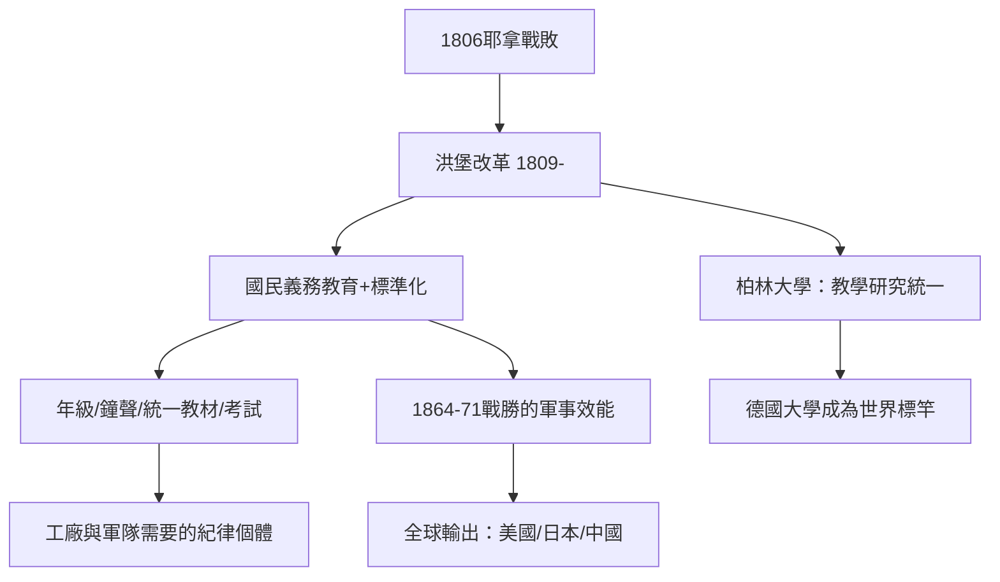

# 5.1 年級、鐘聲與統一教材：普魯士模式的發明

## 戰敗之後的教育革命

1806年10月，普魯士在耶拿-奧爾施泰特被拿破崙徹底擊潰，柏林陷落，王國幾乎解體。費希特在佔領下的柏林發表《對德意志民族的演講》（1807–1808），把民族復興的希望寄託於國民教育。這場恥辱成為普魯士教育改革的直接動機。

改革的執行者是威廉·馮·洪堡（Wilhelm von Humboldt），1809年任普魯士內政部教育司長。他在短短一年多任內推動的兩項立法（包括1810年的考試制度規定與關於學校與課程的規劃），奠定了現代國民教育的骨架。

## 標準化學生的發明

普魯士模式的核心是把學生標準化。其組成元件，大多並非洪堡首創，而是由他整合成系統：

1. 年級制（grade system）：學生按年齡與進度編入固定年級，統一升級。這在1717年腓特烈·威廉一世的義務教育令與後續條例中已有雛形（普魯士1717、1763年腓特烈大帝重申義務教育，是歐洲最早的義務教育立法之一）。
2. 鐘聲與課表：一天的學習被切成固定時段，由鐘聲與鈴聲切割。這個紀律技術在18世紀的軍隊與修道院中已存在，被學校借用以訓練服從與守時。
3. 統一教材與課綱：國家規定教科書與教學內容。
4. 師資培訓與證照：1810年規定中學教師需通過國家考試取得資格；此後師範學校（Normalschule，本義「標準學校」）大量設立。
5. 考試與文憑：以 Abitur（中學畢業考試，1788年普魯士首次規定）作為進入大學的標準資格。

## 福祿貝爾與幼兒的收編

普魯士的發明不僅針對學齡兒童。1837年，圖林根的教師福祿貝爾（Friedrich Fröbel）在巴德布蘭肯堡創立了第一所「幼兒園」（Kindergarten，字義「兒童的花園」），以遊戲、手工與「恩物」（Spielgabe，一套設計化的教具）教育幼兒。1840年他正式命名 Kindergarten。1848年革命後，普魯士當局一度（1851年）禁止幼兒園，視其為具有社會主義傾向——這顯示當局對「教育組織」的政治敏感。

## 為工廠與軍隊準備的人

普魯士模式的意識形態基礎，是對「紀律個體」的培養。歷史與社會學的研究（如 Michael Gove 2010年的著名概括，雖其論述有爭議）常指出：年級、鐘聲、統一教材、標準考試，與工廠的流水線、軍隊的操練在形式上高度同構——不是說學校「就是」工廠，而是說它們共享同一個時代對「可管理的集體」的需求。工業革命需要守時、識字、能讀指令、能服從工序的工人；軍隊需要經過操練的士兵；而國家需要可徵召、可徵稅、可統計的人口。

普魯士模式的軍事效能有史實佐證：1864、1866、1870–71三次戰爭（對丹麥、奧地利、法國）的連勝，被普遍歸功於普魯士軍官團與後備役制度，而後者的基礎是全民義務教育（能讀操典、地圖、指令的士兵）。1870年後，勝利的普魯士成為世界教育改革的參觀對象：美國（1870–1910年代，Horace Mann 早於1843年已考察普魯士並大力推崇）、日本（1872年學制，明治政府聘請大量普魯士顧問，如毛利能範與 Hermann Roesler）、中國（清末學制，1904年《奏定學堂章程》直接參考日本）都引進了普魯士模式。

## 洪堡的另一面：大學的自由

值得注意的是，洪堡本人並非單純的紀律工程師。1810年他創辦柏林大學（今洪堡大學）時提出的大學理念是：教學與研究統一（Einheit von Lehre und Forschung）、學術自由（Lehrfreiheit，教師的自由；Lernfreiheit，學生的選課自由）、大學不應是職業培訓所。他主張「國家必須避免讓一切事情都以國家利益為出發點」的大學觀——學術應該在自由的氛圍中追求真理，這個理念成為19世紀德國大學成為世界學術中心（柏林、哥廷根、海德堡、萊比錫）的基礎，並經由留學德國的美國學者（如 Charles Eliot 改造哈佛）傳入美國，孕育了研究型大學。

## 小結

普魯士模式把「學生」從少數精英擴展到全體兒童，是教育史上最大的擴容。但它同時把學生變成了可管理的標準件：同樣的年級、同樣的教材、同樣的考試。這個矛盾——擴容與標準化是一體兩面——將在20世紀被反复挑戰，其中最深的挑戰之一來自長期被排除在外的另一半人口：女性。那是下一節的主題。
