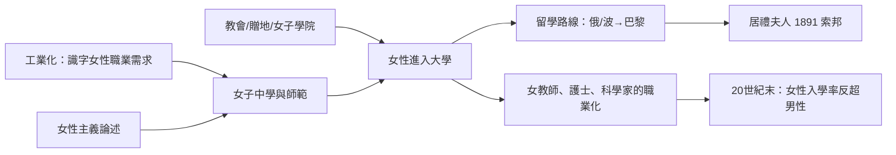

# 5.2 女性學生的艱難破壁

## 為什麼女性被排除

19世紀中葉，當普魯士模式正在把男孩標準化為國民時，女性在多數國家仍被排除在大學與多數正規教育之外。理由的清單長而穩定：女性體弱、不宜用腦（哈佛醫生 Edward Clarke 1873年的《Sex in Education》斷言女性受高等教育會損害生育能力）；女性不需要職業；女大學生會擾亂男學生。

但三股力量正在鬆動這道牆：工業化創造了需要識字女性的職業（教師、護士、文員）；女性主義思想（Mary Wollstonecraft 1792、John Stuart Mill 1869《婦女的屈從地位》）提供了論述武器；而女性自身用行動打開了缺口。

## 破壁的關鍵案例

美國：奧柏林學院1837年率先招收女性；1841年第一名女性獲得美國學士學位（Oberlin 的 Catherine Brewer）。州立大學隨後跟進。1862年《莫里爾法案》（Morrill Land-Grant Act）設立的贈地大學多採男女同校，客觀上大規模打開了女性入學的大門。

俄羅斯與東歐：1860年代改革期間，俄國開辦了女性高等課程，1878年聖彼得堡的 Bestuzhev Courses 正式開課。波蘭、烏克蘭地區的女學生被迫流動——其中最著名的一位，是瑪麗亞·斯克沃多夫斯卡。

居禮夫人：她是女性留學生歷史最著名的例子。瑪麗亞1867年生於華沙（當時屬俄羅斯帝國），波蘭大學不收女性，她與姐姐布羅尼亞參加了地下「飛行大學」（Flying University，1885年前後），並靠做家庭教師賺錢供姐姐先赴巴黎。1891年，24歲的她登上開往巴黎的火車，進入索邦攻讀物理。1893年以第一名取得物理學士，1894年再取數學學士（第二名）。1895年與皮埃爾·居禮結婚，1903年與丈夫及貝克勒爾共獲諾貝爾物理學獎，1911年再獲化學獎——至今仍是唯一在兩個不同科學領域獲諾貝爾獎的人。她的巴黎求學是「女性為了讀書必須出國」這個19世紀常態的最輝煌註腳。

英國：1869年劍橋的 Girton 學院（Emily Davies 創立）成為英國第一所女子學院；牛津的 Lady Margaret Hall（1878）與 Somerville（1879）隨後。但女性長期只能聽課、不能取得學位——劍橋女性直到1948年才獲得完整學位資格。倫敦大學1878年起對女性開放學位，是英國第一所這樣做的大學。

法國：1880年後法國法律逐步允許女性參加中學會考與進入大學；1900年代巴黎已是歐洲女性留學的主要目的地。

日本與中國：日本1872年學制在法律上男女均可入學，但女子高等教育的實質發展在20世紀初（津田梅子創辦的女子英文學校，1900年）。中國1895年後出現教會女學與自辦女學堂（1898年經正女學），1907年清政府頒布《女子學堂章程》；1920年北京大學首次正式招收女生入學旁聽，成為中國公立大學男女同校之始。

## 破壁的驅動結構

## 長期結果

女性入學的長期曲線是本節最有力的證據：20世紀下半葉，先進國家的高等教育出現性別反轉——美國自1980年代初、經合組織多數國家自1990年代起，女性占大學生的比例超過男性；到2020年代，OECD國家25–34歲擁有高等教育學位的女性比例普遍高於男性十個百分點以上。19世紀被認為「不宜用腦」的性別，如今是全球大學的多數。

## 小結

女性學生的破壁史證明：教育的性別壟斷不是自然律，而是制度的選擇；當經濟需要、論述準備與個人行動（如居禮夫人那班開往巴黎的火車）三者匯聚，牆就會倒。牆倒之後，學生的政治潛能開始在全球釋放——1919年的北京，一群年輕人將證明「學生」可以是一個改變國家命運的集體身分。
