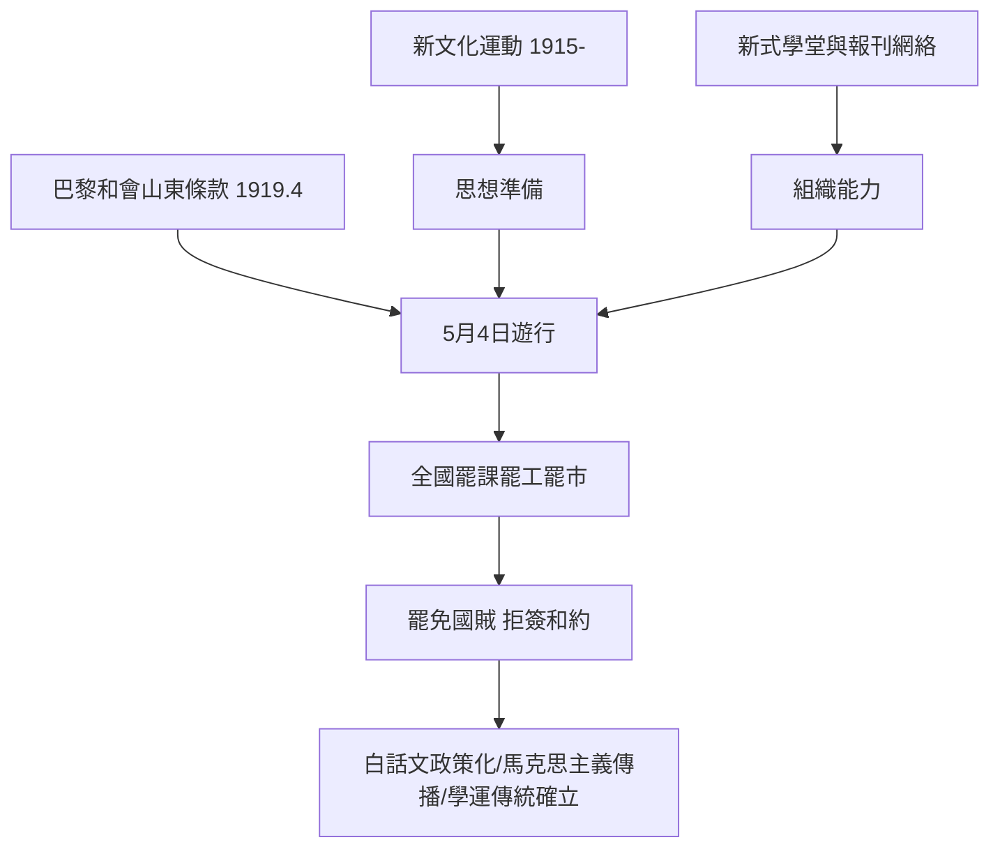

# 6.1 五四運動：學生成為政治力量

## 巴黎的壞消息

1919年5月初，中國知識界的期待與巴黎和會的現實相撞。中國以戰勝國身分出席和會，要求收回德國在山東的權益；但4月30日，美、英、法三國會議決定將德國在山東的權益轉讓給日本——威爾遜的「十四點」與民族自決的承諾在東亞破產。消息於5月1日至2日經留法學生與新聞界傳回北京。

北京的青年早有準備。自1915年《新青年》創刊（陳獨秀主編）以來，新文化運動已在北大醞釀了四年：白話文、科學與民主的口號、對舊禮教的批判。北京大學（校長蔡元培1917年就任後實行思想自由、兼容並包）集中了陳獨秀、胡適、李大釗、魯迅等新派人物，學生社團（如國民雜誌社、新潮社）與校外報紙構成了動員網絡。5月3日晚，北大法科禮堂的學生大會決議：通電巴黎代表拒簽和約、通電全國、次日遊行。

## 5月4日：事件本身

5月4日下午，北京十三所學校約三千名學生齊集天安門，遊行至東交民巷使館區受阻後轉往趙家樓曹汝霖（交通總長，親日派）住宅。學生翻牆入宅，痛毆章宗祥（駐日公使），火燒曹宅。軍警逮捕學生三十二人。

此後兩個月，事件演變為全國性運動：北京學生罷課、通電各地；6月3日起大規模逮捕學生，激起上海工人罷工（6月5日起，六七萬工人參與，中國歷史上第一次以政治為目標的大規模工人罷工）、商人罷市；運動中心的口號是「外爭主權，內除國賊」。6月10日，曹汝霖、章宗祥、陸宗輿被免職；6月28日，中國代表拒簽凡爾賽和約——這是近代中國第一次以民意迫使政府改變外交決策。

## 學生為什麼能動員全國

五四的成功不是偶然，而是三個條件的匯合：

1. 組織網絡：新式學堂與大學（清末新政後已遍布各省）、學生會、同鄉會、報紙與電報（學生的通電迅速傳遍各省），構成了前網路時代的動員系統。
2. 思想準備：四年新文化運動提供了語言與正當性（「德先生」「賽先生」、反帝反舊禮教），使「學生上街」在知識界內部獲得高度共識。
3. 權力真空：北洋政府正陷於南北分裂與派系內鬥，鎮壓能力與合法性都不足。

## 五四的長期效應

1. 馬克思主義傳播：李大釗自1918年（〈庶民的勝利〉）起介紹十月革命與馬克思主義，五四後傳播加速；1920年共產主義小組在上海、北京成立，1921年中國共產黨成立——早期領導人（陳獨秀、毛澤東、周恩來、鄧中夏等）多直接參與或深受五四影響。
2. 白話文的教育化：1920年北洋政府教育部通令小學國文課改用白話文——五四的語言革命在一年內變成官方教育政策。
3. 學生運動的傳統確立：學生作為「先鋒」的政治定位被寫入此後中國政治的腳本（1925年五卅、1935年一二九、1976年四五、1986與1989年學潮）。國民黨與共產黨的青年組織都以五四為精神源頭。
4. 亞洲的連鎖反應：1919年3月1日的朝鮮三一運動（二百萬人參與、數千人死傷的獨立運動）先於五四；印度1920年代的不合作運動、埃及1919年革命同屬一戰後民族自決浪潮——1919年因此被史家稱為「全球反抗之年」。

## 小結

五四證明了：在一個傳媒與教育網絡存在的社會裡，學生可以成為國家的「神經系統」——最先感知刺激、最先反應、帶動其他群體。但它也預示了此後一個世紀的緊張：當權者對學生運動既恐懼又收編。學生作為政治力量的下一個傳奇，發生在另一種極端條件下——一所戰火中流亡的大學，和一群在泥地裡聽課的學生。
