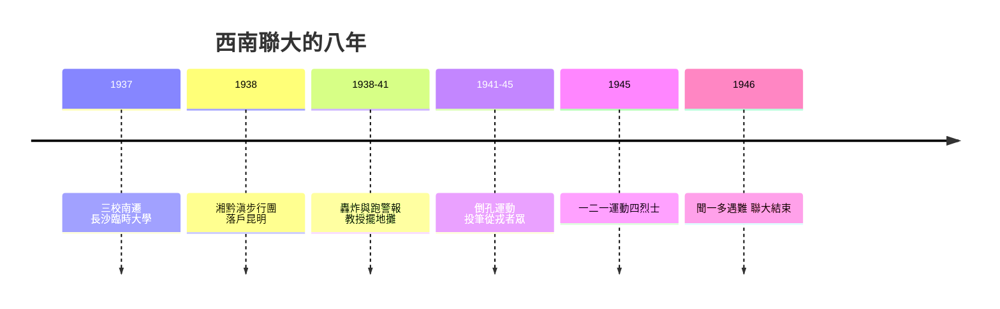

# 6.2 西南聯大：戰火中的講堂

## 從長沙到昆明

1937年7月盧溝橋事變後，平津淪陷。8月，國民政府教育部決定將北京大學、清華大學、南開大學合併南遷，先在長沙組成國立長沙臨時大學（1937年11月1日開學——這一天後來成為西南聯大的校慶日）。1938年武漢告急，學校再度西遷昆明，4月改稱國立西南聯合大學。

西遷本身是一次壯舉：一部分師生乘船經香港、越南入滇；另一部分組成「湘黔滇旅行團」，由聞一多、黃鈺生、曾昭掄、李繼侗等教師率領，1938年2月至4月，兩百餘名師生徒步約一千六百公里（歷時六十八天）穿過湘西、貴州山地抵達昆明——被稱為「世界教育史上的長征」。

## 泥地裡的講堂

聯大的物質條件極端匱乏。校舍由建築學家梁思成、林徽因夫婦設計，因經費一再刪減，最終除圖書館與兩座食堂使用瓦頂外，教室是土牆鐵皮頂，學生宿舍是土牆茅草頂。雨季鐵皮頂被雨點打得轟鳴，教授不得不停課，學生在筆記上寫下「靜坐聽雨」。圖書館座位不足，學生搶座；夜間在茶館讀書成為昆明一景（昆明市場的茶館成了公共自習室，被稱為「泡茶館」）。

物資匱乏下教授的清貧有據可查：聞一多刻章補貼家用，華羅庚一家住牛圈樓上，吳大猷擺地攤賣舊物。日軍空襲頻繁（1938–1941年昆明屢遭轟炸），師生「跑警報」成為日常——聯大學生汪曾祺後來寫有著名的散文〈跑警報〉，記錄防空警報下師生抱著講義疏散到郊外、警報解除再回來上課的場景。

## 為什麼聯大成功了

一所戰時拼湊的流亡大學，培養出後來兩位諾貝爾獎得主（楊振寧、李政道，1957年同獲物理獎，兩人都是聯大學生）、一位兩彈一星元勳群體（鄧稼先、朱光亞、王希季等八位聯大校友獲「兩彈一星功勳獎章」，占獲獎者四分之一以上）、上百位兩院院士。聯大的成功可歸納為幾點：

1. 師資密度空前：三校的著名教授集中一堂（陳寅恪、馮友蘭、金岳霖、聞一多、朱自清、沈從文、錢穆、吳宓、陳省身、周培源、吳大猷等）。同一門課常由幾位大師各開一班，學生可以自由旁聽比較。
2. 通才教育與自由選課：聯大實行學分制，文理科互選，大一不分系；楊振寧回憶他在聯大打了極紮實的物理與數學基礎，同時讀了大量文史。
3. 教授治校與學術自由：聯大由三校長（蔣夢麟、梅貽琦、張伯苓）組成常務委員會，實際校務由梅貽琦主持；教授會對重大事務有發言權。儘管處於戰時，聯大仍保持講學的自由氛圍——國民黨試圖推行的黨義課程與思想控制受到師生軟性抵制（1941年前後的「黨義課事件」是著名案例）。
4. 學生的使命感：國難使學習本身成為救國的方式——「讀書救國」的信念使聯大學生在空襲與飢餓中仍維持高強度的學術訓練。同時聯大也是學運重鎮：1941年「倒孔運動」、1945年一二一運動（昆明學生反內戰，四烈士死難，其中潘琰、李魯連、于再、張華昌均與聯大相關）都發生於此。聞一多1946年7月15日在昆明被特務暗殺，成為戰後知識分子悲劇的象徵。

1946年5月4日，西南聯大結束，三校復員北返。昆明留下的國立昆明師範學院繼承其校產。聯大八年（1937–1946）共培養約八千名學生，畢業約三千八百人。

## 聯大的啟示

西南聯大常被引用為「大學精神」的證據，但更準確的解讀是制度的證據：物質極端匱乏時，決定教育品質的是師資密度、學術自由與學生動機三個非物質變數。聯大證明：鐵皮屋頂不會毀掉教育，而思想控制會（聯大在國民黨壓力下仍維持自由，這正是它與同時期其他流亡大學的差別）。

## 小結

聯大是「學生」這個身份最動人的註腳之一：在國家幾乎不存在的狀態下，一群師生以自組織的方式維持了文明的傳承。它也預示了戰後學生的兩面性：既是學術傳承者，也是政治反抗者。下一章，我們轉向1960年代全球學生的集體爆發——那一次，反抗的對象不只是侵略者，而是整個成熟的消費社會。
