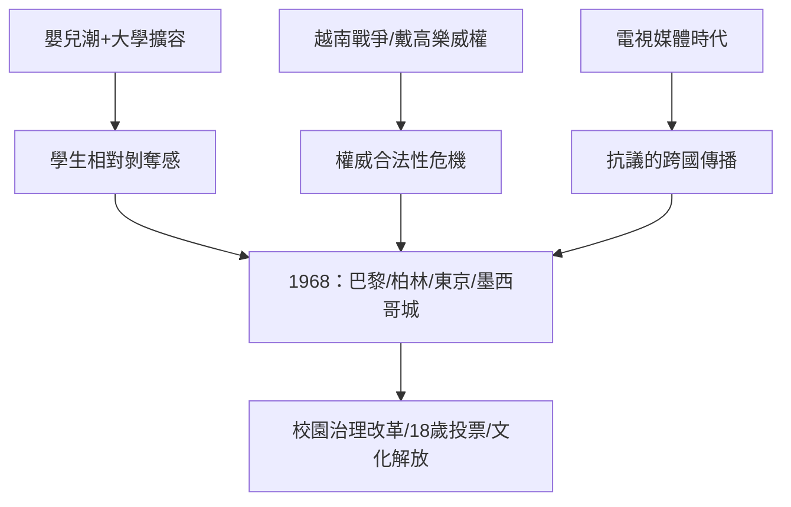

# 7.1 法國五月風暴與美國反戰學潮

## 大學擴容的爆炸前夕

1968年的法國有兩個背景數字：戰後嬰兒潮一代在1960年代中期湧入大學，法國大學生從1958年的約17萬人增至1968年的約51萬人；大學設施與教學方式仍是精英時代的遺產（大講堂、教授獨講、缺少輔導）。楠泰爾新校區（1964年啟用，服務巴黎西郊工業區的工人子弟與中產子弟）成為矛盾最先爆發的地方。

1968年3月22日，楠泰爾學生（領導者包括後來的社會學家丹尼爾·科恩-本迪特，Danny Cohn-Bendit）佔領行政樓，抗議被捕學生與性別管束（男女宿舍不得互訪），提出對大學的全面批判。校方關閉楠泰爾校區，把矛頭引向索邦——5月3日，巴黎警察進入索邦逮捕學生，引爆全巴黎。5月6日起，街頭巷戰（拉丁區的路障）、催淚瓦斯、每天數萬至數十萬人的示威；5月13日，近百萬人的大遊行，工會宣布總罷工；5月中下旬，法國約七百萬至一千萬工人罷工，全國癱瘓。戴高樂一度秘密飛往西德巴登巴登的軍事基地（5月29日），確認軍隊忠誠後於5月30日宣布解散國會、提前大選——6月底戴高樂陣營以壓倒性多數獲勝，運動退潮。

學生的牆上標語成為時代的名片：「禁止禁止」（Il est interdit d'interdire）、「老闆需要你，回工廠去」（Sous les pavés, la plage——「鵝卵石下面是沙灘」，撬起路障石塊發現沙子，象徵秩序之下的自由）、「讓想像力奪權」（Soyons réalistes, demandons l'impossible——「讓我們現實點，要求不可能的事」）。

## 美國：從校園到白宮的反戰

美國學潮的引爆點是越南戰爭（1955/1965美軍大規模介入–1973撤軍）。學生的政治化經歷了幾個階段：

1. 1960年代初：民權運動（1960年2月1日北卡 Greensboro 四名黑人學生的午餐櫃檯靜坐引發全國連鎖；1964年伯克萊加州大學的言論自由運動 Free Speech Movement，Mario Savio 領導，學生抗議校方禁止在校園從事政治活動——這是美國戰後第一場大規模校園運動）。
2. 1965年起：反越戰運動升級（1965年4月華盛頓首次大規模反戰遊行；學生非暴力協調委員會 SNCC 與學生爭取民主社會組織 SDS 是組織骨幹，SDS 的《休倫港宣言》1962年提出「參與式民主」）。
3. 1970年5月4日：肯特州立大學慘案——俄亥俄州國民兵在肯特州立大學向反戰示威學生開槍，四名學生死亡、九名受傷。隨後全美數百所大學罷課，約四百萬學生參與抗議；攝影師 John Filo 拍下的 Mary Ann Vecchio 跪在死難學生屍體旁的照片成為時代影像。

學潮的直接政治後果有限（美軍1973年撤出越南的主因是軍事與財政），但文化後果深遠：18歲投票權（1971年第26修正案，口號「old enough to fight, old enough to vote」）、大學治理的學生參與、課程的去西方中心化、以及「權威」這個詞本身的貶值。

## 共同的結構

法國與美國的學潮相隔一個月，共享三個驅動條件：

1. 人口與擴容錯位：嬰兒潮進入大學，教育系統沒有跟上，學生的相對剝奪感（教育承諾與現實的落差）成為燃料。
2. 權威的合法性危機：戴高樂主義與越戰政府都面臨道德破產——學生是最少利益牽掛、最多文化資本、最願意上街的群體。
3. 媒體的放大：電視把街頭巷戶與校園槍聲傳進每個客廳，抗議本身成為媒體事件，形成跨國模仿（1968年德國、日本東京大學安田講堂事件、墨西哥 Tlatelolco 大屠殺——1968年10月2日墨西哥軍警在特拉特洛爾科廣場屠殺學生示威者，死亡人數至今有爭議，官方數字數十、研究者估計數百）。

## 小結

1968年證明了學生的最大規模政治能量，也證明了它的邊界：可以讓政府震動、讓文化轉向，但難以直接奪取權力。此後，學生的政治角色從「革命先鋒」逐漸轉向「亞文化與身分政治」（下一節），而高等教育本身則朝著另一個方向加速——大眾化、收費化、債務化。
