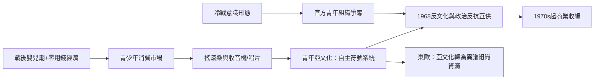

# 7.2 冷戰學生陣營與青年亞文化

## 被意識形態瓜分的青年

1960年代的學生反抗並非一個統一的運動，而是冷戰兩大陣營爭奪「青年」這個新政治資源的戰場。蘇聯陣營的國際學生組織（國際學生聯合會，IUS，1946年成立於布拉格）與西方陣營對應的世界學生大會（International Student Conference，1950年成立）互相攻擊對方為「共產黨御用」與「帝國主義工具」。學生組織的國際會議成為冷戰意識形態鬥爭的縮影。

但真正的青年文化，並不在這些官方組織裡誕生，而在唱片、電台與街頭。

## 搖滾樂：青年的第一部自主媒體

1950年代中期，搖滾樂在美國誕生（1954年 Bill Haley 的〈Rock Around the Clock〉、1955年 Chuck Berry、1956年貓王）。它的革命性在於經濟結構：戰後嬰兒潮一代首次擁有可支配的零用錢，唱片公司發現了「青少年市場」這個全新品類——青年第一次作為獨立的消費者與文化生產者存在。

技術驅動的傳播：電晶體收音機1954年上市，攜帶化使音樂脫離家庭客廳；45轉唱片與黑膠專輯使青年的音樂選擇獨立於父母。1960年代的傳播節點是：披頭四（1964年登陸美國，Ed Sullivan 秀吸引約七千三百萬觀眾）、Monterey（1967）與伍德斯托克音樂節（1969年8月，四十餘萬人）。

青年亞文化的政治性不必通過宣言表達：垮掉的一代（1950年代，Kerouac 1957年《在路上》）、嬉皮（1965年舊金山 Haight-Ashbury 社區起）、1968年巴黎的情境主義口號——它們對消費主義與技術官僚體制的批判，與校園裡的政治反抗互相供血。社會學者 Theodore Roszak（1969《The Making of a Counter Culture》）把這個現象命名為反文化。

## 東方陣營的青年問題

冷戰的另一邊，青年的控制與失控同樣劇烈。蘇聯與東歐以共青團（Komsomol，1926年成立）與少先隊組織青年；中國以紅衛兵動員青年——毛澤東1966年8月起在天安門檢閱的紅衛兵總計上千萬人次，這是歷史上最大規模的青年政治動員之一，其破壞後果（武鬥、抄家、對知識分子與文物的摧殘）有充分檔案與回憶錄證據。

但對青年的文化控制終究有缺口：東歐的搖滾與藍牛仔褲成為地下身分標記；捷克斯洛伐克1976年的「塑化人」案——搖滾樂隊 Plastic People of the Universe 成員受審——直接促成《七七憲章》（1977年，哈維爾等起草）的誕生，證明亞文化空間可以轉化為政治異議的組織資源。1989年東歐革命的街頭主力正是二三十歲的年輕人。

## 亞文化的商業化收編

1970年代起，青年亞文化被消費工業系統性收編：搖滾成為最大宗的文化商品之一、牛仔褲從反叛符號變成全球標準服飾、punk（1976–77年倫敦與紐約）的反商業姿態在兩年內被唱片工業商品化。伯明翰學派的亞文化研究（Stuart Hall、Dick Hebdige 1979《Subculture: The Meaning of Style》）提供了分析框架：亞文化透過風格符號完成對主流的象徵性抵抗，而主流則透過收編消解抵抗。

## 小結

1960年代的遺產有二：一是青年被承認為政治與文化的主體；二是亞文化與商業、政治的複雜三角關係被制度確立——此後每一次青年浪潮（hip-hop、街舞、電競、vlog）都在這個三角中運作。而高等教育本身，在學潮塵埃落定後繼續其大眾化進程，並孕育出一個新的學生形象：背著學貸的教育消費者。那是第八章的主題。
