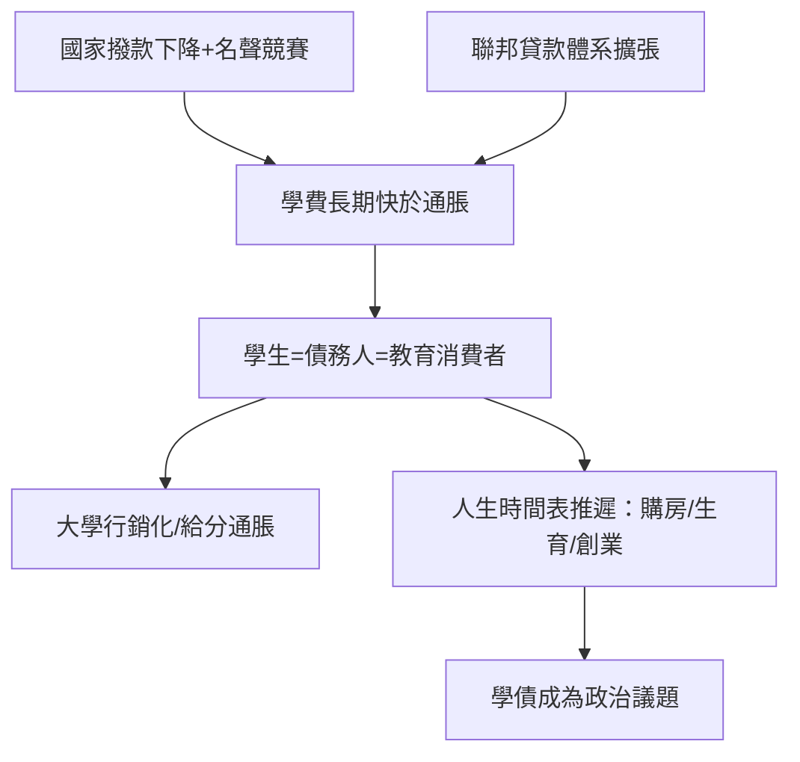

# 8.2 學生貸款：教育消費者的誕生

## 學費為什麼漲

二戰後，美國以《退伍軍人權利法》（1944，約780萬退伍軍人受惠，其中約220萬人進入大學）開啟了聯邦資助高等教育的傳統；1965年《高等教育法》（Higher Education Act）建立聯邦助學金（Pell Grants，1972年設立）與貸款體系。1970年代以前，公立大學學費對多數家庭是可負擔的（加州大學系統長期近乎免費）。

轉折發生在1980年代。兩個結構性因素使學費開始長期快於通脹上漲：

1. 國家退卻：1970年代末的滯脹、1981年里根上台後的減稅與福利緊縮，使各州對公立大學的撥款占比持續下降。加州大學的州撥款占營運預算比例從1970年代的約四至五成，降至2010年代的約一成；公立大學學費在1990–2010年間翻倍以上。
2. 成本病與競賽：經濟學者 William Baumol 的「成本病」理論（服務業生產率難以提升，工資卻隨整體經濟上漲）部分解釋了大學成本；但更強的驅動是「名聲競賽」——大學以設施、師生比、行政編制與排名互相競爭，而這些成本最終轉嫁學費。聯邦貸款的可用性本身也被研究者（如 Bennett 假說，1987年時任教育部長 William Bennett 提出）指為推高學費的因素：錢袋越深，學費越敢漲。

## 學債的量化

結果是美國學生貸款的歷史性累積：截至2023–2024年，美國學生貸款總餘額約1.6–1.7兆美元，債務人約四千三百萬人；平均每位學士畢業生的債務約三萬美元上下（私立與研究生更高，法學、醫學畢業生常超過二十萬美元）。學生貸款成為僅次於房貸的第二大消費信貸類別。

英國1998年引入學費（2012年上調至每年9000英鎊），英格蘭畢業生平均債務約4.5萬英鎊，居已開發國家前列。澳洲1989年首創按收入比例還款（HECS/HELP：收入超過門檻才按比例扣還），被多國參考。日本、韓國、智利（2011年起的學生運動即由學費與私有化引爆，智利總統2013年起由學生運動領袖世代參政）各有嚴重程度不等的學債問題。

## 學生作為消費者

學債改變了學生與大學的關係。當學生（及其家庭）以借貸支付學費，他們開始以消費者邏輯評估大學：排名、畢業率、就業率、平均起薪、宿舍與健身房品質。大學的回應是行銷化：招生辦公室成為專業行銷部門、學生滿意度調查成為治理指標、設施軍備競賽（攀岩牆、豪華宿舍）成為招生武器。批評者（如 Colin Bryer 與 Richard Vedder 等的論述，以及更早的 Clark Kerr 對 multiversity 的批判）指出：學生成為消費者，使「顧客滿意」開始取代「學術嚴格」成為部分大學的實際運營邏輯——給分通脹（grade inflation，哈佛中位數成績從1980年代的B到2010年代的A-）即其症狀之一。

## 債務的社會效應

學債重塑了畢業後的人生時間表：

- 美國聯邦儲備與研究者發現，學債與首次購房年齡延後、創業率下降、結婚與生育延遲相關。
- 還款違約集中於輟學者（沒有文憑卻背了債，是最糟糕的組合）與營利性大學學生（2020年 Trump 政府時期被揭發的科林斯學院破產、借款人防禦案件是典型案例）。
- 政治後果：學債成為美國選舉的核心議題之一；拜登政府2022年宣布每案1–2萬美元的學債減免，2023年被最高法院以越權駁回（Biden v. Nebraska），其後改以收入導向還款計畫（SAVE）等路徑推進——學債已成為美國憲政與選舉政治的常設議題。

## 小結

學生貸款完成了「學生」身分的最後一次現代轉型：從求學者到消費者，從象牙塔的訪客到金融體系的債務人。這個轉型的弔詭在於：教育的目的是長期而無價的，而它的融資方式卻是短期而有價的。21世紀的技術變革——互聯網與免費知識——提供了另一條路徑的可能性：學習可以不再與債務綁定。那是第九章的主題。
