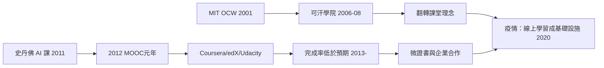

# 9.1 可汗學院與MOOC革命

## 一個表哥的數學課

可汗學院（Khan Academy）的起點微不足道。2004年，對沖基金分析師薩爾曼·可汗（Salman Khan）開始用電話與 Yahoo 記事本為遠在新奧爾良的表妹輔導數學；2006年起他把講解錄成影片放上 YouTube。技術選型非常刻意：他刻意不用人臉，只用一塊虛擬黑板與錄音——因為他觀察到，看見老師的臉會讓學生分心，而放慢節奏、可以暫停重播的影片反而更接近一對一教學。影片他大量利用 YouTube 的自動分發，零成本觸及任何人。

2008年他正式成立非營利組織可汗學院；2010年獲比爾與梅琳達·蓋茲基金會與 Google 的資助（Google Project 10^100 獎金）。至2010年代末，可汗學院影片累計逾數千支，練習題以知識地圖組織，全球使用者以千萬計。2012年，可汗出版《翻轉課堂的可汗學院》（The One World Schoolhouse），提出翻轉課堂（flipped classroom）：知識傳授交給影片，課堂時間用於練習與討論——把布魯姆（Benjamin Bloom）1984年提出的「兩個標準差問題」（一對一輔導的學生平均表現比傳統課堂高出約兩個標準差，而一對一無法規模化）作為使命：讓一對一規模化。

## MOOC：2012年與三大平台

大規模開放線上課程（MOOC）的爆發在2012年——被《紐約時報》稱為「MOOC 之年」。三個平台的誕生路徑：

- edX：2012年5月，MIT 與哈佛合資成立，非營利。前身是 MIT 的 OpenCourseWare（2001年啟動，免費公開全部課程教材，但不提供互動與證書——它證明了內容可以免費，卻沒有證明學習可以規模化）。
- Coursera：2012年由史丹佛的吳恩達（Andrew Ng）與 Daphne Koller 創立。其前身是2011年史丹佛的免費 AI 課（Sebastian Thrun 與吳恩達開設，逾十六萬人註冊——當時史上最大課堂）。
- Udacity：Thrun 離開史丹佛於2012年創立，後轉向職業技能與企業培訓。

MOOC 的技術支柱是三個互聯網時代的發明：影片分發（YouTube 與 CDN 使影片成本趨近於零）、自動評分與同儕互評（使數萬份作業可批改）、以及論壇與學習分析（data-driven 的課程迭代）。最早的實驗其實是2008年：加拿大 Manitoba 大學的 George Siemens 與 Stephen Downes 開設 Connectivism and Connective Knowledge 課程，開放給兩千多名免費線上參與者，並創造了 cMOOC（以連接主義為基礎的開放課程）一詞——後來的商業平台（xMOOC）採用的是更傳統的講授+測驗模式。

## 潮起潮落：MOOC 的現實

2012–2013年，MOOC 被宣稱將顛覆大學（《對哈佛商學院意味著什麼》式的標題充斥媒體；Thrun 甚至預言五十年後世界上只剩十所大學）。但數據很快降溫：賓州大學2013年對 Coursera 百萬註冊者的研究顯示，完成率約僅百分之四到六；註冊者中七成以上已有學士學位——MOOC 主要服務的其實是已受過高等教育者的進修，而非教育弱勢者。

2015年後，平台轉向商業化：收費證書、微學位（micro-credentials，edX 的 MicroMasters、Coursera 的 Specializations）、與企業合作（Google 職業證書2018年起在 Coursera 上線）。2019年 edX 被 2U 以約8億美元收購、Coursera 於2021年上市，MOOC 從「免費教育革命」轉型為職業技能市場。這個弧線再次證明了教育史的老規律：開放的內容容易，開放的資歷難（證書與文憑的稀缺性正是大學最後的護城河——見第八章的信號理論）。

## 翻轉課堂在制度內的落點

MOOC 革命最持久的遺產不在平台，而在校園內部：翻轉課堂、混成學習（blended learning）、學習管理系統（LMS，如 Moodle 2002年開源、Canvas 2011年）成為大學的標準配置。疫情把這些工具從「輔助」變成「基礎設施」——那是下一節的故事。

## 小結

可汗學院與 MOOC 證明了兩件事：知識傳授的邊際成本可以趨近於零（這是印刷術以來最大的載體革命），以及僅有免費內容並不足以讓多數人完成學習（動機、陪伴與結構仍屬稀缺）。當2020年疫情把數億學生強制推上線，這兩條經驗同時被考驗。
