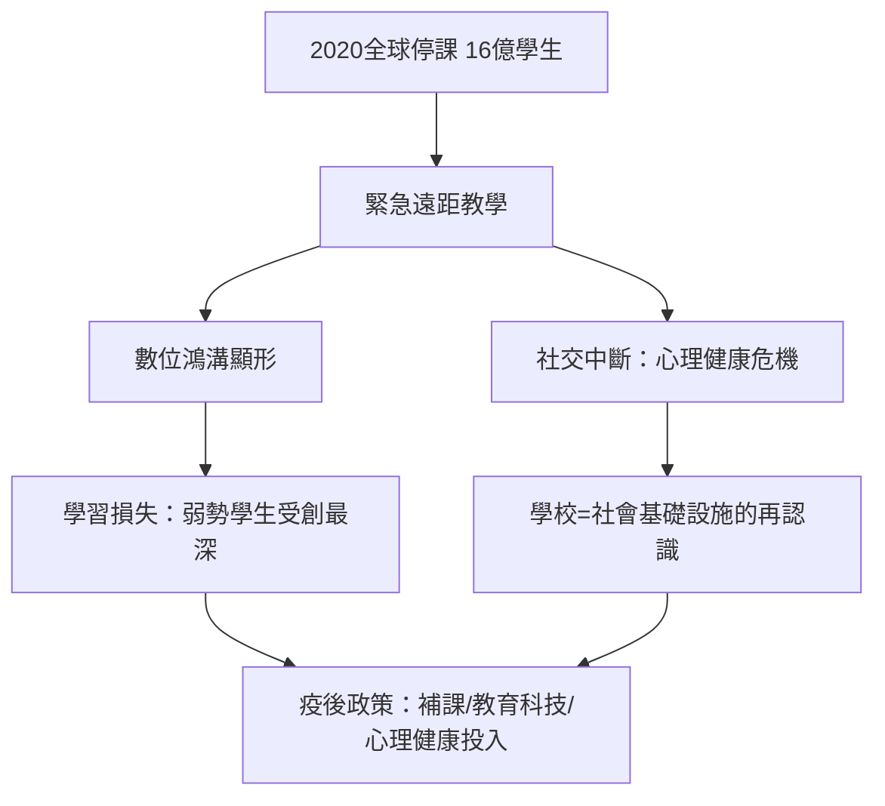

# 9.2 疫情網課世代

## 史上最大規模的同步實驗

2020年1月，COVID-19 疫情從中國武漢擴散。UNESCO 從2月起追蹤各國停課：至4月中旬，全球190多個國家停課，受影響學生約16億人——占全球學生總數九成以上。這是人類歷史上最大規模的一次教育中斷，也是最大規模的線上學習實驗。

各國的應對速度差異極大：中國以釘釘、騰訊會議與國家中小學網絡雲平台（2020年2月緊急上線）支撐大規模網課，武漢學生透過直播應對中高考；韓國、台灣等有高度數位基礎設施的地區快速切換；印度、非洲多國則因設備與網路匱乏陷入長期停擺（印度學校關閉近兩年，是全球最長之一）。

## 學習損失的實證

疫情網課最持久的遺產是對「學習損失」（learning loss）的量化。多國數據一致顯示：

- 美國 NWEA 與國家教育進步測評（NAEP，2022年）顯示數學與閱讀成績跌回數十年前水準，數學降幅相當於失去約半學年以上的進度。
- 荷蘭的研究（Engzell 等人，2021，PNAS）利用該國相對短暫的八週停課與標準化考試，測得相當於五分之一學年的學習損失——且弱勢家庭學生損失更大。
- 世界銀行、UNESCO 與 UNICEF 的聯合估計指出，疫情造成的世代學習損失可能使這一代學生的終身收入減少數兆美元，並加劇不平等（有能力在家上網課的學生損失小，無設備的損失大——「數位鴻溝」第一次以如此規模進入教育統計）。

## 社交中斷與心理健康

網課的不只是學習問題。CDC 的調查（2021）顯示，疫情期間美國高中生的持續悲傷與絕望感比例升至約百分之四十二（2019年約百分之二十八），女性與 LGBTQ 學生更高。校園關閉同時切斷了午餐營養、兒童保護（教師是虐待通報的第一線）、同伴社交——學校不只是教學機構，而是社會基礎設施，這一點在它消失時才被看清。大學生層面，孤獨與心理諮詢需求在2020–2022年創紀錄（第九章男性心理健康部分所述的青年孤獨，在疫情中明顯加深）。

## 網課技術的真實樣貌

大規模遠距教學的實際體驗與理想相去甚遠：

- 直播課的高頻問題是出席而非教學：鏡頭關閉、多工分心、代點名成為全球教師的共同話題。
- 混合式工具被動員：Zoom（日活從2019年底約千萬級暴增至2020年4月的三億）、Google Classroom、Moodle、釘釘、Microsoft Teams。
- 教師的適應成本巨大：大量教師在零培訓下改教網課；各國隨後投入教育科技與教師培訓（如歐盟的數位教育行動計畫）。
- 一對一與自定進度工具（可汗學院式）在部分地區顯示出補償效果，但需要設備與自律。

## 疫後的持久改變

疫情退潮後，部分改變留存：混合教學成為大學常態選項；錄播與非同步學習被制度化；線上考試與監考（proctoring）技術引發的隱私爭議進入治理議程；家庭教育與在家自學（homeschooling）在美國等地的比例疫情後高於疫情前；教育科技的風險投資在2021年達到峰值後回落。更重要的是世代效應：網課世代對「學習必須在教室」的預設被打破——當2022年底生成式 AI 出現時，一個已經數位化的教育系統迎接了它。

## 小結

疫情網課世代是第九、十章之間的橋樑：它證明了大規模線上學習在技術上可行、在教育上昂貴（學習損失與社交成本），也證明了學校的社會功能遠超知識傳授。當 ChatGPT 於2022年11月問世，教育系統即將面對的不是載體的改變，而是「學生到底要學什麼」的根本問題。
