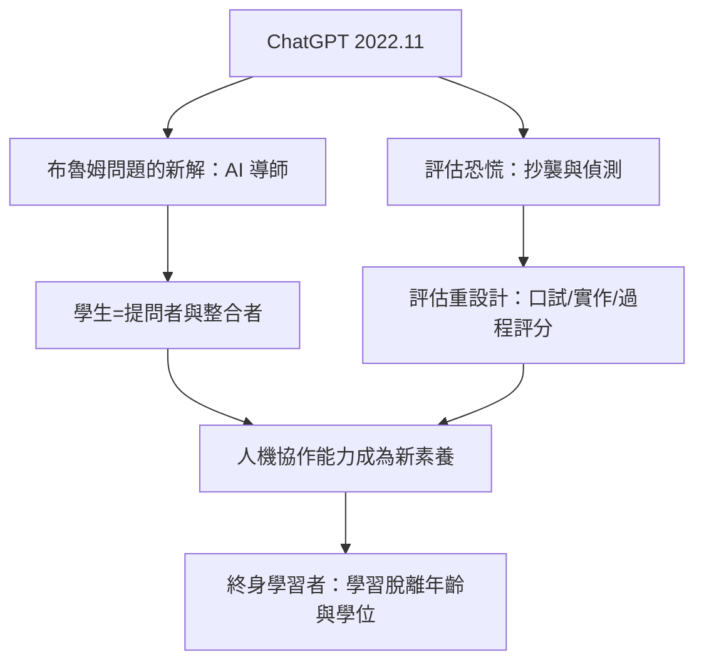

# 10.1 AI 隨身導師與提問者的崛起

## 2023年1月的恐慌

2022年11月30日，OpenAI 發布 ChatGPT。兩個月內月活躍用戶破億（史上最快的消費級應用之一）。教育界的第一反應是恐慌：紐約市教育局2023年1月宣布封鎖校園網路上的 ChatGPT（後於同年5月解封並轉向引導使用）；各國大學隨即陷入評估與規範混亂；英文詞彙新增了 thrunting（用 AI 冒名寫作）與 AI 檢測的軍備競賽（Turnitin 等公司推出 AI 偵測，但其可靠性屢遭質疑，OpenAI 本身2023年也因準確率問題撤下了自家的 AI 文本分類器）。

恐慌的核心是一個古老的評估問題：如果答案唾手可得，我們該考什麼？法國哲學家 Michel Serres 早在2012年（《拇指之子》）就預言：當所有知識都在口袋裡，記憶與複述的教育將失效——他稱這一代為「拇指的新人」。ChatGPT 把這個預言提前兌現。

## 布魯姆問題的答案

但同一個技術，也為1984年布魯姆提出的「兩個標準差問題」（第九章第一節）提供了解答的可能性：一對一輔導的效果無可替代，但無法規模化——如果 AI 可以成為每個學生的隨身輔導者呢？

2023年以來的實踐路徑：

- 可汗學院率先上線 Khanmigo（2023年，與 OpenAI 合作，基於 GPT-4），刻意設計為「蘇格拉底式導師」——系統提示詞禁止直接給答案，必須引導學生分步思考。這是「AI 導師不代做」的產品化嘗試。
- 各大學課堂快速分化為兩派：禁止派（回歸紙筆與口試以確保真實性）與整合派（重新設計作業——過程性評估、口頭答辯、以 AI 為對手的批判性閱讀）。
- 研究證據開始累積：賓州大學2024年的實地實驗（在土耳其高中使用 GPT-4 導師）發現：允許自由使用 AI 時學生表現更好，但停用後反而落後於未用 AI 的對照組——「AI 搖籃」效應（把 AI 用作答案機會傷害學習；把它用作輔導則可能增益）。這為「如何設計 AI 學習」提供了第一個嚴格證據。

## 學生的角色重構

AI 時代對學生身分的改寫可歸納為三個層面：

1. 從答案的檢索者到問題的提出者。當答案免費，問題的品質成為稀缺品——提問、界定問題、評估答案的能力（批判性思維的實操版本）成為新核心素養。
2. 從獨立完成到人機協作。寫作、編程、研究的流程被重構為「人設定目標與判斷、AI 生成草稿與代碼、人編輯與驗證」——教育於是必須教「如何與 AI 協作」（prompt engineering 只是表層，更深的是工作流設計與驗證習慣）。
3. 從同質化到個性化。AI 導師理論上可以按每個學生的程度、興趣與語言調整教學（這正是可汗學院、Duolingo Max、Squirrel AI 等產品的方向），大班教學的「平均學生」預設可能被打破。

## 教育系統的兩難

AI 也把教育系統的結構性矛盾推到檯面：

- 評估的合法化危機：以可帶回家完成的作業評定學歷，在 AI 時代失去防偽能力。口試、實作、課堂內評估的回歸是可預見的方向（2024年起英澳等多國大學已提高課堂內評估比重）。
- 教師角色的再定位：從知識傳授者轉向學習設計者、動機維持者與價值示範者——AI 難以替代的恰是關係與榜樣（第九章的社會性學習證據在此重新變得重要）。
- 公平的新鴻溝：付費高階模型與免費模型的差異、以及 AI 素養的家庭差異，可能製造新的不平等——UNESCO 2023年發布首份《教育中的生成式 AI 指南》，呼籲以人為中心的監管。

## 小結

AI 沒有取消學生，而是取消了「學生作為答案記憶者」這個角色。當知識的取得趨於免費，學生的價值移向問題、判斷與整合——以及與人（教師、同伴）共同學習的過程本身。這條邏輯的終點，是「學生」作為人生階段的終結：在知識半衰期以年計的時代，每個人都是終身學習者。那是最後一節的主題。
