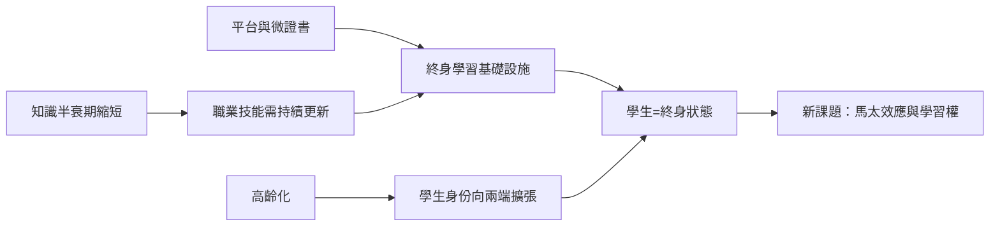

# 10.2 學生作為終身狀態

## 知識半衰期的收縮

「學生是一個年齡階段」的觀念，建立在工業時代的一個穩定假設上：人生前二十年學到的知識，足以支撐之後四十年的工作。這個假設在20世紀後半開始失效。工程、醫學、資訊領域的從業者早已知道：專業知識的有效期以年計——醫學界常用的說法是，醫學知識的翻倍週期從1950年的約五十年縮短到2010年代的數年（Densen 2011年在《Translational Medicine》上的估算常被引用）。

數據層面，終身學習已成為勞動市場的硬需求：OECD 的成人技能調查（PIAAC）顯示，成年人的閱讀與數學技能在離開學校後普遍下降，而技能利用度與工資、健康直接相關；世界經濟論壇《未來就業報告》估計，約一半勞動者的核心技能在五年內需要更新（2023年報告估計未來五年約四分之一的工作崗位受技術變動干擾，四成以上核心技能將改變）。

## 終身學習的制度化

終身學習從口號變成制度，有一條清晰的演進線：

- 概念奠基：1960年代 UNESCO（保羅·朗格朗 Paul Lengrand 的終身教育報告，1965/1970）與1972年富爾報告（Learning to Be）確立終身教育為國際政策語言；1996年 OECD 的《Making Lifelong Learning a Reality》與歐盟2000年里斯本戰略把「學習型經濟」定為目標。
- 資歷與微證書：2010年代起，微學位（edX MicroMasters 2015起）、數位徽章（Open Badges，Mozilla 2011年起）、技能檔案（LinkedIn Skills）嘗試把碎片化學習變成可攜帶的資歷。新加坡的 SkillsFuture（2015年起，政府直接給每個25歲以上公民學習津貼）是國家級終身學習制度最完整的實驗。
- 大學的功能外溢：繼續教育學院、線上碩士（Georgia Tech 2014年推出的電腦科學線上碩士 OMSCS，學費約傳統的六分之一，被視為價格革命的標竿）、開放大學（英國 Open University 1969年創立，以廣播電視起步——終身學習的制度遠祖）。

## 誰在學習：終身學習者的畫像

現實的終身學習者呈現明顯的結構偏差：Coursera 與多個平台的研究顯示，線上學習者的學歷普遍高於人口平均——已有學士學位者最容易成為再學習者。這是「馬太效應」的學習版：教育資源越多的人，越善於利用新的學習機會。OECD 的 Skills Outlook 反覆警告：低技能、低學歷成人參與培訓的比率顯著偏低——如果終身學習制度不解決這個偏差，它將放大而非縮小不平等。

另一個新群體是銀髮學習者：高齡化與延長的工作壽命使「60歲上大學」成為現象（日本的開放大學、中國的老年大學——1983年第一所老年大學在山東紅島創立，至2020年代老年大學系統學員以千萬計）。學生作為身份，正在向人生的兩端同時擴張。

## 學習的本質回歸

終身學習時代把本書貫穿的四條線索收攏為一個結論：

1. 身份：學生不再是18–22歲的專屬身份，而是任何人在任何時刻與知識建立關係的狀態。
2. 政治角色：當知識更新成為生存條件，「學習權」成為新的公民權議題（再培訓津貼、學習帳戶、失業保險與教育的合流——丹麥的 flexicurity 模式是先例）。
3. 師生關係：教師、AI、同伴與自我構成多主體學習網絡；權威從「知識的持有者」轉向「學習的設計者與激勵者」。
4. 空間：學習發生於雲端、工作現場、社區與身體（運動、手作、實驗室）——杏壇的物理隱喻被徹底解構。

## 結語：回到篝火邊

人類最早的學習不在學校——它發生在篝火邊、獵場上、作坊裡：跟著大人看、聽、模仿、失敗、再試。學校是文明為了規模化而發明的中介，而這個中介兩千年來反覆自我改造：孔子的杏壇、波隆那的公會、普魯士的鐘聲、西南聯大的泥地、MOOC 的伺服器、AI 的對話框。

每一次改造都回應同一個問題：誰需要學什麼，誰來決定？從貴族到平民，從精英到全民，從國家到個人，從老師到 AI——「學生」這個身份的每一次擴容，都是人類把學習的主權再釋放一次的過程。AI 時代的終身學習者，某種意義上是回到起點：學習再次成為每個人自己的事，只是這一次，篝火邊坐著七十億人，而火種無限。
