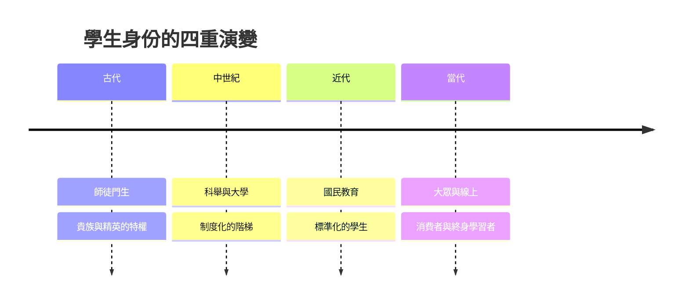

# 學生的故事：從竹簡書童、師徒烙印到學潮火種與演算法時代的終身學習者

本書跨越數千年，講述「學生」這個身份如何從古文明中少數精英的師徒傳承，經歷科舉與大學制度的確立、印刷術與國民教育的普及、學生運動對歷史的改寫，一路演變成大眾高等教育、線上學習，以及 AI 時代對「學習者」概念的徹底重構。

全書沿四條主線交織：身份與階級、社會與政治角色、師生關係、學習空間與載體。

* 第1章-杏壇門生與諸子百家的跟隨者
    * [1.1-孔子與三千弟子](01.1-孔子與三千弟子.md)
    * [1.2-顏回與子路：弟子的忠誠與傳承](01.2-顏回與子路弟子的忠誠與傳承.md)
* 第2章-古希臘學園與羅馬修辭學弟子
    * [2.1-柏拉圖學院與蘇格拉底方法](02.1-柏拉圖學院與蘇格拉底方法.md)
    * [2.2-羅馬修辭學校與實用型學生](02.2-羅馬修辭學校與實用型學生.md)
* 第3章-太學、國子監與寒窗苦讀的舉子
    * [3.1-科舉：朝為田舍郎暮登天子堂](03.1-科舉朝為田舍郎暮登天子堂.md)
    * [3.2-東林書院與太學生的政治覺醒](03.2-東林書院與太學生的政治覺醒.md)
* 第4章-歐洲中世紀大學與學生公會
    * [4.1-波隆那：學生僱傭教授的傳奇](04.1-波隆那學生僱傭教授的傳奇.md)
    * [4.2-遊學學徒與拉丁語的知識共和國](04.2-遊學學徒與拉丁語的知識共和國.md)
* 第5章-普魯士模式與現代學生的標準化
    * [5.1-年級、鐘聲與統一教材](05.1-年級鐘聲與統一教材.md)
    * [5.2-女性學生的艱難破壁](05.2-女性學生的艱難破壁.md)
* 第6章-改寫歷史的青年
    * [6.1-五四運動：學生成為政治力量](06.1-五四運動學生成為政治力量.md)
    * [6.2-西南聯大：戰火中的講堂](06.2-西南聯大戰火中的講堂.md)
* 第7章-狂熱與激情：六八風暴與世界學潮
    * [7.1-法國五月風暴與美國反戰學潮](07.1-法國五月風暴與美國反戰學潮.md)
    * [7.2-冷戰學生陣營與青年亞文化](07.2-冷戰學生陣營與青年亞文化.md)
* 第8章-高等教育大眾化與學貸的重擔
    * [8.1-文憑通脹：大眾化時代的焦慮](08.1-文憑通脹大眾化時代的焦慮.md)
    * [8.2-學生貸款：教育消費者的誕生](08.2-學生貸款教育消費者的誕生.md)
* 第9章-MOOC、螢幕世代與被打破的圍牆
    * [9.1-可汗學院與MOOC革命](09.1-可汗學院與MOOC革命.md)
    * [9.2-疫情網課世代](09.2-疫情網課世代.md)
* 第10章-ChatGPT、演算法教練與終身學習者
    * [10.1-AI隨身導師與提問者的崛起](10.1-AI隨身導師與提問者的崛起.md)
    * [10.2-學生作為終身狀態](10.2-學生作為終身狀態.md)

## 全書架構圖

