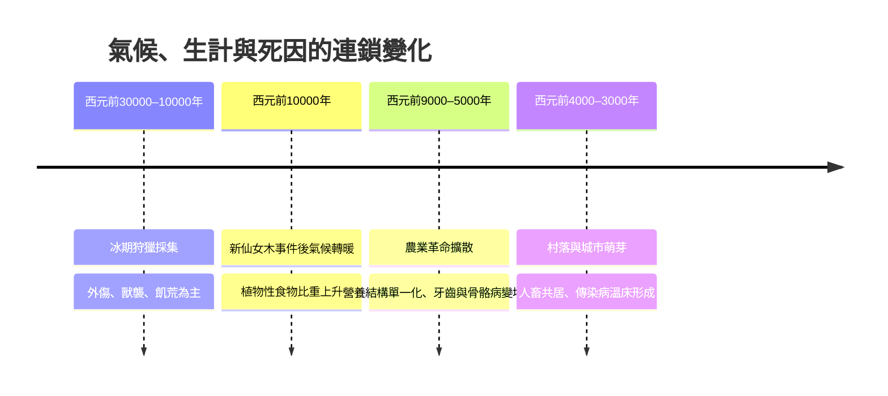

# 1.1 死亡統計：平均壽命三十歲的世界

如果有一份西元前一萬年的「人口普查」，它會呈現出一個令現代人難以置信的世界：人類的平均壽命大約只有二十至三十歲。這個數字常被誤解為「當時的人最多活到三十歲就死了」，但真相更為殘酷——少數幸運者確實能活到五、六十歲甚至更久，但他們被數量驚人的早夭者拉低了平均。死亡像一個不對稱的天平：一端是大量在出生前後就消失的生命，另一端則是極少數撐過所有關卡的老者。

## 天平的傾斜

根據古人類學家對史前骨骼遺骸的推估，遠古社會的嬰兒死亡率高達百分之四十至五十——每兩個新生兒中，就有一個看不到自己的第一個生日。這不是誇張的文學修辭，而是來自墓葬中嬰兒骸骨比例、以及二十世紀仍維持狩獵採集生活的部落（如非洲的 !Kung 人）的民族誌觀察，所作出的保守估計。

若我們用數學方式描述這個世界，平均壽命其實是由極度偏斜的死亡分布所決定的：

$$e_0 = \frac{\sum_i d_i \cdot x_i}{\sum_i d_i}$$

其中一半以上的 $d_i$（死亡人數）集中在 $x_i \leq 5$ 歲的區間。一旦熬過童年，活到二十歲的人往往還能再期待二十到三十年的生命。換句話說，「平均壽命三十歲」與「三十歲就老死」是兩件完全不同的事——前者是嬰兒墓穴堆疊出來的統計幻象，後者則從未發生。

## 殺手的名單

史前人類的死因清單，與現代人截然不同。那是一個沒有慢性病氾濫的世界，因為多數人活不到癌症與心血管疾病發作的年紀。站在食物鏈與疾病鏈頂端的是：

1. **外傷與感染**：狩獵大型動物時被野獸撞擊、踩踏、撕裂，或被燧石工具割傷。皮膚一旦破損，敗血症便是唯一的結局——沒有抗生素，一個被野豬咬傷的獵人可能在數天內死於發熱與譫妄。
2. **分娩**：產婦因難產大出血或產褥感染死亡的比例，可能高達每百次分娩奪走一至兩位母親。女性一生懷孕多次，累積風險使分娩成為育齡婦女的頭號死因。
3. **飢餓與營養不良**：冰川退縮、獵物遷徙、植物歉收，都會讓整個群體陷入飢荒。飢餓本身致死之外，也削弱免疫，讓「普通的」感染變成致命的。
4. **急性傳染病**：值得注意的是，在我們討論的這個時代（約西元前三萬年至前三千年），麻疹、天花、流感這類「群聚疾病」尚未出現——它們需要足夠密集的人口才得以存在。史前人類面對的傳染病原多是來自動物的偶發感染（如破傷風、炭疽），而真正的大瘟疫，要等到農業與城市把人類、家畜與老鼠擠在一起之後才登場。

## 氣候如何書寫死亡

遠古的死亡統計並非靜態，它隨著氣候與生計方式劇烈波動。末次冰期於約一萬一千七百年前結束，全球暖化改變了這份死亡清單的排序：

農業帶來了更穩定的熱量供給，讓人口成長，卻也帶來了隱藏的代價：以少數幾種穀物為主食導致營養單一化，定居住宅吸引來老鼠、寄生蟲與污水，人與家畜的親密共處則讓病原體獲得跨越物種的跳板。考古遺骨顯示，早期農民的牙齒蛀蝕與傳染病痕跡，往往比他們的狩獵採集祖先更嚴重。這是一場深刻的交換：**用更穩定但更擁擠的死亡，取代更劇烈但更分散的死亡**。

## 統計背後的生命

在這些冰冷的百分比之下，是一個個有名有姓——雖然名字已不可考——的生命。一個舊石器時代的母親可能埋葬過三個孩子，然後繼續懷孕，因為群體的存續取決於足夠的新生兒。一位四十歲的長老可能是整個部落唯一的「歷史記憶庫」，他記得上一場大旱與求生的路徑；他的死亡，等於一座圖書館的焚毀。

正因為死亡如此頻繁而貼近，遠古人類不可能對它無感。當嬰兒的屍骨被小心翼翼地以紅赭石染色、當死者被以蜷曲的姿態如同胎兒般入葬，我們看到的正是人類面對那高得驚人的死亡機率時，所做出最莊嚴的回應。至於他們手中有什麼樣的「醫療」可以對抗這份機率——那將是下一節的主題。

> 延伸閱讀：見下一節〈1.2 環境與醫療：燧石、獸骨與無消毒的時代〉。
