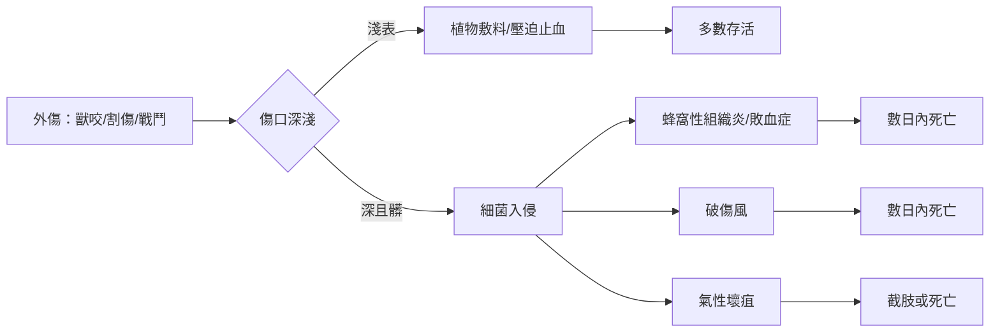

# 1.2 環境與醫療：燧石、獸骨與無消毒的時代

要理解遠古人類如何死去，必須先理解他們受傷之後會發生什麼事——而答案是：幾乎沒有任何我們今天所謂的「醫療」。在消毒觀念、麻醉與抗生素都尚未出現的兩萬年裡，人類的醫療是一套混合了實用經驗、植物知識與靈性儀式的體系。它並非全然無效，但它對抗的敵人實在太過強大。

## 工具即凶器，也即藥器

舊石器與新石器時代的醫療工具箱，和狩獵工具箱幾乎是同一個：燧石刀片可以剖開獸皮，也可以割開膿瘍；獸骨磨成的針可以縫製衣物，也可以固定骨折。考古遺址出土的史前顱骨上，帶有成功的**環鋸術**（trepanation）痕跡——在新石器時代的歐洲，人們會在活人頭骨上鑽孔，據推測是為了治療頭痛、癲癇或顱內外傷。令人驚訝的是，部分出土顱骨的鑽孔邊緣顯示出明顯的癒合痕跡，證明有些患者術後存活了數月甚至數年。這是史前外科最驚人的成就：在人類尚未理解感染之前，某些社群已透過經驗發展出可操作的顱骨手術。

但成功的環鋸術是例外。日常的傷口處理才是真正的試煉場：

一個被燧石割傷腿部的獵人，若傷口沾染了泥土或動物糞便，敗血桿菌與破傷風梭菌便會在厭氧的深部組織中繁殖。他的同伴能做的，是用樺木多孔菌之類的植物敷料按壓傷口——事實上，本書稍後將詳述的冰人奧茨，隨身便攜帶了這類具有藥用與止血功用的真菌，顯示新石器時代的獵人已具備基礎的傷口照護知識。

## 骨頭說出的病史

由於遠古沒有任何文字記錄，我們對史前疾病的所有知識都來自骸骨。古病理學（paleopathology）告訴我們：

- **骨折**：癒合不良或根本未癒合的長骨骨折極為常見，顯示固定技術原始。
- **牙齒**：農業社會的遺骨蛀牙率明顯高於狩獵採集者，澱粉與糖分是牙菌斑的盛宴；嚴重的牙周病與齲齒會引發顎骨感染，成為慢性的痛苦殺手。
- **營養不良**：骨骼上的哈里斯線（Harris lines）與牙釉質發育不全，記錄了童年時期反覆的飢荒與疾病。
- **關節炎**：幾乎所有中年以上的史前遺骨都有退行性關節病變，勞累的一生直接刻在骨頭上。

而在這些骨頭之外，還有一整個不可見的死亡世界：腹瀉、肺炎、敗血症——這些不會在骨骼留下痕跡的疾病，可能才是史前真正的頭號殺手。嬰兒死於脫水性腹瀉的悲劇，在骸骨上完全不留隻字片語，只在墓葬的統計中留下沉默的印記。

## 產床上的死亡

分娩是史前醫療最無力應對的場景。難產——胎位不正、骨盆過窄、胎盤滯留——在沒有剖腹產與輸血的年代，往往意味著母子皆亡。考古遺址中偶爾出土的母子合葬墓，是這種悲劇最直接的證據。即使順利生產，產後的產褥熱（子宮感染）也可能在數天內奪走產婦的性命：接生者的手、切割臍帶的石器、鋪在地上的獸皮，全都是細菌的載體，而沒有人知道「洗手」二字為何物。

生育的風險結構性地塑造了社會：高死亡率迫使高生育率，女性一生懷孕六至八次，每次都是一次賭命。這也解釋了為何許多史前文化中，生育女神與死亡意象常常並置——生的入口與死的出口，在同一位女性的身體上重合。

## 巫與藥的未分離

遠古的「醫者」同時是巫師。薩滿以歌舞、煙燻與植物致幻劑（如毒蠅傘、顛茄類）進入「異界」，為病者驅趕致病的靈體。這在今天看來是迷信，但其中包含了不可忽視的經驗核心：他們知道哪些植物能止痛、哪些能止瀉、哪些能讓人入睡。柳樹皮（富含水楊酸，即阿斯匹靈的前身）的止痛用法，可以追溯到史前時代的歐亞大陸。醫療與宗教在當時是一體的兩面——因為人們尚無「病菌」的概念，能解釋疾病的只有超自然。

這種巫藥合一的狀態，將延續數萬年，直到希波克拉底在希臘宣告「疾病源於自然，而非神靈」。而在那之前，人類能倚靠的，只有燧石的鋒利、草藥的經驗，以及群體彼此扶持的體溫。當醫療失效時，逝者將被交到另一套制度手中——葬禮。下一節，我們將跟隨一具在冰川中沉睡五千三百年的屍體，看看新石器時代一場真實的死亡是如何發生的。

> 延伸閱讀：見下一節〈1.3 名人案例：冰人奧茨之死〉。
