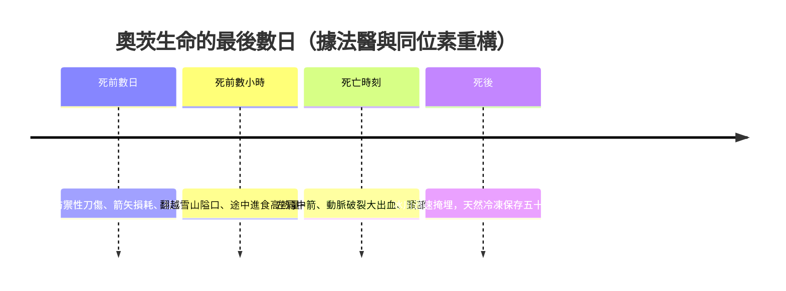

# 1.3 名人案例：冰人奧茨之死

一九九一年九月十九日，一對德國登山客在南蒂羅爾的奧茲塔爾阿爾卑斯山（Ötztal Alps）海拔三千二百一十公尺處，發現了一具從融冰中露出的屍體。起初大家以為是近年失蹤的登山者，警方甚至動用了氣壓鑿來「打撈」遺體——過程中戳壞了他的臀部與背包。數天後，放射性碳定年結果震驚了世界：這個人死於約西元前三三〇〇年，距今五千三百多年。他很快被暱稱為「奧茨」（Ötzi），成為人類史上最著名的一具史前遺體，也是最完整的一樁史前謀殺案。

## 他的一生：四十五歲的「長老」

奧茨死時約四十五歲，身高約一六〇公分，體重約五十公斤。在平均壽命二十至三十歲的新石器時代，他已是一位高齡者，這暗示了他在社群中可能擁有長老或獵人的重要地位。現代醫學掃描還原了他一生的病歷：

- 動脈鈣化，是已知最早的人類動脈粥樣硬化案例——即使在新石器時代，血管老化也與現代人無異；
- 寄生蟲：腸道中有鞭蟲蟲卵；
- 膽囊結石、重度關節炎、牙齒嚴重磨損與牙周病；
- 左腳踝有陳舊性骨折正在癒合，肋骨也有癒合中的裂痕，顯示死前曾受傷；
- 他身上有六十一處刺青，由炭灰刺入皮膚構成，位置多與關節炎疼痛處及針灸經絡重合，被推測是一種原始的疼痛治療。

## 死亡現場：法醫學的重構

二〇〇一年，新的X光檢查在奧茨左肩胛骨與肋骨之間發現了一個此前被忽略的東西：一支燧石箭頭，深度約十三公分。這一發現徹底改寫了案件。

法醫學家的重構如下：箭頭切斷了左鎖骨下動脈或其分支，造成大量內出血——這是致命傷，若在今日，及時手術或許可救，但在新石器時代，他會在數小時內因失血與心包填塞而死。此外，他的頭部有一處嚴重的鈍器傷，可能發生在箭傷之前、之時或倒地之後，學界至今仍有爭論。他的右手掌還有一道深及骨頭的防禦性傷口，是死前數天才造成的。

這些證據指向一場暴力衝突：奧茨可能在逃亡。他胃裡的最後一餐（紅鹿肉、野山羊肉、穀物與梅子）顯示他在死前不久匆忙進食；他攜帶了完整的裝備——銅斧（當時的尖端工藝品）、弓與尚未完成的箭、熊皮帽、草編斗篷——卻唯獨沒有帶走他價值連城的銅斧之外更易攜帶的某些物品，且箭袋中的箭多數缺頭，顯示剛經歷過戰鬥。DNA 分析顯示他的箭袋中殘留著至少兩個他人的血跡，他的刀具上也有他人血液。這是一場致命追逐的終點。

## 一場雪崩式的「完美葬禮」

奧茨的屍體之所以能保存，是因為他死後不久便被冰川的冰與融雪覆蓋，處於持續冷凍、缺氧、又被濕度恰到好處地脫水的狀態——這是自然界的「冰凍木乃伊」。諷刺的是，殺死他的阿爾卑斯山，成為他最好的防腐師。如果他在低地死亡，他的皮膚、衣物、胃容物與最後一餐，都將隨肉身一同腐爛，留給後世的將只是一些牙齒與碎骨。

從文化史的角度看，這具遺體是一份無比珍貴的「死亡檔案」：他的衣物（獸皮、草編、皮革）展示了新石器時代的紡織與製革技術；他的銅斧證實了阿爾卑斯地區在當時已有金屬貿易；他攜帶的樺木多孔菌（附在皮繩上，可能用於止血與藥用）是史上最早被記錄的「隨身醫藥包」之一；他胃中食物的 DNA 分析，則讓我們精確知道一個新石器時代的人類在最後一頓飯裡吃了什麼。

## 為何奧茨重要

奧茨之死之所以值得在死亡史上佔據一節，是因為它把抽象的「史前死亡統計」變成了一個有血有肉、有傷口、有恐懼、有最後一餐的具體案例。他死於外傷與大出血——正是 1.1 節中遠古頭號死因；他身上有關節炎、寄生蟲與血管老化——正是 1.2 節中骸骨病理學的活體版本；而他的屍體被同伴或自然「安置」在冰川之中，則引出了本章最後、也最重要的問題：人類從什麼時候開始，不再任由死者被遺棄，而是開始「埋葬」他們？當第一具遺體被放入墓穴、灑上紅赭石的那一刻，人類的宗教與文明，才真正誕生。

> 延伸閱讀：見下一節〈1.4 文化與信仰：第一次埋葬死者的人類〉。
