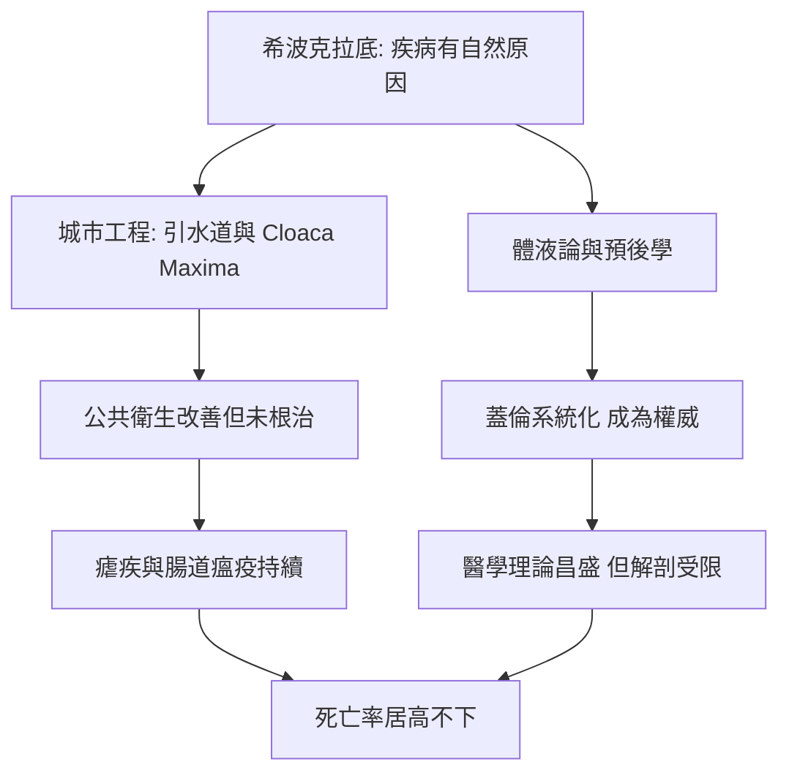

# 2.2 環境與醫療：無下水道的帝國與希波克拉底革命（約西元前 8 世紀 – 西元 5 世紀）

## 錯誤的標題，正確的疑問

本章標題所謂「無下水道的帝國」，其實是個必須修正的迷思：羅馬不但有下水道，還有一條舉世聞名的——大下水道（Cloaca Maxima）。它始建於王政時代，最初為排除羅馬廣場一帶的沼澤積水，後來逐漸擴展為覆蓋城市的磚石地下溝渠，最終匯入台伯河。羅馬人同時建成十一條引水道，為百萬人口的都城每日輸送數十萬立方米清水，公共浴場、噴泉、公共廁所一應俱全。就城市公共工程而言，古代世界無出其右。

然而先進的工程並不等於有效的公共衛生。引水道的水在露天水槽與鉛管中二次污染；許多居民仍從台伯河直接取水；下水道主要排走雨水與街道污水，多數住家並未接管；而羅馬城賴以為生的台伯河下游沼澤，始終是瘧疾的溫床。工程改善了生活，卻沒能切斷疾病的鏈條——「羅馬熱」照樣每年準時造訪。

## 希波克拉底革命：疾病有了自然的原因

真正的革命發生在醫學思想裡。約西元前 5 至前 4 世紀的科斯島，希波克拉底及其學派提出劃時代的主張：疾病不是神罰，而是自然現象，必須用觀察與理性去研究。著名的《聖病論》直言癲癇同樣有其自然成因，世人卻因無知而視之為神聖。醫者首度被要求記錄病歷、預測病程（預後學）、並以希波克拉底誓言約束職業倫理。

學說的核心是體液論：人體由血液、黏液、黃膽汁、黑膽汁四種體液構成，四者失衡即生病，治療的目標是恢復平衡——放血、催吐、瀉下、飲食調養，都是讓體液「復位」的手段。以現代眼光看，體液論的生理學是錯的，放血甚至常是有害的；但「疾病有自然原因、可觀察、可預測」這一步，卻把醫學從巫術的引力場中拔了出來。

## 蓋倫：帝國的醫學權威

二世紀的帕加馬醫師蓋倫，將希波克拉底傳統系統化為一套龐大的醫學體系。他曾任皇帝馬可·奧理略的宮廷醫師，並在安東尼大瘟疫期間親身留在羅馬救治病患，留下關於病程的記載。蓋倫精通解剖（以動物解剖推及人體，因當時解剖人體備受禁忌）、提出脈搏診斷與藥物學分類，著作宏富。此後一千餘年，蓋倫的權威籠罩了拜占庭、伊斯蘭與中世紀歐洲的醫學——這既是他的勝利，也埋下教條化的隱憂。

## 解剖的禁忌

古希臘羅馬的醫學成就，始終被人體解剖的禁忌所限。托勒密王朝的亞歷山卓曾短暫開放人體解剖（希羅菲勒斯與埃拉西斯特拉圖斯據載甚至進行過活體解剖罪犯），但在羅馬治世，宗教與社會觀感使系統性的人體解剖幾近不可能。蓋倫只能以獼猴、豬、羊的解剖類推人體——因此他關於人體的許多結論是錯的，例如認為血液在肝臟生成後如潮汐般往復流動。這個錯誤要等到十七世紀哈維才被推翻。在這個意義上，羅馬帝國是「無解剖的醫學帝國」：工程輝煌、理論卓越，但對人體內部的認識，始終隔著一層宗教與禮法的玻璃。

帝國的醫師能論證疾病的自然原因，卻仍在瘴氣與體液之間打轉；這些理論遇到真實的死亡時如何表現，最好的檢驗場是帝王與哲人自己的病榻。下一節，我們走進蘇格拉底、亞歷山大與馬可·奧理略的死因現場。

> 上一節看見疫病如何啃蝕帝國的人口；這一節看見醫學與工程如何應戰——而他們留下的權威與局限，要再等一千多年才被超越。接著，且看死亡如何親臨三位名人。
