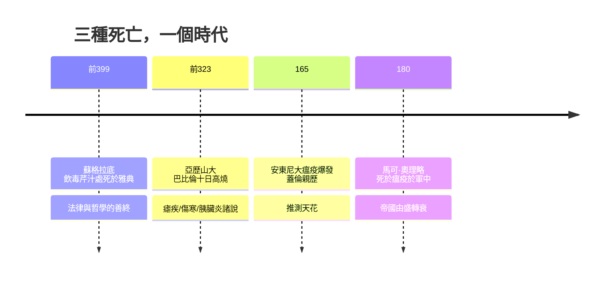

# 2.3 名人案例：蘇格拉底、亞歷山大與安東尼瘟疫（約西元前 8 世紀 – 西元 5 世紀）

## 蘇格拉底：前 399 年，一杯毒芹汁

西元前 399 年，七十歲的蘇格拉底被雅典五百人陪審團以「不敬神明、腐化青年」的罪名判處死刑。行刑方式是飲下毒芹汁（毒參，Conium maculatum 的萃取物）。柏拉圖在《斐多篇》中記錄了這場著名的死亡：獄卒說明毒芹的作用，蘇格拉底平靜地接過杯子，「像牛飲水一樣」一飲而盡。毒芹鹼由下而上麻痺——先覺得雙腿沉重，麻木向上蔓延至胸口，最後波及呼吸中樞而窒息。柏拉圖寫道，行刑者按住他，發現他已無氣息。蘇格拉底拒絕了朋友安排的逃亡，理由是服從城邦的法律；他以自己的死，示範了何謂哲學的善終。

## 亞歷山大大帝：前 323 年，巴比倫的十日高燒

西元前 323 年 6 月，三十二歲的亞歷山大大帝在巴比倫猝逝。古代史料記載他連日狂飲宴樂之後發起高燒，病情惡化十餘天而亡——史稱「十日熱」。死因至今成謎：瘧疾（惡性瘧在美索不達米亞流行）、傷寒（2003 年一項研究曾將其指為可能病因，以進展性腹側癱瘓推測）、酒精性肝病或胰臟炎，乃至中毒之說，均有擁護者。他死時部將問帝國交給誰，據載他答道「給最強者」（toi kratistoi）——隨即開啟了繼業者數十年的內戰。一位征服了從希臘到印度河的統治者，敗給的可能只是一隻瘧蚊或一杯摻了污染的水。他的遺體被護送至埃及亞歷山卓安葬，象徵著希臘化時代與地中海—東方疾病網絡的接軌。

## 馬可·奧理略：180 年，皇帝死於大瘟疫

西元 165 年起，安東尼大瘟疫沿軍隊自東方席捲帝國，推測為天花。最著名的見證者是醫師蓋倫：他親身記載患者出現發熱、咽部潰瘍、皮膚先起黑色膿皰疹而後乾燥脫落——這些描述是天花假說的核心依據。瘟疫在軍中蔓延至萊茵河與多瑙河防線，削弱了帝國的兵員與稅收。

諷刺的是，帝國最著名的「哲學家皇帝」馬可·奧理略，其《沉思錄》通篇是斯多噶式的死亡練習：「你可能即刻離開生命，就讓這決定你的言行吧。」他常年征戰於瘟疫與蠻族入侵的前線。西元 180 年，馬可·奧理略在文多波那（今維也納附近）的軍營中病逝，一般認為他染上了這場大瘟疫，得年五十八歲。哲人與瘟疫的直接相遇，讓安東尼瘟疫成為古代醫療史與思想史的交會點。

## 名人死因的共同註腳

三個案例恰好構成三類死亡：法律處決、急性傳染病、大流行瘟疫。蘇格拉底之死證明即使最智慧的頭腦，也無法豁免城邦的暴力；亞歷山大之死顯示在細菌與病毒面前，征服者與平民同樣脆弱；馬可·奧理略之死則標誌著羅馬盛世的終結——「五賢帝」時代在他手中落幕，此後帝國再也沒有擺脫瘟疫與危機的陰影。

而這些死亡之所以被後世反覆誦讀，是因為死者與其時代都留下了關於「如何面對死亡」的回答。蘇格拉底從容飲下毒酒，馬可·奧理略在瘟疫中寫作《沉思錄》——哲學的善終傳統，正是下一節的主題。

> 上一節的醫學與工程終究救不了這些名人；但古人面對死亡時的思想武器——靈魂不朽、memento mori、伊比鳩魯的寧靜——將在 2.4 登場。
