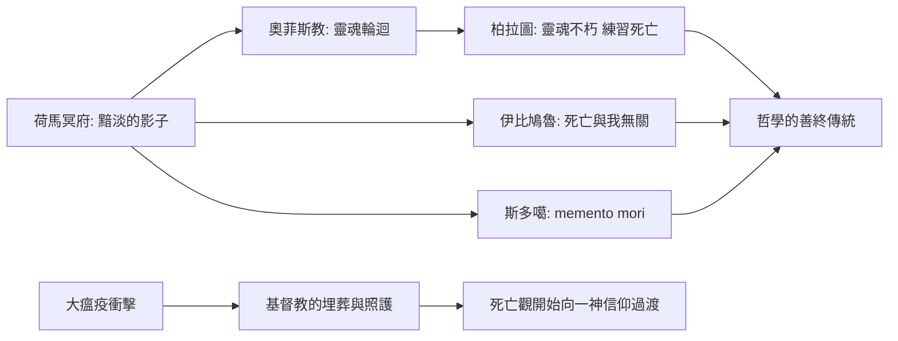

# 2.4 文化與信仰：從靈魂不朽到哲學的善終（約西元前 8 世紀 – 西元 5 世紀）

## 哈迪斯的幽暗國度

荷馬的《伊利亞德》與《奧德賽》（約西元前 8 世紀）為希臘世界定下了死亡想像的基調：亡魂墜入哈迪斯治下的幽暗冥府，渡過冥河，成為失去血肉的影子。阿基里斯在冥府中對奧德修斯說，寧願在人間為傭，也不願在死者中為王——早期希臘人對死亡的理解，是徹底的黯淡與無力。隨著時間推移，冥府逐漸分化出至福樂土（Elysium）與塔爾塔羅斯懲罰之所，奧菲斯教與畢達哥拉斯教派則傳播靈魂轉世的信仰：死亡不是終點，而是靈魂的又一次啟程。這些觀念為柏拉圖的靈魂學說準備了土壤。

羅馬人承襲希臘冥府，另有一套與家戶息息相關的死亡禮俗：家中有人過世，親屬要呼喚逝者之名（conclamatio）、守靈、出殯遊行，死者葬於城外的大道上，先祖墓地成為家族記憶的公共空間。死亡在羅馬是家庭與法律事件，遺囑與葬儀的講究，映照出帝國的社會秩序。

## 埃及亡靈書的餘緒

在希臘化的世界邊緣，古埃及的死亡信仰仍在延續並轉型。《亡靈書》的傳統自新王國以來指引亡者通過杜阿特（冥界）的審判，稱心臟於天平，與瑪阿特（真理）之羽對秤。托勒密時代與羅馬統治下的埃及，木乃伊製作、莎草紙陪葬經文與棺槨上的來世地圖依然盛行，費揚姆地區的木乃伊肖像畫更展現埃及信仰與希臘羅馬寫實繪畫的融合。亞歷山大安葬於此，並非偶然——埃及的永生承諾，始終對整個地中海世界散發引力。

## 哲學家如何教人去死

西元前 399 年蘇格拉底之死，把死亡變成哲學的核心考題。柏拉圖在《斐多篇》中藉老師的臨終立論：靈魂不朽，死亡不過是靈魂掙脫肉身的枷鎖，因此哲學家一生都在「練習死亡」。伊比鳩魯則走向另一端：靈魂由原子構成，隨身體消散，故「死亡與我們無關——我們存在時，死亡尚未來；死亡來時，我們已不在」。這句話成為古代最著名的安慰處方。斯多噶學派（塞內卡、愛比克泰德、馬可·奧理略）則主張時刻預演死亡——memento mori（記住你終將死去），將每一日當作最後一日來活，就能對命運無所畏懼。馬可·奧理略在瘟疫蔓延的邊疆軍營中寫下：「所謂死，不過是自然的一項工作。」

## 一場瘟疫裡的信仰競逐

安東尼與西普里安瘟疫不僅奪走人口，也重排了信仰的版圖。迦太基主教西普里安在瘟疫中勸勉信友照顧病患與死者；史家注意到，基督徒社群願意收屍、埋葬、照料棄置的病患，這種在死亡面前的組織力，成為基督教在三世紀危機後擴張的重要文化資本——死亡信仰的差異，第一次展現出改寫歷史的實際力量。

## 從冥河到彼岸

古希臘羅馬人用哲學馴服死亡的恐懼，卻馴服不了死亡的頻率——羅馬熱與腸道瘟疫依然照單收割。當帝國在疫病、內亂與遷徙中搖晃，那些承諾復活與永生的信仰逐漸勝出；此後的一千年，死亡的敘事將由教會、巫術與黑死病接手。冥河上的擺渡人退役了，但另一場更平等的死亡風暴正在醞釀。

> 體液學說與哈迪斯的時代在此落幕：蘇格拉底的毒酒、亞歷山大的高燒與奧理略的瘟疫都寫進了歷史。下一章，我們走進 1347 年——黑死病將讓死亡面前人人平等，也讓整個中世紀學會跳死亡之舞。
