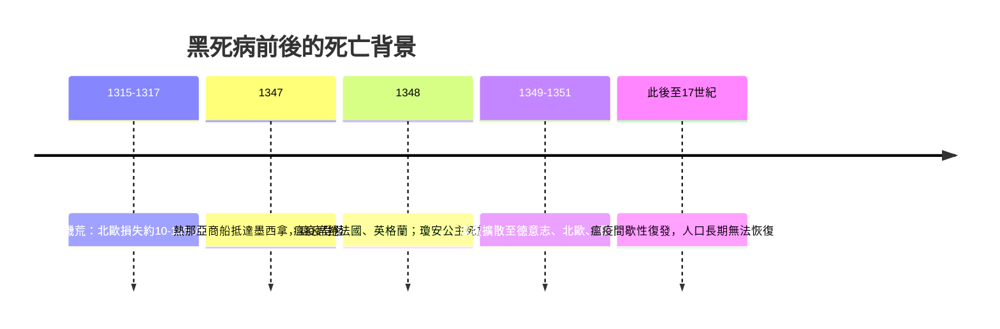

# 3.1 死亡統計：歐洲失去三分之一的人口

1347 年 10 月，十二艘熱那亞商船駛入西西里的墨西拿港。船上的水手大多已經死去，倖存者身上布滿黑色的膿皰。碼頭上的人們還不知道，這幾艘船帶來的，是歐洲歷史上最致命的一場災難——後世稱之為「黑死病」。

瘟疫沿著商路以驚人的速度推進：1348 年初到達法國與北非，同年夏天登陸英格蘭，1349 年橫掃德意志與低地國家，1350 年抵達北歐，1351 年深入俄羅斯平原。短短四年，這場大流行覆蓋了當時已知的大半個歐洲。

## 一場模糊而巨大的死亡

中世紀沒有人口普查，也沒有精確的死亡登記，但各種碎片化的紀錄共同指向一個結論：這是一場規模空前的人口災難。佛羅倫斯的編年史家記載該城失去過半居民；英格蘭多個教區的死亡登記顯示死亡率超過四成；巴黎、倫敦、錫耶納等大城市十室九空。

現代史學家根據教區紀錄、遺囑登記、修道院財產清冊與稅冊反覆估算，得出這樣的區間：

| 項目 | 估計 |
|------|------|
| 歐洲人口損失比例 | 約 30% – 60% |
| 死亡人數 | 約 2,500 萬 – 5,000 萬（或更高） |
| 歐洲人口恢復到瘟疫前水準 | 約 150 年（至 16 世紀） |
| 感染腺鼠疫未治療的死亡率 | 約 30% – 60% |
| 肺鼠疫、敗血性鼠疫未治療死亡率 | 接近 100% |

死亡並非一次性的。1347–1351 年是第一波，此後鼠疫在歐洲每隔數年、十數年便捲土重來：1361 年、1369 年、1374 年……直至 17 世紀仍不時爆發（1665 年的倫敦大瘟疫即是最後一次大流行）。孩童在間歇期出生，卻往往在下一波瘟疫中死去，這使得整個 14 世紀下半葉的死亡率居高不下。

## 鼠疫的三種面貌

黑死病其實不是一種病，而是同一病原體——鼠疫桿菌（Yersinia pestis）——在人體內的三種表現：

- **腺鼠疫**：最常見，鼠蚤叮咬後細菌進入淋巴系統，腹股溝、腋下、頸部出現劇痛的腫塊（「淋巴腺鼠疫」之名的由來），死亡率約三至六成。
- **肺鼠疫**：細菌入侵肺部，患者咳血，並可透過飛沫直接人傳人，於二至三日內死亡，未治療死亡率近乎百分之百。寒冷季節肺鼠疫比例上升，是冬天死亡率更高的原因。
- **敗血性鼠疫**：細菌進入血液，全身內出血，皮膚出現黑斑——「黑死病」之名由此而來。患者往往在發病當天死亡，快到連神父都來不及趕到。

## 瘟疫不是孤立的災難

黑死病降臨在一個已經被削弱了的歐洲。1315–1317 年的大饑荒（「大饑荒」The Great Famine）先於瘟疫三十年到來：異常的暴雨使莊稼連年腐爛，牲畜大量死亡，北歐估計餓死了 10%–15% 的人口。倖存者普遍營養不良，免疫力低下。瘟疫之後，肺結核、麻風等慢性傳染病也長期流行——中世紀晚期的麻風病院遍布歐洲各地，而結核（當時稱「癆病」或「白瘟疫」）則悄無聲息地成為慢性殺手。

在整體死亡率中，嬰兒與幼兒是沉默的犧牲者。中世紀的嬰兒死亡率本已超過 35%——每三個新生兒中就有一個活不過週歲——瘟疫、饑荒與戰亂更將這個數字推向恐怖的高峰。許多教堂的墓葬層中，兒童骸骨的比例遠超成人。

當鼠疫終於離開一座城市時，倖存者面對的是空蕩的街道、無人耕種的田地，以及一個迫切需要解釋的問題：這一切究竟是為什麼？醫生們提出了他們的答案——雖然那些答案幾乎救不了任何人。下一節，我們將走進中世紀的診療室，看看鳥嘴醫生、放血刀與水銀如何應對這位看不見的敵人。
