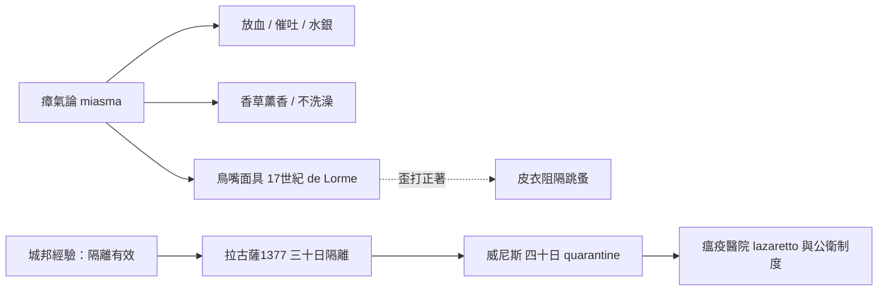

# 3.2 環境與醫療：鳥嘴醫生、放血與水銀

當黑死病吞噬整個城市時，中世紀的醫生們並沒有逃跑——至少一開始沒有。他們手持的是一套完全錯誤的理論，和一批幾乎無用的藥物。然而正是在這場徹底的失敗中，人類發明了歐洲歷史上第一套公共衛生制度：檢疫。

## 四體液學說的最後輝煌

自希波克拉底與蓋倫以來，歐洲醫學的信條是「四體液說」：人體由血液、黏液、黃膽汁、黑膽汁四種液體構成，疾病是體液失衡的結果。鼠疫則被解釋為「空氣腐壞」（miasma，瘴氣）——腐爛屍體與汙濁空氣釋放的有毒蒸氣進入體內，導致體液敗壞。

這個解釋衍生出一整套療法：

- **放血（bloodletting）**：醫生認為多餘或「敗壞」的血液必須排出。理髮師兼外科醫生用刀片劃開病人靜脈，或以水蛭吸血。對鼠疫患者放血，只會加速虛脫與死亡。
- **催吐與通便**：用嘔吐劑與瀉藥「排出」壞體液，進一步掏空病人的體力。
- **煙燻與香草**：在病房焚燒迷迭香、杜松、沒藥，以「淨化」腐壞的空氣。這雖然殺不了鼠疫桿菌，卻意外地稍微驅趕了跳蚤。
- **水銀與劇毒藥物**：水銀（汞）被製成藥膏塗敷淋巴腫塊，甚至內服。病人不是死於鼠疫，就是死於汞中毒。 arsenic（砷）與蟾蜍粉也常被入藥。

醫生的建議還包括：不要洗澡（認為熱水會打開毛孔讓瘴氣入侵）、不要吃過熟的水果、聞強烈氣味（如糞便或醋）以「抵禦」瘴氣。教會與大學醫學院編寫了數十份《防疫手冊》（pestilential treatises），全部基於這套理論。

## 鳥嘴醫生：一個晚了一百年的發明

提及中世紀瘟疫，多數人腦海中浮現的是戴著鳥嘴面具的醫生。但必須澄清一個史實：這套裝備並非黑死病年代（14 世紀）的產物，而是 17 世紀的發明——一般歸於法王路易十三的首席醫師 Charles de Lorme，約於 1619 年設計。真正的「鳥嘴醫生」主要活躍於 17–18 世紀義大利與法國的瘟疫季節，後來的藝術作品把它「穿越」回了中世紀。

鳥嘴面具的設計邏輯仍是瘴氣論：鳥嘴前端塞滿芳香物質（龍涎香、薄荷、乾玫瑰花瓣、沒藥、樟腦），呼吸時空氣先經過香草過濾；玻璃護目鏡防護眼睛，全身打蠟皮衣避免接觸「有毒空氣」，手執木杖用於檢查病人而不必觸碰。這套裝備對鼠疫桿菌毫無直接的抗菌作用，但皮衣的確能擋住跳蚤——歪打正著地提供了一點真實的防護。

## 40 天檢疫：錯誤理論下的正確制度

瘟疫時期最有價值的發明，不是任何藥物，而是一種行政措施。1377 年，亞得里亞海的拉古薩（今杜布羅夫尼克）率先規定：來自疫區的旅客必須先在城外隔離 30 天（trentino）。威尼斯隨後將其延長為 40 天，義大利語 quaranta giorni——這就是「檢疫」（quarantine）一詞的由來。

為什麼是 40 天？數字源自聖經傳統（基督在荒野禁食 40 天、大洪水降下 40 天），純屬宗教象徵，卻意外地接近科學：鼠疫的潛伏期通常為數日至一週，40 天足以讓被感染者發病或康復，船隻上的鼠蚤也多數餓死。威尼斯、熱那亞、米蘭等城邦進而建立瘟疫醫院（lazaretto）、疫死者的特殊埋葬規定、貨物消毒與通報制度。這些城邦的政策使義大利部分城市在後續瘟疫波中死亡率明顯低於北歐。

## 救不了肉體的制度

平心而論，中世紀醫療對鼠疫患者的個體治療幾乎是零效果——沒有任何一種藥物能對抗鼠疫桿菌（要到 20 世紀的抗生素才真正有效）。但檢疫制度的誕生說明了一個重要轉折：當醫學理論失敗時，人類開始用「組織與制度」對抗死亡。城市封鎖、疫情通報、公共隔離——現代公共衛生的雛形，正是在屍橫遍野的中世紀港口城市中誕生的。

然而，瘟疫面前，再精緻的鳥嘴面具、再嚴格的檢疫，也擋不住它對社會最頂層的入侵。下一節要講的，是一位英格蘭公主的死亡——黑死病用它最簡單的方式證明：在死亡面前，王家血統一文不值。
