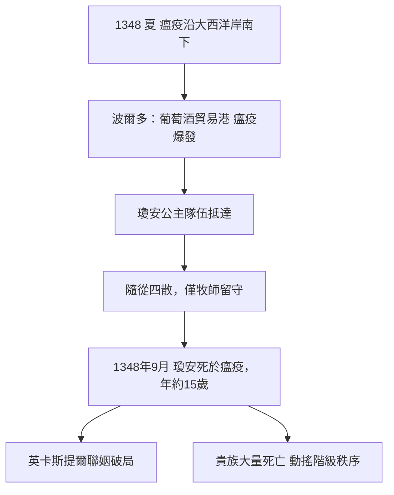

# 3.3 名人案例：瓊安公主與黑死病面前的不分貴賤

1348 年夏天，英格蘭國王愛德華三世精心策劃的一樁政治聯姻，正沿著朝聖之路南下。隊伍的中心是一位十五歲的少女：瓊安（Joan of England），國王最疼愛的女兒。她即將穿越法蘭西，渡海前往西班牙卡斯提爾，嫁給國王佩德羅一世。就在途中，瘟疫追上了她。

## 一場精心安排的婚約

瓊安生於 1333 年（或 1334 年初），是愛德華三世與王后埃諾的菲莉帕的女兒。這樁與卡斯提爾的婚約有明確的政治盤算：英格蘭正與法國走向百年戰爭，需要伊比利半島的盟友制衡法蘭西；卡斯提爾的艦隊比斯開灣航線對英倫海峽的補給至關重要。對愛德華三世而言，這是典型的「以婚姻換聯盟」。

1348 年春夏之際，瓊安的隊伍自英格蘭啟程，走的是歷代朝聖者與使節慣用的路線：經法蘭西南部，在吉倫特河口的大城波爾多停留，再轉往西班牙。護送的包括她的家庭教師與隨從，英格蘭王室為此行做了周詳安排——卻沒有任何安排能防範即將到來的東西。

## 瘟疫抵達波爾多

1348 年，黑死病正沿著大西洋岸南下：先毀掉諾曼第與布列塔尼，繼而席捲法蘭西南部的酒鄉。波爾多作為繁忙的葡萄酒出口港，與英格蘭保持頻繁的航運——正是瘟疫傳播的完美通道。當年夏末，瘟疫在城中爆發。

瓊安的隊伍抵達時，正撞上疫情最烈的時刻。傳統記載她住在波爾多；一說她在附近的小鎮避疫，但都改變不了結局。1348 年 9 月 2 日前後，年僅十五歲的瓊安公主死於瘟疫——多數史料推斷為腺鼠疫或肺鼠疫。她從未抵達西班牙，也從未見過她的未婚夫。

## 王廷的震動與隨從的潰散

消息傳回英格蘭，愛德華三世寫信給卡斯提爾國王阿方索十一世告知死訊，語氣沉痛。信中記載了一個細節：瓊安的隨從在她病倒後四散奔逃，最後只有一位牧師留下來為她守靈——即使是王室成員，臨終時身邊也只剩一名神職人員。這封信成為黑死病史上最著名的貴族死亡紀錄之一。

更殘酷的是後續：她的護送者們有人也死於途中；而整個英格蘭王室與貴族階層，在 1348–1349 年同樣損失慘重。愛德華三世的另一名女兒（一般認為是幼女布蘭奇）可能也死於同一年瘟疫；大量主教、貴族、騎士在 1349 年死去，英格蘭議會一度因貴族死亡過多而難以運作。

## 平等的掠奪者

瓊安公主之死說明了一個 14 世紀歐洲人最難接受的事實：黑死病不歧視。它可以因一艘商船進港而入侵王子的行宮，可以透過一支護送隊伍抵達公主的床邊。社會階層或許能提供較好的食物與居所，卻無法提供免疫。

當然，瘟疫的打擊在階級間並非完全均勻——貴族與城市窮人同樣大量死亡，而農民因營養不良可能更脆弱；但死亡率驚人的接近，足以動搖整個社會的心智秩序。如果上帝的瘟疫可以殺死公主，那麼貴族與農奴之間的差別還剩下什麼？

這個問題的答案，並不是瓊安的父親用外交給出的，而是由無數農民和城市工匠用雙腳與鐮刀給出的：勞動力銳減之後，倖存者的身價暴漲，農奴開始要求工資與自由。而在深層的精神層面，一場關於死亡的全新想像正在繪畫與手冊中成形——下一節，我們將欣賞骸骨與活人共舞的壁畫，以及中世紀最暢銷的死亡指南。
