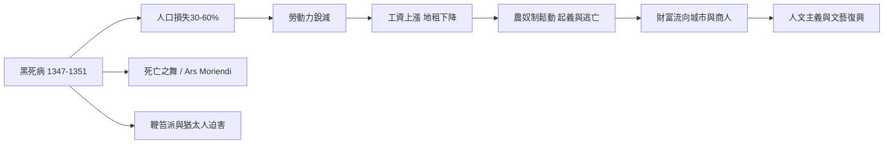

# 3.4 文化與信仰：死亡之舞與臨終藝術 Ars Moriendi

黑死病沒有留下任何有效的藥物，卻留下了一整個時代的藝術。當死亡帶走三分之一的人口，歐洲人的心靈需要新的形象來理解它。於是，骸骨開始在壁畫裡牽起主教與農民的手；印刷術問世後，第一本暢銷書竟是一部教人「如何死去」的手冊。中世紀晚期，死亡成為文化的主角。

## 死亡之舞：骸骨邀你共舞

「死亡之舞」（法文 Danse Macabre，德文 Totentanz）是中世紀晚期最重要的藝術母題：一列骷髏（或擬人化的死亡）牽起活人的手，帶領他們跳舞走向墳墓。隊伍中最關鍵的設計是活人的排列——教宗、皇帝、主教、騎士、商人、農民、嬰兒，一個社會的所有階層依次出列，而骷髏對每個人都一視同仁。

這個母題約在 15 世紀初成形，與瘟疫的反覆爆發直接相關。現存最早的壁畫之一繪於 1424–1425 年的巴黎聖無辜者墓園（聖嬰墓園）；德國呂貝克的瑪利恩教堂（1463 年 Bernt Notke 作）與巴塞爾的死亡之舞也極負盛名。1493 年，紐倫堡出版哈特曼·舍德爾的《編年史》，附有木刻死亡之舞，使這一形象傳遍歐洲。

死亡之舞的核心訊息只有一句：memento mori（記住你終有一死）——而且死亡不分貴賤，正呼應了瓊安公主之死所暴露的事實。它既是佈道，也是黑色幽默：骸骨拉小提琴、敲鈴鼓，活人驚惶、無奈、掙扎，卻沒有人能脫隊。

## Ars Moriendi：如何正確地死去

如果死亡無可逃避，那麼問題只剩下一個：如何死得「好」。15 世紀上半葉（約 1415–1440 年間），一部名為《臨終藝術》（Ars Moriendi）的手冊問世，很快成為當時歐洲最流行的書籍之一，古騰堡印刷術問世後更被大量印製——它甚至比許多聖經譯本更早、更廣地被印刷。

手冊描述臨終者床邊發生的一場靈魂之戰：天使與魔鬼守在病榻兩側，魔鬼提出五種誘惑，試圖讓臨終者在最後一刻失落信仰：

1. 不信（對信仰絕望）
2. 絕望（不相信上帝的慈悲）
3. 不耐（怨懟上帝與周遭的人）
4. 驕傲（誇耀自己一生的善行）
5. 貪執（死死抓住塵世的財物）

手冊針對每一種誘惑給出對策，並附上臨終者可以複誦的祈禱文，也指導家人朋友如何在床邊陪伴、何時勸誡、如何避免讓死者掛念財產。這是一部徹底的「死亡技術手冊」——它把死亡變成一門可以學習、可以準備的技藝。善終（a good death）的觀念從此深植於西方文化，直到今日的安寧療護仍在處理同樣的問題：臨終者需要陪伴、和解與意義，而非孤獨地死去。

## 恐懼的異端出口：鞭笞派與對猶太人的迫害

瘟疫也釋放了中世紀最黑暗的群體心理。由於教會的祈禱似乎失效，一些信眾開始自行「補救」：鞭笞派（Flagellants）成群結隊在城鎮間遊行，互相鞭打至皮開肉綻，以求以苦行平息上帝之怒。他們的遊行起初贏得同情，後來演變為攻擊教士、否定聖事的騷亂，1349 年教宗克雷芒六世不得不正式譴責並鎮壓。

更慘烈的是替罪羊的尋找。因為找不到瘟疫的真正原因，流言四起，指稱是猶太人在井中投毒。從 1348 年春天起，屠殺席捲法蘭西、德意志與低地國家：史特拉斯堡在 1349 年 2 月的「史特拉斯堡大屠殺」中，數百至逾千名猶太人被處死，全城猶太社區幾乎被毀。值得注意的是，教宗克雷芒六世曾在 1348 年發布詔書明確保護猶太人，指出瘟疫同樣殺死猶太人，投毒之說毫無根據——但世俗群眾的恐懼與掠奪慾望壓過了教會的裁示。恐懼找不到病原，就會自己製造敵人。

## 從屍骸到再生：一條意想不到的因果鏈

然而，這場災難也意外地鬆動了封建社會的根基。勞動力銳減使倖存農民身價暴漲：工資上漲、地租下降，農奴逃往城市或與領主談判。1351 年英格蘭《勞工法》試圖凍結工資，卻擋不住趨勢；1381 年的英格蘭農民起義、此後數十年的農奴制瓦解，都是這條鏈條的環節。剩餘財富向城市與商人階層集中，對現世生活與個人才幹的肯定逐漸抬頭——人文主義者正是在這片廢墟上開始重新閱讀古典文本。文藝復興的曙光照亮的，正是一座曾經十室九空的城市。

死亡的平等掠奪，最終竟搖出了社會的新生；對死亡的恐懼，也逼出了歐洲歷史上最早的公共衛生制度。黑死病時代就這樣同時孕育了毀滅與重生的兩條線索——當我們進入下一章，瘟疫退潮後的 16–18 世紀，死亡將從曠野的骷髏之舞，回到家庭的床榻，成為一場安靜的、被儀式包裹的告別。
