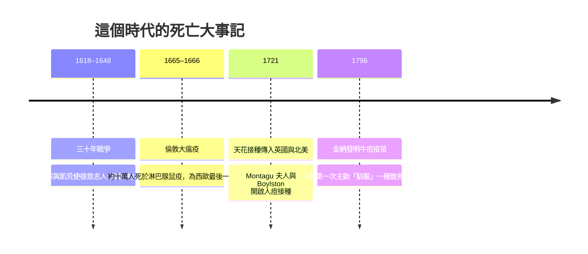

# 4.1 死亡統計：天花與斑疹傷寒的年代

黑死病的陰影逐漸退去之後，十六世紀末至十八世紀的歐洲並未迎來健康的時代。舊的瘟疫換了面孔，以更日常、更持續的方式收割生命。這兩百多年間，歐洲的平均壽命大約落在三十五至四十歲之間——比中世紀略有提升，但嬰兒死亡率依然驚人，許多地區每四個新生兒就有一個活不過一歲。

## 天花：眾王之病

如果要在這個時代挑出一個頭號殺手，那就是天花（smallpox）。它不同於黑死病那種數年一輪的狂潮，而是常駐人間：幾乎每個人都會感染，倖存者留下麻臉，未倖存者約三成死亡。十八世紀的歐洲，天花每年奪走約四十萬條人命，死者的三分之一是五歲以下的幼兒。它也被稱為「眾王之病」——英女王瑪麗二世（1694 年）、法國國王路易十五（1774 年）、俄國沙皇彼得二世都死於天花。它甚至改寫了王朝繼承：正是因為天花掃除了多數斯圖亞特與波旁的繼承人，漢諾瓦王朝才得以入主英格蘭。

## 斑疹傷寒：戰爭與貧民的熱病

排名第二的是斑疹傷寒（typhus），由蝨子傳播，因此它專門跟隨軍隊、監獄與貧民窟。它的德文別名「軍營熱」（Kriegsfieber）說明了一切：1618–1648 年的三十年戰爭中，德意志地區死於斑疹傷寒與相關瘟疫的人數，遠超過死於刀劍的人數。城市貧民窟則是它的另一個巢穴——擁擠、骯髒、人蝨共存。

與此同時，猩紅熱、產褥熱、白喉、痢疾與敗血症構成了死亡榜單的中堅。產褥熱尤其殘酷：產婦在分娩後數日內死於高燒與膿毒，而沒有人知道那是接生者未洗淨的雙手在傳播鏈球菌。

## 死亡率的年表

## 接種：統計曲線的第一次轉折

在醫師們仍以體液學說解釋疾病的年代，一場來自民間與異國的統計學勝利，搶先登場。1721 年，曾在鄂圖曼帝國目睹人痘接種（variolation）的英國貴婦 Mary Wortley Montagu 夫人，將此術帶回倫敦；同年在波士頓，醫師 Zabdiel Boylston 在天花流行中為近三百人接種。數據很快說話：接種者死亡率約百分之二至三，遠低於自然感染的一成至三成。而 1796 年，英國鄉村醫師愛德華．金納（Edward Jenner）從擠奶女工不感染天花的民間觀察出發，以牛痘（cowpox）實驗成功，創造了「疫苗」（vaccine，源自拉丁文 vacca，母牛）一詞。

必須指出，人痘接種本身仍有風險，在民間也曾引發疑懼與抵制——但它證明了一件前所未有的事：死亡的機率是可以被計算、比較並主動降低的。一個時代即將結束的訊號，就藏在這些數字裡：死亡依然是日常的、無所不在的，但人類第一次拿到了改寫死亡統計表的工具。

> 延伸閱讀：接種背後的醫學革命，見下一節〈4.2 環境與醫療：解剖學復興與手術死亡率〉。
