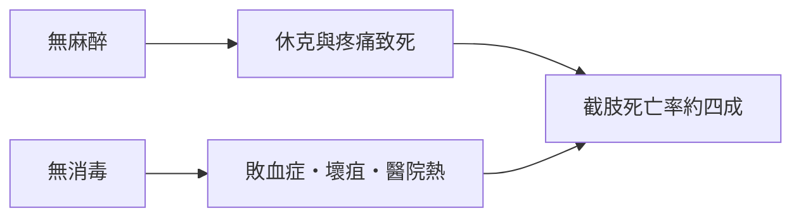

# 4.2 環境與醫療：解剖學復興與手術死亡率

這個時代的醫學，上演著一場奇特的雙面劇：一方面，人體的奧祕以前所未有的速度被揭開；另一方面，病床邊與手術台上的實際死亡率，幾乎與中世紀無異。理解身體的能力，遠遠跑在治癒身體的能力之前。

## 維薩里：親眼看見人體

1543 年，二十九歲的布魯塞爾解剖學家安德烈亞斯．維薩里（Andreas Vesalius）在巴塞爾出版了《人體構造七卷》（De humani corporis fabrica libri septem）。在這之前，歐洲的解剖學課堂上，教授高坐講席朗讀蓋倫的古籍，由理髮師兼外科匠在下方切開屍體——沒有人真正仔細看。維薩里親手持刀，發現蓋倫的解剖學（基於猿類與豬）錯誤百出：蓋倫描述的下頜骨是兩塊，人只有一塊；蓋倫說血液穿過心臟中隔的孔洞，那個孔根本不存在。《人體構造七卷》以精美版畫呈現剝離到肌腱的人體立於風景之前，本身就是一個宣言：真理在屍體上，不在古籍裡。

## 哈維：血液循環的發現

1628 年，英國宮廷醫師威廉．哈維（William Harvey）發表《心血運動論》（De Motu Cordis），以簡單卻無可辯駁的定量論證推翻了千年定見。他計算出心臟每搏輸出量若如蓋倫所言由肝臟不斷新生，兩小時內產生的血液將超過全身總重——這在物理上不可能。唯一的解釋是：血液是循環的。哈維的名言「以實驗而非古籍為師」，正是這個時代精神（乃至後來啟蒙運動）的醫學版本。

## 但手術台依然是屠場

然而，解剖學與生理學的勝利，並沒有改變外科醫師面對的殘酷現實。直到十九世紀之前，手術沒有麻醉、沒有消毒。手術的技術上限，就是「快」——倫敦外科名醫 Robert Liston 以三分鐘截肢聞名，因為病人清醒，痛苦與休克的時間每多一秒都在累積死亡。

代價是驚人的數據。十八世紀倫敦聖托馬斯醫院（St Thomas's Hospital）的紀錄顯示，截肢病人的死亡率約在四成上下，某些年分甚至過半。法國外科軍醫 Dominique Jean Larrey 在拿破崙戰爭中觀察到「醫院熱」（hospital fever / la fièvre d'hôpital）：在污濁、通風不良的戰地醫院裡，接受手術的傷兵幾乎難逃感染而死，敗血症、膿毒與壞疽讓「開刀」近乎等同「判刑」。產褥熱同理——產房醫師的雙手，是當時最有效的疾病傳播工具。

## 醫院：慈善與危險的混合體

這個時代的醫院多半是教會慈善機構的延伸，病人擠在大通舖裡，空氣惡濁，傷口潰爛的氣味飄散在走廊。巴黎主宮醫院（Hôtel-Dieu）一張床常擠兩至四個病人，住院反而增加死亡風險。知識的進步集中在解剖學教室、皇家學會與印刷術裡，而病床邊的醫療仍以放血、灌腸、催吐與汞劑為主——十七世紀英王查理二世臨終前，就被御醫們反覆放血並施以烙鐵與瀉藥。

環境因素同樣是殺手：城市人口增長、巷弄擁擠、污水橫流，結核與腸道疾病在貧民區蔓延。醫學在書本上突飛猛進，在街道上卻步不前——這道鴻溝，要等到下一個世紀的公共衛生與麻醉革命才能跨越。

> 延伸閱讀：解剖學革命如何影響個人的死亡，見下一節〈4.3 名人案例：查理一世的斷頭台與莫札特的猝逝〉。
